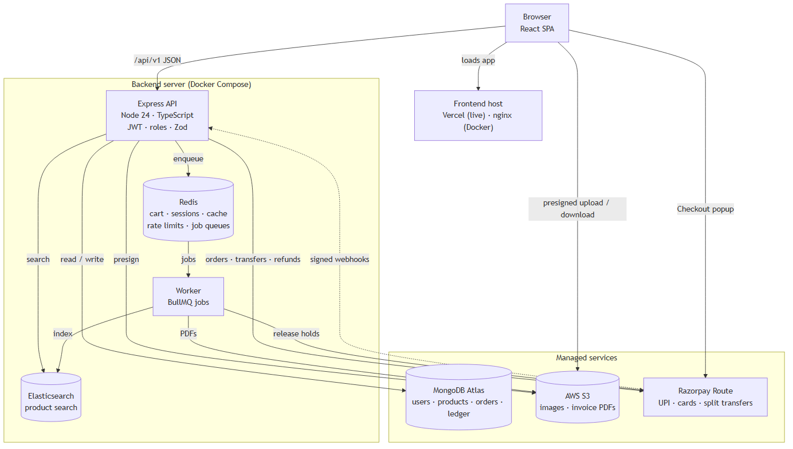

# ShopSphere — Multi-Vendor E-Commerce Marketplace

[](https://github.com/Adarsh619/Rout_Adarsh_Pradhan_Capstone_Projects/actions/workflows/fs01-ci.yml)

An Amazon-style marketplace where **many vendors sell**, **customers buy from several of them in one checkout**, and the platform
**splits each payment** between the vendors and keeps a **commission** (Razorpay test mode for payments; vendor payouts simulated).

| Layer | Tech |
|---|---|
| Frontend | React 19 · Vite · React Router · TanStack Query · Tailwind CSS |
| API + worker | Node.js 24 · Express 5 · TypeScript · Zod · BullMQ |
| Data | MongoDB 7.0 (replica set, transactions) · Redis 7.4 · Elasticsearch 8.19 |
| Files | AWS S3 (Adobe S3Mock locally) |
| Payments | Razorpay test mode (UPI, cards, webhooks, refunds) + own split-and-escrow ledger; built-in mock needs no account ([how it works](docs/09-payments.md)) |
| Infra | Docker Compose · nginx · GitHub Actions |

**Status:** Day 8 of 10. Sign-in and roles work end to end; vendors apply for a store, admins approve or suspend it, vendors list products with photos uploaded straight to S3, and shoppers search 214 seeded products across 5 stores with typo-tolerant Elasticsearch search. Shoppers fill one cart from several stores (as guests too), check out once with stock held for 15 minutes, pay through Razorpay's test-mode popup, and follow each store's part from placed to delivered while vendors pack and ship their own part. Each store's share is held until delivery, then paid out (simulated); cancelling a part refunds it through Razorpay. Coupons (platform or store), an invoice PDF for each store's part, and reviews from customers whose order was delivered. Admins see live analytics (sales, commission, daily chart, top stores and products) and can refund and moderate; vendors see their earnings. Progress is tracked in the [10-day build tracker](docs/guides/DAY_PLAN.md).



## Quick start (Docker)

Prerequisite: Docker Desktop (give it at least 4 GB of memory; Elasticsearch needs it).

```bash
cp .env.example .env            # Windows PowerShell: copy .env.example .env
docker compose up --build
```

| URL | What |
|---|---|
| http://localhost:3000 | Web app (shows the status of every service) |
| http://localhost:3000/api/v1/health | API health through nginx |
| http://localhost:4000/api/v1/health | API health, direct |

Create the demo accounts, then the demo catalogue (27 categories, 5 stores, 214 products from DummyJSON and Fake Store,
438 photos copied into S3, 582 reviews, 3 demo coupons; about a minute the first time, a few seconds after that). Every password is `DEMO_PASSWORD` in `.env`.

```bash
docker compose exec api node dist/scripts/seed-users.js
docker compose exec api node dist/scripts/seed-catalog.js
docker compose exec api node dist/scripts/seed-orders.js     # optional: 40 demo orders over the last 30 days
```

| Email | Role | What to try |
|---|---|---|
| `customer@shopsphere.test` | Customer | Fill a cart from two stores, check out, pay (Razorpay: UPI `success@razorpay`; or the mock screen), follow the order, cancel a part to see the refund |
| `vendor@shopsphere.test` | Vendor | Vikram Electronics: add a payout account, then pack, ship and deliver paid orders under **Orders to ship** and watch the share go held → paid out |
| `admin@shopsphere.test` | Admin | Analytics (after `seed-orders`); orders and refunds; commission rates; review the waiting application from Kavya Handicrafts |
| `meera@`, `arjun@`, `sana@`, `rohan@shopsphere.test` | Vendor | The other four approved stores |
| `kavya@shopsphere.test` | Vendor | A store application waiting for approval |

Demo coupons: `WELCOME10` (10% off up to ₹200, orders over ₹499, once per customer), `FLAT100` (₹100 off ₹1,000+),
`VIKRAM5` (5% off Vikram Electronics' items, ₹1,000+ from that store).

The catalogue comes from a committed snapshot ([`backend/seed/catalog.json`](backend/seed/catalog.json)), so seeding never
depends on those sites being up; refresh it with `npm run seed:snapshot`. Prices are converted to rupees. The seed
finishes by rebuilding the search index; to rebuild it on its own: `docker compose exec api node dist/scripts/reindex.js`.

Port 3000 taken? Set `FRONTEND_PORT=3001` (and `CORS_ORIGINS=http://localhost:3001`) in `.env`. MongoDB, Redis, Elasticsearch, S3Mock and the API publish their ports on `127.0.0.1` only. The browser loads photos and uploads new ones straight from S3Mock on port 9090, the same way it talks to AWS S3 on the live site.

## Developing without rebuilding images

Keep the backing services in Docker and run the code on your PC with hot reload:

```bash
docker compose up -d mongo redis elasticsearch s3
cd backend && npm install && npm run dev        # API on :4000 (another terminal: npm run dev:worker)
cd frontend && npm install && npm run dev       # app on :5173, /api is proxied to :4000
```

The backend's defaults already point at these local services.

## Tests

```bash
cd backend && npm run lint && npm test           # unit tests, no services needed
cd backend && npm run test:integration           # needs the Docker services above
cd frontend && npm run lint && npm test
bash scripts/smoke-test.sh http://localhost:3000 # whole stack, through nginx
```

CI ([`.github/workflows/fs01-ci.yml`](../.github/workflows/fs01-ci.yml)) runs all of these on every push that touches `FS-01/`.

## Documentation

Everything is in [`docs/`](docs/README.md): overview, features and roles, architecture, design decisions, data model, API reference (including cart, checkout and orders), background jobs and search, payments and escrow, security, PRD, app flow, database schema and API list. More topics are added as each part is built.
