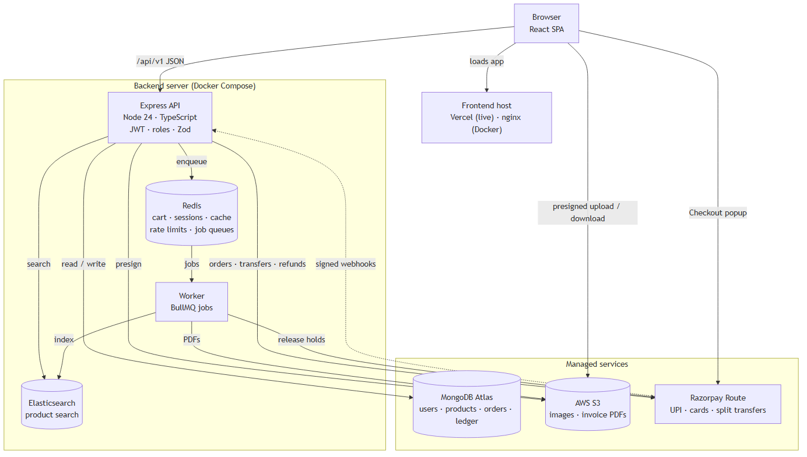

# 03 · System architecture

[← Features and roles](02-features-and-roles.md) · [Index](README.md) · [Next: Design decisions →](04-design-decisions.md)

The browser loads the React app from a static host and calls one Express API. The API keeps its data in MongoDB, uses Redis for carts, sessions, caching and job queues, and asks Elasticsearch for search results. Slow work (search indexing, invoice PDFs, payouts, expiring reservations) runs in a separate worker. Files never pass through the API: the browser uploads and downloads them straight from S3 with short-lived presigned URLs. Razorpay takes the payment and tells the API about it with signed webhooks.



Source: [`assets/architecture.mmd`](assets/architecture.mmd).

## Components

| Component | Responsibility |
|---|---|
| **React app** | All screens for the three roles; talks only to `/api/v1` and, for files and payment, to S3 and the Razorpay popup |
| **Express API** (`backend/src/index.ts`) | Auth, validation, business rules, transactions; stateless, so it can be restarted at any time |
| **Worker** (`backend/src/worker.ts`) | BullMQ consumers: `search-index`, `invoice-pdf`, `payout`, `reservation-expiry` |
| **MongoDB** | Source of truth for users, vendors, products, orders, ledger; replica set so checkout can use transactions |
| **Redis** | Carts, refresh sessions, product cache, rate-limit counters, job queues |
| **Elasticsearch** | Search index of active products; rebuilt from MongoDB at any time with `npm run reindex` |
| **S3** | Product images (public-read through the app) and invoices (private) |
| **Razorpay Route** | Collects the payment; holds, releases and reverses per-vendor transfers |

## A request, step by step

Adding a product to the cart:

1. Browser → `POST /api/v1/cart/items` (through nginx locally, straight to the API domain when live).
2. Express: Helmet headers, CORS check, JSON body (max 100 kB), request log.
3. Zod validates `{ productId, qty }`.
4. API reads the product (Redis cache, else MongoDB), checks it's active and in stock.
5. API writes the quantity into the cart hash in Redis and returns the updated cart.

Paying for an order goes through the API, Razorpay and the worker; see the [buying journey](specs/02-app-flow.md#3-buying-journey).

## Code layout

```
FS-01/
├── backend/            Express API + worker (TypeScript)
│   ├── src/
│   │   ├── app.ts          builds the Express app from its dependencies (tests pass fakes)
│   │   ├── index.ts        API entry: connects services, starts HTTP, graceful shutdown
│   │   ├── worker.ts       worker entry: BullMQ consumers
│   │   ├── config/env.ts   every setting, validated with Zod at start-up
│   │   ├── lib/            MongoDB, Redis, Elasticsearch, S3 clients, health checks, logger
│   │   ├── middleware/     error handling (and, from Day 2, auth)
│   │   └── routes/         HTTP routes (one module per area from Day 2)
│   └── tests/              unit tests; tests/integration needs the real services
├── frontend/           React app (Vite)
├── docs/               this documentation
├── scripts/            smoke test (seed and reindex later)
└── docker-compose.yml  the whole local stack
```

## Local vs live

| | Local (Docker Compose) | Live |
|---|---|---|
| Frontend | nginx container on `localhost:3000`, proxies `/api` | Vercel, calls the API domain directly |
| API + worker | containers | Docker on an Oracle Cloud Always Free ARM VM (2 OCPU / 12 GB) behind Caddy (HTTPS) |
| MongoDB | container, single-node replica set | MongoDB Atlas M0 |
| Redis, Elasticsearch | containers | containers on the same VM |
| S3 | Adobe S3Mock container | AWS S3, `ap-south-1` |
| Payments | `mock` driver | Razorpay test mode |

The same images and code run in both; only environment variables change.
