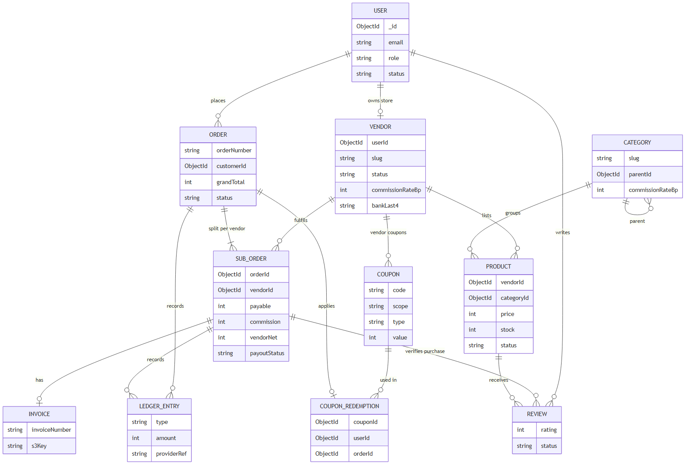

# 05 · Data model

[← Design decisions](04-design-decisions.md) · [Index](README.md) · [Next: Security →](10-security.md)

ShopSphere keeps permanent data in **MongoDB** (11 collections), short-lived data in **Redis**, and a search copy of products in **Elasticsearch**.
Every field, type and index is listed in the [database schema spec](specs/03-database-schema.md); this page explains how the pieces fit together.

Source: [`assets/erd.mmd`](assets/erd.mmd).

## Collections at a glance

| Collection | Holds | Key relationships |
|---|---|---|
| `users` | Accounts for all three roles, addresses | — |
| `vendors` | One store per vendor user: status, commission override, payout account | `userId → users` |
| `categories` | Two-level category tree with optional commission rates | `parentId → categories` |
| `products` | Listings with price, stock, images, ratings | `vendorId → vendors`, `categoryId → categories` |
| `orders` | What the customer bought and paid, with item snapshots | `customerId → users` |
| `subOrders` | Each vendor's part of an order: status, tracking, commission, payout (held → released → paid) | `orderId → orders`, `vendorId → vendors` |
| `ledgerEntries` | Append-only record of every money movement | order, sub-order, vendor |
| `reviews` | Ratings from customers who received the product | product, user, sub-order |
| `coupons`, `couponRedemptions` | Discount codes and who used them on which order | vendor (for vendor coupons), order |
| `invoices` | Invoice number and S3 key per sub-order | `subOrderId → subOrders` |
| `webhookEvents` | Payment events already handled, so repeats are ignored | — |

## Modelling choices

- **Snapshots, not references, for what was bought.** Order lines copy title, image and price at purchase time, so editing or deleting a product never changes a past order or invoice.
- **Denormalised numbers for speed.** `ratingAvg`, `ratingCount` and `soldCount` live on the product so search can sort by them without joins; they are updated when a review is added or an order is paid.
- **Rates frozen at purchase.** A sub-order stores the commission rate used, so changing a rate later never changes what a vendor was already promised.
- **Ledger is append-only.** Earnings and analytics are sums over ledger entries; mistakes are corrected with new entries, never edits.
- **Statuses with history.** Every sub-order status change is pushed to `statusHistory` with who and when, which is what the customer's timeline shows.

## Money example

Customer buys a ₹1 000 phone case from vendor A (10% commission) and a ₹500 cable from vendor B (category rate 8%), with platform coupon `SAVE10` (10% off, max ₹100).

| | Order | Sub-order A | Sub-order B |
|---|---|---|---|
| itemsTotal | 150 000 | 100 000 | 50 000 |
| discount (platform coupon, split by value) | 10 000 | 6 667 | 3 333 |
| payable (customer paid) | **140 000** | 93 333 | 46 667 |
| commission (on itemsTotal) | | 10 000 | 4 000 |
| vendorNet (held, then paid out) | | **90 000** | **46 000** |

Platform keeps 140 000 − 90 000 − 46 000 = **4 000 paise (₹40)** = commission ₹140 − coupon ₹100. The ledger balances.

## What lives where

| Data | Store | Why |
|---|---|---|
| Accounts, products, orders, money | MongoDB | Permanent, transactional |
| Carts, sessions, cache, rate limits, queues | Redis | Fast, short-lived, expires on its own |
| Search copy of active products | Elasticsearch | Full-text search, filters, facets; rebuildable |
| Images, invoice PDFs | S3 | Large files, served by presigned URLs |
