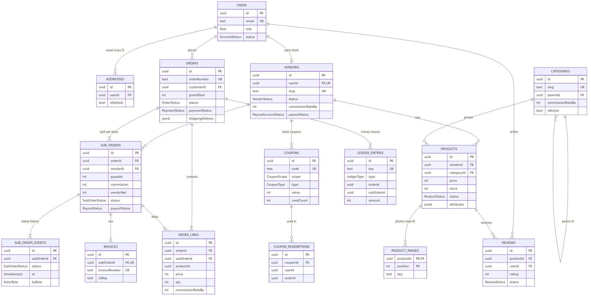

# 05 · Data model

[← Design decisions](04-design-decisions.md) · [Index](README.md) · [Next: API reference →](06-api-reference.md)

ShopSphere keeps permanent data in **PostgreSQL** (17 tables, defined in [`backend/prisma/schema.prisma`](../backend/prisma/schema.prisma)
and created by Prisma migrations), short-lived data in **Redis**, and a search copy of products in **Elasticsearch**.
Every column, type and index is listed in the [database schema spec](specs/03-database-schema.md); this page explains
how the pieces fit together.

Source: [`assets/erd.mmd`](assets/erd.mmd).

## Tables at a glance

| Table | Holds | Key relationships |
|---|---|---|
| `users` | Accounts for all three roles | — |
| `addresses` | Saved delivery addresses (up to 5, one default) | `userId → users` |
| `vendors` | One store per vendor user: status, commission override, payout account | `userId → users` (unique) |
| `categories` | Two-level category tree with optional commission rates | `parentId → categories` |
| `products` | Listings with price, stock, specs (`jsonb`), ratings | `vendorId → vendors`, `categoryId → categories` |
| `product_images` | A product's photos in display order | `(productId, position)` |
| `orders` | One checkout: totals, coupon, payment, delivery address snapshot | `customerId → users` |
| `sub_orders` | Each store's part of an order: status, tracking, commission, payout (held → released → paid), refund | `orderId → orders`, `vendorId → vendors` |
| `order_lines` | What was bought, with title, price and commission rate copied at checkout | `orderId → orders`, `subOrderId → sub_orders` |
| `sub_order_events` | Every status change of a part: who, when, note | `subOrderId → sub_orders` |
| `ledger_entries` | Append-only record of every money movement | order, sub-order, vendor |
| `reviews` | Ratings from customers who received the product (plus imported ones) | product, user, sub-order |
| `coupons`, `coupon_redemptions` | Discount codes and who used them on which order | vendor (store coupons), order |
| `invoices` | Invoice number and S3 key per sub-order | `subOrderId → sub_orders` (unique) |
| `counters` | Yearly sequences for order and invoice numbers | — |
| `webhook_events` | Payment events already handled, so repeats are ignored | `(provider, eventId)` unique |

## Modelling choices

- **Ids are UUIDs (v7).** They're time-ordered, so sorting by id is sorting by creation, and they reveal nothing about
  how many orders or users exist. A malformed id in a URL is rejected (404/400) before it reaches the database.
- **Money is `integer` paise, rates `integer` basis points.** Never floats.
- **Snapshots, not references, for what was bought.** Order lines copy title, image and price at purchase time, and the
  order keeps a `jsonb` copy of the delivery address, so editing or deleting a product or address never changes a past
  order or invoice.
- **Rates frozen at purchase.** Each order line stores the commission rate used (vendor override, else the category's,
  else its department's, else 10%), so changing a rate later never changes what a vendor was already promised.
- **Ledger is append-only.** Earnings and analytics are sums over ledger entries; mistakes are corrected with new
  entries, never edits. `key = <type>:<sub-order or order id>` is unique, so a retried job can't book twice.
- **Statuses with history.** Every sub-order status change adds a `sub_order_events` row with who and when, which is
  what the customer's timeline shows.
- **Unpaid parts stay hidden.** A sub-order starts as `awaiting_payment` and becomes `placed` when the order is paid;
  vendors only ever see parts with a `placedAt` date.
- **Denormalised numbers for speed.** `ratingAvg`, `ratingCount` and `soldCount` live on the product so search can sort
  by them without joins; they're recomputed when a review is added or hidden, or an order is paid.
- **Nested objects became prefixed columns.** A part's payout, refund and tracking (`payoutStatus`, `refundAmount`,
  `trackingNumber` …) and an order's payment and coupon are plain columns, so they can be indexed and summed.
- **Enums in the database.** Statuses, roles and ledger types are PostgreSQL enums, so a typo can't be stored.

## Races and transactions

Checkout, payment, cancellation and payouts change several tables at once inside one `prisma.$transaction`
(READ COMMITTED). Races are settled by conditional updates inside it:

| Race | Guard |
|---|---|
| Two shoppers buy the last unit | `UPDATE products SET stock = stock - qty WHERE id = … AND stock >= qty`: the second matches 0 rows and its checkout rolls back |
| Vendor ships while the customer cancels | `UPDATE sub_orders … WHERE id = … AND status = <the status it was read with>`: the loser gets 409 |
| Popup callback and webhook confirm the same payment | `UPDATE orders … WHERE status = 'pending_payment'` + unique `(provider, eventId)` |
| Two checkouts take the last coupon use | `UPDATE coupons SET usedCount = usedCount + 1 WHERE usedCount < usageLimit` |
| Two orders at the same moment | `INSERT … ON CONFLICT DO UPDATE SET seq = seq + 1 RETURNING seq` on `counters` |

## Money example

Customer buys a ₹1 000 phone case from vendor A (10% commission) and a ₹500 cable from vendor B (category rate 8%),
with platform coupon `SAVE10` (10% off, max ₹100).

| | Order | Sub-order A | Sub-order B |
|---|---|---|---|
| itemsTotal | 150 000 | 100 000 | 50 000 |
| discount (platform coupon, split by value) | 10 000 | 6 667 | 3 333 |
| payable (customer paid) | **140 000** | 93 333 | 46 667 |
| commission (on itemsTotal) | | 10 000 | 4 000 |
| vendorNet (held, then paid out) | | **90 000** | **46 000** |

Platform keeps 140 000 − 90 000 − 46 000 = **4 000 paise (₹40)** = commission ₹140 − coupon ₹100. The ledger balances.

## What lives where

| Data | Store | Why |
|---|---|---|
| Accounts, products, orders, money | PostgreSQL | Permanent, relational, transactional |
| Carts, sessions, cache, rate limits, queues | Redis | Fast, short-lived, expires on its own |
| Search copy of active products | Elasticsearch | Full-text search, filters, facets; rebuildable from PostgreSQL |
| Images, invoice PDFs | S3 | Large files, served by presigned URLs |

## Changing the schema

1. Edit `backend/prisma/schema.prisma`.
2. `npm run db:migrate -- --name <what-changed>` creates a migration under `prisma/migrations/` and applies it locally.
3. Commit the migration. The API runs `prisma migrate deploy` when it starts, so CI and the live server apply it on
   the next deploy.
