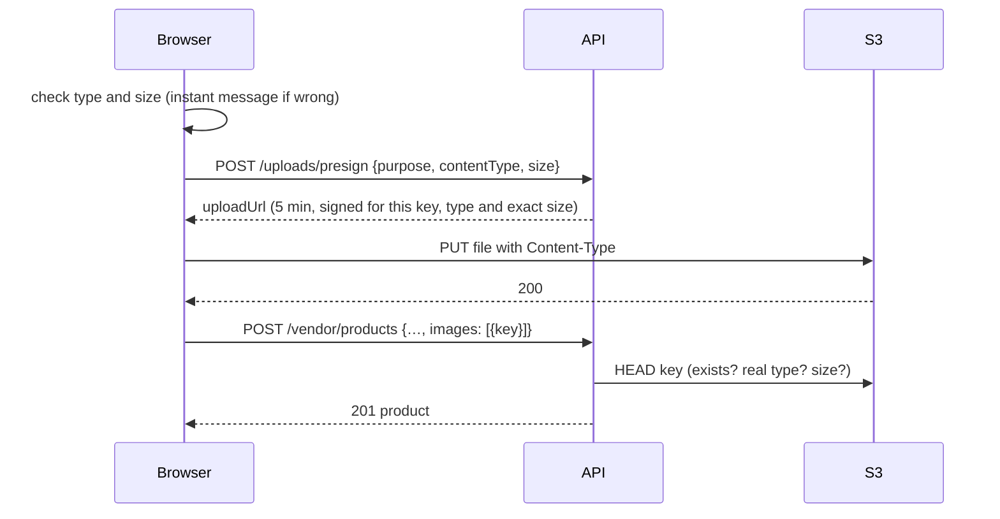

# 06 · API reference

[← Data model](05-data-model.md) · [Index](README.md) · [Next: Background jobs and search →](08-background-jobs.md)

This page documents the endpoints that exist today, with real request and response shapes. The full plan, including
endpoints still to come, is the [API list](specs/04-api-list.md). A machine-readable `openapi.yaml` follows on Day 10.

## Conventions

| | Rule |
|---|---|
| Base URL | `/api/v1` (locally `http://localhost:3000/api/v1` through nginx) |
| Format | JSON in and out; request bodies up to 100 kB |
| Auth | `Authorization: Bearer <accessToken>` from sign-in (15 min). The refresh cookie is only for `/auth/refresh` and `/auth/logout`, which also need `X-Requested-With: ShopSphere` ([Security](10-security.md)) |
| Money | **Integer paise**: `price: 1999900` is ₹19,999. Fractions are rejected |
| Lists | `?page=1&limit=20` (limit ≤ 50) → `{ items, page, limit, total }`; some lists add `counts` per status |
| Ids | 24-hex MongoDB ids. An id that can't exist answers 404, the same as one that doesn't |
| Caching | Cached reads say `X-Cache: HIT` or `MISS` |
| Updates | `PATCH` changes only the fields sent; anything left out keeps its saved value |

### Errors

Every error has the same shape. Form errors list **one message per field**, so the frontend can show each next to its input.

```json
{
  "error": {
    "code": "validation_error",
    "message": "Some fields need fixing",
    "details": { "fields": [{ "field": "mrp", "message": "MRP can't be lower than the selling price" }] }
  }
}
```

| HTTP | `code` | When |
|---|---|---|
| 400 | `validation_error`, `invalid_json` | Bad input; `details.fields` says which |
| 401 | `unauthenticated`, `token_expired`, `session_ended` | Not signed in, token expired (refresh and retry), session revoked |
| 403 | `forbidden` | Wrong role; `details.requiredRoles` lists the right ones |
| 403 | `vendor_not_approved` | The vendor's store isn't approved; `details.storeStatus` is `none`, `pending`, `rejected` or `suspended` |
| 404 | `not_found`, `store_not_found` | Unknown id, another vendor's product, a store that isn't public |
| 409 | `already_applied`, `invalid_transition`, `sku_taken`, `category_in_use`, `product_has_orders` | The action doesn't fit the current state |
| 429 | `rate_limited` | Too many attempts; `Retry-After` header |
| 503 | `search_unavailable` | Elasticsearch is down; browsing, store and product pages still work |

## Auth and account

Built on Day 2 and described in [Security](10-security.md): `POST /auth/register`, `POST /auth/login`, `POST /auth/refresh`,
`POST /auth/logout`, `GET /auth/me`, `PATCH /account`, `POST /account/password`.

## Vendors and stores

### `POST /vendors/apply` (vendor)

Submits the store application. Calling it again while it's `pending` edits it; after a rejection it applies again
(status back to `pending`, the reason cleared). An approved or suspended store gets `409 already_applied`.

```json
{ "storeName": "Vikram Electronics", "description": "Phones and laptops", "contactEmail": "vikram@example.com",
  "phone": "+91 98765 43210", "gstin": "29ABCDE1234F1Z5" }
```

| Field | Rule |
|---|---|
| `storeName` | 3–60 characters; becomes the URL slug (`vikram-electronics`, then `-2`, `-3` … if taken) |
| `phone` | Indian mobile; `+91`, spaces and dashes are removed, stored as 10 digits |
| `gstin` | Optional; 15-character GST format, upper-cased |

`201` (first time) or `200`: `{ "store": OwnStore }`.

```json
{ "store": { "id": "6aeb…", "storeName": "Vikram Electronics", "slug": "vikram-electronics", "status": "pending",
  "rejectionReason": null, "contactEmail": "vikram@example.com", "phone": "9876543210", "gstin": "29ABCDE1234F1Z5",
  "logoUrl": null, "logoKey": null, "commissionRateBp": null, "submittedAt": "…", "approvedAt": null, … } }
```

### `GET /vendors/me` · `PATCH /vendors/me` (vendor)

`GET` returns `{ "store": OwnStore | null }` (`null` before applying). `PATCH` edits any of the fields above plus
`logoKey` (a key from an upload with purpose `store-logo`, or `null` to remove the logo). A suspended store can't be edited.

### `GET /stores/:slug` (public)

An **approved** store and its products: `{ store: PublicStore, products: { items: ProductCard[], page, limit, total } }`.
Accepts the same `sort`, `category`, `page`, `limit` as `GET /products`. Contact details and status are never included.

### Admin: `GET /admin/vendors?status=&page=`

Applications and stores with their owner and product count. Pending applications come oldest first.

```json
{ "items": [{ …OwnStore, "owner": { "id": "…", "name": "Kavya Iyer", "email": "kavya@shopsphere.test" }, "productCount": 0 }],
  "page": 1, "limit": 20, "total": 1, "counts": { "pending": 1, "approved": 5, "rejected": 0, "suspended": 0 } }
```

### Admin: `POST /admin/vendors/:id/{approve|reject|suspend|restore}`

| Action | From | To | Body |
|---|---|---|---|
| `approve` | `pending` | `approved` | — |
| `reject` | `pending` | `rejected` | `{ "reason": "5–500 characters, shown to the vendor" }` |
| `suspend` | `approved` | `suspended` | `{ "reason": "…" }` |
| `restore` | `suspended` | `approved` | — |

Any other combination is `409 invalid_transition` with `details.status` and `details.allowedFrom`. The update is
conditional on the current status, so two admins clicking at once can't both act. Suspending a store hides all of its
products immediately (their cached pages are cleared too).

## Categories

### `GET /categories` (public, cached 5 min)

The active tree: departments with their categories.

```json
{ "items": [{ "id": "…", "name": "Electronics", "slug": "electronics",
  "children": [{ "id": "…", "name": "Smartphones", "slug": "smartphones", "children": [] }] }] }
```

### Admin: `GET · POST /admin/categories`, `PATCH · DELETE /admin/categories/:id`

- `GET` lists every category, hidden ones included, with `productCount`.
- `POST { name, parentId?, commissionRateBp?, sortOrder? }`: no `parentId` makes a department; the parent must be a department (two levels only).
- `PATCH { name?, isActive?, commissionRateBp?, sortOrder? }`: `isActive: false` hides a category from shoppers.
- `DELETE` only works on an empty category: `409 category_in_use` with `details.products` and `details.subCategories` otherwise.

Every change clears the category cache and cached product pages (they show the category name).

## Products (shoppers)

### `GET /products?category=&sort=&page=&limit=`

Active products of approved stores, straight from MongoDB (the home page's department browsing). `category` is a slug;
a department includes its sub-categories. `sort` is `newest` (default), `price_asc`, `price_desc` or `rating`.
Full-text search with filters is `GET /search` below.

```json
{ "items": [{ "id": "…", "title": "iPhone 13 Pro", "brand": "Apple",
  "image": { "url": "http://localhost:9090/shopsphere-local/products/<vendorId>/seed-dj-123-1.webp", "alt": "iPhone 13 Pro" },
  "price": 9399900, "mrp": 10399900, "discountPercent": 10, "inStock": true, "ratingAvg": 4.1, "ratingCount": 3,
  "vendor": { "storeName": "Vikram Electronics", "slug": "vikram-electronics" } }],
  "page": 1, "limit": 20, "total": 214 }
```

### `GET /products/:id` (cached 5 min)

The full product: everything on the card plus `description`, `category`, `vendor.id`, all `images`, `stock` and
`attributes` (specifications). Drafts, inactive products and products of stores that aren't approved answer 404.

## Search

Served by Elasticsearch, kept in step with MongoDB by a background job ([how](08-background-jobs.md)).

### `GET /search`

| Parameter | Meaning |
|---|---|
| `q` | Search words (up to 100 characters); typos allowed. Empty = browse everything |
| `category` | Category or department slug |
| `brand` | Repeat for several: `brand=Apple&brand=Samsung` (any of them) |
| `vendor` | Store slug |
| `minPrice`, `maxPrice` | **Paise**, inclusive |
| `rating` | 1–4: average rating at least this |
| `inStock` | `true` for in-stock only |
| `sort` | `relevance` (default with `q`), `newest` (default without), `price_asc`, `price_desc`, `rating` |
| `page`, `limit` | As every list (limit ≤ 50) |

```json
{ "items": [ProductCard, …], "page": 1, "limit": 24, "total": 4,
  "matchedAllWords": true, "tookMs": 12,
  "facets": {
    "categories": [{ "slug": "smartphones", "name": "Smartphones", "count": 4 }],
    "brands": [{ "value": "Apple", "count": 4 }],
    "vendors": [{ "slug": "vikram-electronics", "name": "Vikram Electronics", "count": 4 }],
    "price": [{ "key": "20000-plus", "min": 2000000, "max": null, "count": 3 }],
    "rating": [{ "min": 4, "count": 1 }, { "min": 3, "count": 2 }],
    "inStock": 4 } }
```

- Each facet counts with every filter **except its own**, so ticking a brand still shows the other brands' counts.
- `matchedAllWords: false` means no product had every word, so results match all but one of them.
- Price buckets: under ₹500, ₹500–1 000, ₹1 000–5 000, ₹5 000–20 000, over ₹20 000 (only non-empty ones are listed).

### `GET /search/suggest?q=`

Up to 8 product titles for autocomplete, from 2 characters: `{ "items": [{ "id": "…", "title": "Galaxy S24" }] }`.
Matches word beginnings ("gal" → Galaxy) and whole words with a typo ("macbok" → MacBook).

## Products (the vendor's own)

All need a vendor whose store is **approved** (`403 vendor_not_approved` otherwise). A vendor only ever sees their own
products: another store's product id answers **404**, which doesn't reveal that it exists.

| Method | Path | Does |
|---|---|---|
| GET | `/vendor/products?status=&q=&page=` | My products, newest change first; `q` searches titles; `counts` per status |
| GET | `/vendor/products/:id` | One of my products, for the edit form |
| POST | `/vendor/products` | Create (status `draft` unless sent) |
| PATCH | `/vendor/products/:id` | Change any fields, including `status` |
| DELETE | `/vendor/products/:id` | Delete, with its photos. `409 product_has_orders` once it has sold; set it `inactive` instead |

```json
{ "title": "Galaxy S24 128 GB", "description": "…", "brand": "Samsung", "categoryId": "6aeb…",
  "price": 7499900, "mrp": 7999900, "stock": 25, "sku": "GS24-128",
  "attributes": { "RAM": "8 GB", "Colour": "Onyx Black" },
  "images": [{ "key": "products/<vendorId>/0b6c….webp", "alt": "Front" }],
  "status": "active" }
```

| Rule | Error |
|---|---|
| `price` and `mrp` are whole paise, ₹1 to ₹1 crore; `mrp` defaults to `price` | field `price` / `mrp` |
| `mrp ≥ price` | field `mrp` |
| `stock` 0–100 000; title 3–150 characters; description up to 5 000; up to 20 specifications | that field |
| `categoryId` is an active category | field `categoryId` |
| Up to 6 photos, no repeats; `active` needs at least one | field `images` |
| Each **new** photo key is under `products/<this vendor's id>/` and really was uploaded as JPEG/PNG/WebP ≤ 5 MB (checked in S3) | field `images.<n>` |
| `sku` unique within the store | `409 sku_taken` |

On `PATCH`, photos removed from the list are deleted from S3, and the product's cached page is cleared.

## Uploads

### `POST /uploads/presign` (vendor)

```json
{ "purpose": "product-image", "contentType": "image/webp", "size": 183204 }
```

| Field | Rule |
|---|---|
| `purpose` | `product-image` (approved store) or `store-logo` (any store, so a logo can go with the application) |
| `contentType` | `image/jpeg`, `image/png` or `image/webp` (no SVG: it can carry scripts) |
| `size` | Exact file size in bytes, 1 to 5 MB |

`201`:

```json
{ "key": "products/<vendorId>/<uuid>.webp",
  "uploadUrl": "https://<bucket>.s3.ap-south-1.amazonaws.com/products/…?X-Amz-Signature=…&X-Amz-SignedHeaders=content-length%3Bcontent-type%3Bhost",
  "method": "PUT", "headers": { "Content-Type": "image/webp" },
  "url": "https://<bucket>.s3.ap-south-1.amazonaws.com/products/<vendorId>/<uuid>.webp", "expiresIn": 300 }
```

Rate limit: 120 links per vendor per 15 minutes.



The API never handles the file itself. It checks the result twice: the signed link only accepts that type and size, and
the product save re-checks the stored object, which matters because the local S3 mock doesn't verify signatures.

## Where this is tested

| Area | Tests |
|---|---|
| Store application, admin review, transitions, public store page | `backend/tests/integration/vendors.test.ts` |
| Categories, product rules, ownership, photo checks, cache, suspension hiding products, upload links | `backend/tests/integration/catalog.test.ts` |
| Slugs, money, category tree, upload checks, file URLs, signed-link format | `backend/tests/catalog-units.test.ts` |
| Search parameters, query rules, facet counts, autocomplete | `backend/tests/search-units.test.ts`, `backend/tests/integration/search.test.ts` |
| The whole flow through nginx, S3 included | `scripts/smoke-test.sh` (CI) |
