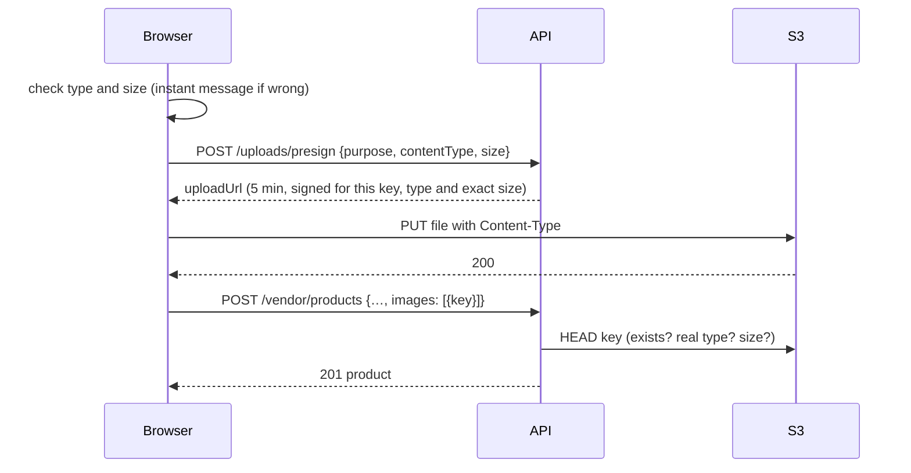

# 06 · API reference

[← Data model](05-data-model.md) · [Index](README.md) · [Next: Frontend →](07-frontend.md)

This page documents the endpoints that exist today, with real request and response shapes (Days 1–8). The full plan, including
endpoints still to come, is the [API list](specs/04-api-list.md). A machine-readable `openapi.yaml` follows on Day 10.

## Conventions

| | Rule |
|---|---|
| Base URL | `/api/v1` (locally `http://localhost:3000/api/v1` through nginx) |
| Format | JSON in and out; request bodies up to 100 kB |
| Auth | `Authorization: Bearer <accessToken>` from sign-in (15 min). The refresh cookie is only for `/auth/refresh` and `/auth/logout`; those and guest cart writes also need `X-Requested-With: ShopSphere` ([Security](10-security.md)) |
| Money | **Integer paise**: `price: 1999900` is ₹19,999. Fractions are rejected |
| Lists | `?page=1&limit=20` (limit ≤ 50) → `{ items, page, limit, total }`; some lists add `counts` per status |
| Ids | 24-hex MongoDB ids. An id that can't exist answers 404, the same as one that doesn't |
| Caching | Cached reads say `X-Cache: HIT` or `MISS` |
| Updates | `PATCH` changes only the fields sent; anything left out keeps its saved value |

### Errors

Every error has the same shape. Form errors list **one message per field**, so the frontend can show each next to its input.

```json
{
  "error": {
    "code": "validation_error",
    "message": "Some fields need fixing",
    "details": { "fields": [{ "field": "mrp", "message": "MRP can't be lower than the selling price" }] }
  }
}
```

| HTTP | `code` | When |
|---|---|---|
| 400 | `validation_error`, `invalid_json` | Bad input; `details.fields` says which |
| 401 | `unauthenticated`, `token_expired`, `session_ended` | Not signed in, token expired (refresh and retry), session revoked |
| 403 | `forbidden` | Wrong role; `details.requiredRoles` lists the right ones |
| 403 | `vendor_not_approved` | The vendor's store isn't approved; `details.storeStatus` is `none`, `pending`, `rejected` or `suspended` |
| 404 | `not_found`, `store_not_found` | Unknown id, another vendor's product, a store that isn't public |
| 402 | `payment_failed` | The (test) payment was declined; the order can still be paid |
| 409 | `already_applied`, `invalid_transition`, `sku_taken`, `category_in_use`, `product_has_orders` | The action doesn't fit the current state |
| 409 | `out_of_stock`, `cart_full`, `cart_empty`, `cart_changed`, `price_changed`, `order_not_payable`, `too_many_addresses` | Cart and checkout conflicts, explained below |
| 400 | `invalid_signature` | A payment proof or webhook that doesn't verify |
| 409 | `payment_not_completed` | Razorpay says the payment didn't go through |
| 409 | `coupon_invalid`, `coupon_exhausted`, `code_taken`, `already_reviewed` | Coupon and review conflicts, explained below |
| 403 | `not_delivered` | Reviewing a product that hasn't been delivered to you |
| 404 | `invoice_not_ready` | The invoice PDF is still being made |
| 503 | `webhook_not_configured` | No webhook secret is set on this server |
| 502 | `payment_unavailable` | The payment provider can't be reached; nothing was charged |
| 429 | `rate_limited` | Too many attempts; `Retry-After` header |
| 503 | `search_unavailable` | Elasticsearch is down; browsing, store and product pages still work |

## Auth and account

Built on Day 2 and described in [Security](10-security.md): `POST /auth/register`, `POST /auth/login`, `POST /auth/refresh`,
`POST /auth/logout`, `GET /auth/me`, `PATCH /account`, `POST /account/password`. Signing in or up also moves a guest's cart
into the account (below).

## Vendors and stores

### `POST /vendors/apply` (vendor)

Submits the store application. Calling it again while it's `pending` edits it; after a rejection it applies again
(status back to `pending`, the reason cleared). An approved or suspended store gets `409 already_applied`.

```json
{ "storeName": "Vikram Electronics", "description": "Phones and laptops", "contactEmail": "vikram@example.com",
  "phone": "+91 98765 43210", "gstin": "29ABCDE1234F1Z5" }
```

| Field | Rule |
|---|---|
| `storeName` | 3–60 characters; becomes the URL slug (`vikram-electronics`, then `-2`, `-3` … if taken) |
| `phone` | Indian mobile; `+91`, spaces and dashes are removed, stored as 10 digits |
| `gstin` | Optional; 15-character GST format, upper-cased |

`201` (first time) or `200`: `{ "store": OwnStore }`.

```json
{ "store": { "id": "6aeb…", "storeName": "Vikram Electronics", "slug": "vikram-electronics", "status": "pending",
  "rejectionReason": null, "contactEmail": "vikram@example.com", "phone": "9876543210", "gstin": "29ABCDE1234F1Z5",
  "logoUrl": null, "logoKey": null, "commissionRateBp": null, "submittedAt": "…", "approvedAt": null, … } }
```

### `GET /vendors/me` · `PATCH /vendors/me` (vendor)

`GET` returns `{ "store": OwnStore | null }` (`null` before applying). `PATCH` edits any of the fields above plus
`logoKey` (a key from an upload with purpose `store-logo`, or `null` to remove the logo). A suspended store can't be edited.

### `GET /stores/:slug` (public)

An **approved** store and its products: `{ store: PublicStore, products: { items: ProductCard[], page, limit, total } }`.
Accepts the same `sort`, `category`, `page`, `limit` as `GET /products`. Contact details and status are never included.

### Admin: `GET /admin/vendors?status=&page=`

Applications and stores with their owner and product count. Pending applications come oldest first.

```json
{ "items": [{ …OwnStore, "owner": { "id": "…", "name": "Kavya Iyer", "email": "kavya@shopsphere.test" }, "productCount": 0 }],
  "page": 1, "limit": 20, "total": 1, "counts": { "pending": 1, "approved": 5, "rejected": 0, "suspended": 0 } }
```

### Admin: `POST /admin/vendors/:id/{approve|reject|suspend|restore}`

| Action | From | To | Body |
|---|---|---|---|
| `approve` | `pending` | `approved` | — |
| `reject` | `pending` | `rejected` | `{ "reason": "5–500 characters, shown to the vendor" }` |
| `suspend` | `approved` | `suspended` | `{ "reason": "…" }` |
| `restore` | `suspended` | `approved` | — |

Any other combination is `409 invalid_transition` with `details.status` and `details.allowedFrom`. The update is
conditional on the current status, so two admins clicking at once can't both act. Suspending a store hides all of its
products immediately (their cached pages are cleared too).

## Categories

### `GET /categories` (public, cached 5 min)

The active tree: departments with their categories.

```json
{ "items": [{ "id": "…", "name": "Electronics", "slug": "electronics",
  "children": [{ "id": "…", "name": "Smartphones", "slug": "smartphones", "children": [] }] }] }
```

### Admin: `GET · POST /admin/categories`, `PATCH · DELETE /admin/categories/:id`

- `GET` lists every category, hidden ones included, with `productCount`.
- `POST { name, parentId?, commissionRateBp?, sortOrder? }`: no `parentId` makes a department; the parent must be a department (two levels only).
- `PATCH { name?, isActive?, commissionRateBp?, sortOrder? }`: `isActive: false` hides a category from shoppers.
- `DELETE` only works on an empty category: `409 category_in_use` with `details.products` and `details.subCategories` otherwise.

Every change clears the category cache and cached product pages (they show the category name).

## Products (shoppers)

### `GET /products?category=&sort=&page=&limit=`

Active products of approved stores, straight from MongoDB (the home page's department browsing). `category` is a slug;
a department includes its sub-categories. `sort` is `newest` (default), `price_asc`, `price_desc` or `rating`.
Full-text search with filters is `GET /search` below.

```json
{ "items": [{ "id": "…", "title": "iPhone 13 Pro", "brand": "Apple",
  "image": { "url": "http://localhost:9090/shopsphere-local/products/<vendorId>/seed-dj-123-1.webp", "alt": "iPhone 13 Pro" },
  "price": 9399900, "mrp": 10399900, "discountPercent": 10, "inStock": true, "ratingAvg": 4.1, "ratingCount": 3,
  "vendor": { "storeName": "Vikram Electronics", "slug": "vikram-electronics" } }],
  "page": 1, "limit": 20, "total": 214 }
```

### `GET /products/:id` (cached 5 min)

The full product: everything on the card plus `description`, `category`, `vendor.id`, all `images`, `stock` and
`attributes` (specifications). Drafts, inactive products and products of stores that aren't approved answer 404.

## Search

Served by Elasticsearch, kept in step with MongoDB by a background job ([how](08-background-jobs.md)).

### `GET /search`

| Parameter | Meaning |
|---|---|
| `q` | Search words (up to 100 characters); typos allowed. Empty = browse everything |
| `category` | Category or department slug |
| `brand` | Repeat for several: `brand=Apple&brand=Samsung` (any of them) |
| `vendor` | Store slug |
| `minPrice`, `maxPrice` | **Paise**, inclusive |
| `rating` | 1–4: average rating at least this |
| `inStock` | `true` for in-stock only |
| `sort` | `relevance` (default with `q`), `newest` (default without), `price_asc`, `price_desc`, `rating` |
| `page`, `limit` | As every list (limit ≤ 50) |

```json
{ "items": [ProductCard, …], "page": 1, "limit": 24, "total": 4,
  "matchedAllWords": true, "tookMs": 12,
  "facets": {
    "categories": [{ "slug": "smartphones", "name": "Smartphones", "count": 4 }],
    "brands": [{ "value": "Apple", "count": 4 }],
    "vendors": [{ "slug": "vikram-electronics", "name": "Vikram Electronics", "count": 4 }],
    "price": [{ "key": "20000-plus", "min": 2000000, "max": null, "count": 3 }],
    "rating": [{ "min": 4, "count": 1 }, { "min": 3, "count": 2 }],
    "inStock": 4 } }
```

- Each facet counts with every filter **except its own**, so ticking a brand still shows the other brands' counts.
- `matchedAllWords: false` means no product had every word, so results match all but one of them.
- Price buckets: under ₹500, ₹500–1 000, ₹1 000–5 000, ₹5 000–20 000, over ₹20 000 (only non-empty ones are listed).

### `GET /search/suggest?q=`

Up to 8 product titles for autocomplete, from 2 characters: `{ "items": [{ "id": "…", "title": "Galaxy S24" }] }`.
Matches word beginnings ("gal" → Galaxy) and whole words with a typo ("macbok" → MacBook).

## Addresses (signed in)

`GET /account/addresses` · `POST /account/addresses` · `PATCH /account/addresses/:id` · `DELETE /account/addresses/:id`

```json
POST /api/v1/account/addresses
{ "name": "Priya Sharma", "phone": "+91 98765 43210", "line1": "12 MG Road", "line2": "",
  "city": "Bengaluru", "state": "Karnataka", "pincode": "560001", "label": "Home", "isDefault": true }

201 { "address": { "id": "…", "phone": "9876543210", "line2": null, "isDefault": true, … }, "items": [ … ] }
```

- Up to 5 per account (`409 too_many_addresses`). Exactly one is the default whenever any exist; the first is the default automatically.
- Phones are 10-digit Indian mobiles (`+91`, spaces and dashes are removed); PIN codes are 6 digits.
- Checkout copies the address into the order, so editing or deleting it later never changes a placed order.

## Cart (guests too)

| Method | Path | Body | Notes |
|---|---|---|---|
| GET | `/cart` | | The cart with today's prices and stock |
| POST | `/cart/items` | `{ productId, qty }` | Adds to what's already there (up to 10 of a product, at most the stock); `201` for a new line |
| PATCH | `/cart/items/:productId` | `{ qty }` | Sets the quantity |
| DELETE | `/cart/items/:productId` | | Removes the line |

A signed-in user's cart belongs to the account. A guest's cart is tied to an httpOnly `ss_guest` cookie (random id, 7 days);
writes then also need `X-Requested-With: ShopSphere` like the other cookie endpoints. **Signing in or signing up moves the
guest cart into the account**: quantities of the same product add up (max 10) and the cookie is cleared.

```json
{ "cart": {
    "groups": [{ "vendor": { "id": "…", "storeName": "Vikram Electronics", "slug": "vikram-electronics" },
                 "items": [{ "productId": "…", "title": "Galaxy Phone", "image": { "url": "…", "alt": "…" },
                             "price": 2000000, "mrp": 2000000, "qty": 1, "stock": 5, "lineTotal": 2000000, "problem": null }],
                 "subtotal": 2000000 }],
    "itemCount": 1, "itemsTotal": 2000000, "problems": 0, "canCheckout": true } }
```

Each group is one store, and becomes one part of the order at checkout. A line whose product changed stays in the cart
with a `problem` (`unavailable`, `out_of_stock` or `not_enough_stock`), its amount leaves the totals and `canCheckout`
is false until it's fixed. Products a vendor deleted simply disappear.

| Error | When |
|---|---|
| `404 not_found` | The product isn't on sale (draft, inactive, or its store isn't approved) |
| `409 out_of_stock` | More than the stock; `details: { available, inCart }` |
| `409 cart_full` | 50 different products already |

## Checkout and payment (customers)

### `POST /checkout`

```json
{ "addressId": "…", "expectedTotal": 2059800 }
```

Re-reads every price and stock level, then in **one MongoDB transaction** takes the stock and creates the order plus one
part (sub-order) per store. The order waits for payment for 15 minutes (`RESERVATION_MINUTES`); after that its stock goes
back on sale. The bought lines leave the cart.

```json
201 { "order": { "id": "…", "orderNumber": "SS-2026-000001", "status": "pending_payment", "grandTotal": 2059800,
                 "reservationExpiresAt": "…", "parts": [{ "vendor": { "storeName": "Vikram Electronics" }, "status": "awaiting_payment", … },
                                                        { "vendor": { "storeName": "Meera Gadgets" }, … }], … },
      "payment": { "provider": "mock", "providerOrderId": "order_mock_…", "amount": 2059800, "currency": "INR", "expiresAt": "…" } }
```

| Error | When |
|---|---|
| `409 cart_empty` | Nothing to buy |
| `409 cart_changed` | A line became unavailable or short of stock; `details.items` lists them |
| `409 price_changed` | `expectedTotal` (what the shopper saw) differs from today's total; `details.itemsTotal` is the new one |
| `409 out_of_stock` | Someone else bought the last units a moment earlier (the transaction lost the race) |
| `400 validation_error` | `addressId` isn't one of the shopper's addresses |
| `502 payment_unavailable` | The payment provider couldn't be reached; the stock was released and nothing was charged |
| `403 forbidden` | Vendors and admins can't buy |

### Paying: `POST /payments/mock/pay`, then `POST /checkout/verify`

With `PAYMENT_PROVIDER=mock` (local, tests, CI) the API also plays the payment gateway, the way Razorpay's popup does:

```json
POST /payments/mock/pay   { "providerOrderId": "order_mock_…", "outcome": "success" }
200 { "providerOrderId": "order_mock_…", "providerPaymentId": "pay_mock_…", "signature": "9f2c…" }
```

`outcome: "failure"` answers `402 payment_failed` and the order stays payable. The browser then sends the result to be verified:

```json
POST /checkout/verify   { "orderId": "…", "providerOrderId": "order_mock_…", "providerPaymentId": "pay_mock_…", "signature": "9f2c…" }
200 { "order": { "status": "confirmed", "payment": { "status": "paid", … }, "parts": [{ "status": "placed", … }, …] } }
```

The signature is HMAC-SHA256 of `order id|payment id`, Razorpay's own scheme, so on Day 6 the real Razorpay popup replaces
the mock gateway and `/checkout/verify` stays the same. A wrong signature is `400 invalid_signature`; verifying the same
payment twice changes nothing; paying an order that already expired is `409 order_not_payable`.

### Paying with Razorpay (`PAYMENT_PROVIDER=razorpay`)

The payment step also has `keyId` (the public test key). The browser opens Razorpay's Checkout popup with it and sends
the popup's `razorpay_order_id`, `razorpay_payment_id` and `razorpay_signature` to `POST /checkout/verify` as
`providerOrderId`, `providerPaymentId` and `signature`. Besides the signature, the API asks Razorpay that the payment
belongs to this order, is for the right amount and is captured (capturing it if only authorised). A failed payment is
`409 payment_not_completed`. Details: [Payments](09-payments.md).

### `POST /webhooks/razorpay` (signed by Razorpay)

`payment.captured`, `payment.failed`, `refund.processed`, `refund.failed`. Needs `X-Razorpay-Signature` (HMAC-SHA256 of
the raw body with `RAZORPAY_WEBHOOK_SECRET`); each `X-Razorpay-Event-Id` is handled once. `400 invalid_signature` if the
signature is wrong, `503 webhook_not_configured` when no secret is set. Answers `{ "ok": true, "result": "order confirmed" }`.

## Orders (customers)

| Method | Path | Notes |
|---|---|---|
| GET | `/orders?page=` | Newest first: number, status, total, first item's photo and title, each store's status |
| GET | `/orders/:id` | The order, its parts with their timelines and tracking, and `payment` (the payment step) while it waits for payment |
| POST | `/orders/:id/cancel` | Cancels an **unpaid** order; its stock goes back at once |
| POST | `/orders/:id/sub-orders/:subId/cancel` | `{ reason? }` Cancels one store's part while it's `placed` or `packed`: stock goes back, the vendor's held share is reversed and what was paid for the part is refunded through Razorpay (`part.refund`, `payment.refundedAmount`) |

Another customer's order answers `404`. Customers never see commission or vendor shares.

| Order status | Meaning |
|---|---|
| `pending_payment` | Stock held, waiting for payment |
| `confirmed` | Paid; stores are working on their parts |
| `completed` | Every part is delivered or cancelled (at least one delivered) |
| `cancelled` | Cancelled before payment, or every part cancelled |
| `expired` | Not paid in time; stock went back on sale |

## Orders (vendors)

### `GET /vendor/orders?status=&page=`

The store's **paid** parts only (an order waiting for payment isn't the vendor's business yet), newest first, with what to
pack, where to send it and the money: `payable` (what the customer paid for this part), `commission` and `vendorNet`
(what the store receives), and `payout` (`held` until delivery, then `released` and `paid`; `reversed` if cancelled). `counts` gives the number per status for the filter tabs. `nextStatus` is the one step allowed next.

### `POST /vendor/orders/:subId/status`

```json
{ "status": "shipped", "tracking": { "carrier": "Delhivery", "number": "DL123456" } }
200 { "part": { "status": "shipped", "tracking": { … }, "nextStatus": "delivered", "timeline": [ … ] } }
```

One step at a time: `placed → packed → shipped → delivered`. Shipping needs tracking. Anything else is
`409 invalid_transition` with `details.allowed`; another store's part is `404`. Delivering the last open part completes the order.
Delivering releases the store's share and the worker pays it out.

### `PUT /vendors/me/payout`

```json
{ "accountHolder": "Vikram Rao", "accountNumber": "1234 5678 9012", "ifsc": "HDFC0001234" }
200 { "store": { …, "payout": { "accountHolder": "Vikram Rao", "bankLast4": "9012", "ifsc": "HDFC0001234", "provider": "mock" } }, "payoutsStarted": 1 }
```

Registers the account with the payout provider (simulated) and keeps only the last 4 digits. Shares already released
and waiting for these details are sent straight away (`payoutsStarted`).

## Reports

All amounts in paise; days are **Indian time** (midnight to midnight IST). `from` and `to` are `YYYY-MM-DD`, both
included, default the last 30 days, at most 366 days.

### `GET /admin/analytics?from=&to=` (admin)

```json
{ "range": { "from": "2026-10-10", "to": "2026-11-08" },
  "totals": { "gmv": 51333200, "cancelledValue": 13873000, "collected": 37721102, "refunds": 5032198,
              "paidOrders": 41, "averageOrderValue": 1042763, "commission": 3746020, "platformDiscounts": 78998,
              "platformRevenue": 3667022, "payoutsSent": 25505910 },
  "ordersByStatus": { "completed": 28, "confirmed": 9, "cancelled": 5, "expired": 2 },
  "partsByStatus": { "delivered": …, "shipped": …, "packed": …, "placed": …, "cancelled": … },
  "daily": [{ "day": "2026-10-10", "sales": …, "orders": … }, …],
  "topVendors": [{ "storeName": "Meera Fashion House", "sales": …, "orders": …, "commission": … }],
  "topProducts": [{ "title": "…", "storeName": "…", "units": 4, "sales": … }],
  "escrow": { "held": 8208270, "released": 0, "paid": 25505910, "reversed": 4835790, "counts": { … } },
  "failingRefunds": 1, "refundsOwed": 339900 }
```

| Figure | Meaning | From |
|---|---|---|
| `gmv` | Value of everything sold (paid parts, before discounts); `cancelledValue` = how much of it was later cancelled | Parts paid in the range |
| `collected` | Payments received minus refunds | Ledger |
| `commission` | Commission earned minus commission given up on cancellations | Ledger |
| `platformDiscounts` | What platform coupons cost | Ledger |
| `platformRevenue` | `commission − platformDiscounts`: what ShopSphere keeps | Ledger |
| `paidOrders`, `averageOrderValue` | Orders paid in the range, average amount paid | Ledger |
| `daily` | Payments received per day, every day of the range (0 where none) | Ledger |
| `topVendors`, `topProducts` | Top 5 by sales, cancelled parts left out | Parts paid in the range |
| `escrow` | Where vendors' money is **now**: held until delivery, released (waiting for payout), paid, reversed | Parts' payout status |
| `refundsOwed` | Refunds promised but not yet made by the payment provider | Parts |

### `GET /vendor/earnings?from=&to=&page=` (vendor)

The store's `totals` (`sales`, `couponDiscounts` it paid for, `commission`, `net` share, `orders`), its `escrow` now,
`daily` share, `payoutAccount` (whether payouts can be sent) and the paid parts of the range, newest first, with each
one's payout status and reference.

## Admin tools

| Method | Path | Body | Does |
|---|---|---|---|
| PATCH | `/admin/vendors/:id/commission` | `{ "commissionRateBp": 500 }` or `null` | A store's own rate (0–50%), used instead of its categories' rates for **new** orders; `null` goes back to the category rates |
| PATCH | `/admin/categories/:id` | `{ "commissionRateBp": 1500 }` or `null` | A category's rate (a sub-category without one uses its department's, then 10%) |
| GET | `/admin/orders?q=&refund=&page=` | | Find orders by order number (or its last digits) or customer email; `refund=failed` lists refunds that haven't gone through. Each part says whether support can refund it |
| POST | `/admin/sub-orders/:subId/refund` | `{ "reason": "Parcel lost in transit" }` | Support cancels a part that's **placed, packed or shipped** (not delivered) and refunds it: same money rules as a customer cancellation; the reason is shown on the order's timeline |
| POST | `/admin/sub-orders/:subId/refund/retry` | | Tries a refused refund again now instead of waiting for the hourly retry; `409` if it was already sent |
| GET · PATCH | `/admin/reviews[/:id]` | `{ "status": "hidden" }` | Review moderation (above) |

## Coupons

### In the cart: `POST /cart/coupon` · `DELETE /cart/coupon`

```json
POST /api/v1/cart/coupon   { "code": "welcome10" }
200 { "cart": { …, "itemsTotal": 2059800,
                "coupon": { "code": "WELCOME10", "description": "10% off your order, up to ₹200 (orders over ₹499)", "scope": "platform", "storeName": null },
                "couponProblem": null, "discount": 20000, "grandTotal": 2039800 } }
```

One code per cart, checked when applied and again at checkout, with the same pricing checkout uses. A code that stops
applying (the cart dropped below its minimum, say) stays on the cart with `couponProblem` explaining why and no
discount. `409 coupon_invalid` says why a code can't be applied ("This code isn't valid.", "This coupon has expired.",
"You've already used this coupon.", "Add items worth ₹200 more to use this coupon (from this store)." …). A guest's
coupon moves into the account at sign-in like the cart does.

At checkout send the **total the shopper saw** (`grandTotal`, after the discount) as `expectedTotal`. The order then has
`discount`, `grandTotal` and `coupon: { code, scope }`, and each part `discountShare` and `payable`. If the last use was
taken a moment earlier, checkout answers `409 coupon_exhausted`.

| Coupon | Who pays | Effect |
|---|---|---|
| Platform (`/admin/coupons`) | ShopSphere | Discount split across the parts by value; vendors still get their full share; capped at the order's total commission |
| Vendor (`/vendor/coupons`) | That store | Only that store's part is discounted; its commission is on what the customer paid for it |

### Managing coupons: `GET · POST · PATCH /admin/coupons[/:id]`, `/vendor/coupons[/:id]`

```json
POST /api/v1/vendor/coupons
{ "code": "VIKRAM5", "type": "percent", "value": 500, "maxDiscount": 50000, "minOrder": 100000,
  "endsAt": "2026-12-31T18:29:59Z", "usageLimit": 500, "perUserLimit": 2, "description": "5% off Vikram Electronics" }
201 { "coupon": { "id": "…", "code": "VIKRAM5", "scope": "vendor", "vendorId": "…", "usedCount": 0, "isActive": true, … } }
```

`value` is basis points for `percent` (1%–90%) and paise for `flat`. Codes are 4–20 letters and numbers, stored
upper-case, unique (`409 code_taken`) and can't be changed; everything else can (`PATCH`, e.g. `{ "isActive": false }`).
Vendors only see and change their own store's coupons.

## Reviews

### `GET /products/:id/reviews?page=`

```json
{ "items": [{ "id": "…", "rating": 5, "title": "Love it", "body": "Battery lasts two days.", "authorName": "Asha",
              "verified": true, "createdAt": "…" }],
  "page": 1, "limit": 20, "total": 4,
  "summary": { "ratingAvg": 4.3, "ratingCount": 4, "stars": { "5": 2, "4": 1, "3": 1, "2": 0, "1": 0 } },
  "viewer": { "canReview": false, "reason": "not_delivered", "mine": null } }
```

Visible reviews, newest first. `viewer` is there for a signed-in customer only: whether they may review, and why not
(`not_delivered`, `already_reviewed`). `verified` marks reviews by customers whose order was delivered; the demo
catalogue's own reviews aren't verified.

### `POST /products/:id/reviews` (customer)

`{ "rating": 1–5, "title"?: "…", "body": "at least 10 characters" }`. Only after an order with this product was
**delivered** to this customer (`403 not_delivered`), once per product (`409 already_reviewed`). The product's and the
store's ratings are recalculated from the visible reviews straight away, and search picks up the new rating.

### Admin: `GET /admin/reviews?status=`, `PATCH /admin/reviews/:id`

`{ "status": "hidden", "reason": "…" }` hides a review (or `visible` shows it again); ratings are recalculated at once.

## Invoices

### `GET /invoices/:subId` (the buyer, the selling store, admins)

```json
{ "invoiceNumber": "INV-2026-000001", "url": "https://…/invoices/<vendorId>/INV-2026-000001.pdf?X-Amz-…", "expiresInSeconds": 300 }
```

One PDF per store's part, made by the worker once the order is paid and stored privately in S3. The answer is a
**5-minute signed download link**, made fresh each time. Anyone else gets `404`; while the PDF is still being made,
`404 invoice_not_ready`. Order and vendor-order views carry `invoiceNumber` once it exists.

## Products (the vendor's own)

All need a vendor whose store is **approved** (`403 vendor_not_approved` otherwise). A vendor only ever sees their own
products: another store's product id answers **404**, which doesn't reveal that it exists.

| Method | Path | Does |
|---|---|---|
| GET | `/vendor/products?status=&q=&page=` | My products, newest change first; `q` searches titles; `counts` per status |
| GET | `/vendor/products/:id` | One of my products, for the edit form |
| POST | `/vendor/products` | Create (status `draft` unless sent) |
| PATCH | `/vendor/products/:id` | Change any fields, including `status` |
| DELETE | `/vendor/products/:id` | Delete, with its photos. `409 product_has_orders` once it has sold; set it `inactive` instead |

```json
{ "title": "Galaxy S24 128 GB", "description": "…", "brand": "Samsung", "categoryId": "6aeb…",
  "price": 7499900, "mrp": 7999900, "stock": 25, "sku": "GS24-128",
  "attributes": { "RAM": "8 GB", "Colour": "Onyx Black" },
  "images": [{ "key": "products/<vendorId>/0b6c….webp", "alt": "Front" }],
  "status": "active" }
```

| Rule | Error |
|---|---|
| `price` and `mrp` are whole paise, ₹1 to ₹1 crore; `mrp` defaults to `price` | field `price` / `mrp` |
| `mrp ≥ price` | field `mrp` |
| `stock` 0–100 000; title 3–150 characters; description up to 5 000; up to 20 specifications | that field |
| `categoryId` is an active category | field `categoryId` |
| Up to 6 photos, no repeats; `active` needs at least one | field `images` |
| Each **new** photo key is under `products/<this vendor's id>/` and really was uploaded as JPEG/PNG/WebP ≤ 5 MB (checked in S3) | field `images.<n>` |
| `sku` unique within the store | `409 sku_taken` |

On `PATCH`, photos removed from the list are deleted from S3, and the product's cached page is cleared.

## Uploads

### `POST /uploads/presign` (vendor)

```json
{ "purpose": "product-image", "contentType": "image/webp", "size": 183204 }
```

| Field | Rule |
|---|---|
| `purpose` | `product-image` (approved store) or `store-logo` (any store, so a logo can go with the application) |
| `contentType` | `image/jpeg`, `image/png` or `image/webp` (no SVG: it can carry scripts) |
| `size` | Exact file size in bytes, 1 to 5 MB |

`201`:

```json
{ "key": "products/<vendorId>/<uuid>.webp",
  "uploadUrl": "https://<bucket>.s3.ap-south-1.amazonaws.com/products/…?X-Amz-Signature=…&X-Amz-SignedHeaders=content-length%3Bcontent-type%3Bhost",
  "method": "PUT", "headers": { "Content-Type": "image/webp" },
  "url": "https://<bucket>.s3.ap-south-1.amazonaws.com/products/<vendorId>/<uuid>.webp", "expiresIn": 300 }
```

Rate limit: 120 links per vendor per 15 minutes.



The API never handles the file itself. It checks the result twice: the signed link only accepts that type and size, and
the product save re-checks the stored object, which matters because the local S3 mock doesn't verify signatures.

## Where this is tested

| Area | Tests |
|---|---|
| Store application, admin review, transitions, public store page | `backend/tests/integration/vendors.test.ts` |
| Categories, product rules, ownership, photo checks, cache, suspension hiding products, upload links | `backend/tests/integration/catalog.test.ts` |
| Slugs, money, category tree, upload checks, file URLs, signed-link format | `backend/tests/catalog-units.test.ts` |
| Search parameters, query rules, facet counts, autocomplete | `backend/tests/search-units.test.ts`, `backend/tests/integration/search.test.ts` |
| Addresses, cart (guest cookie, merge on sign-in, stock checks), checkout, the overselling race, payment verification, expiry, cancelling, vendor status steps | `backend/tests/integration/orders.test.ts` |
| Commission and splitting, status rules, payment signatures | `backend/tests/order-units.test.ts` |
| Razorpay driver, webhooks, escrow, ledger balance, refunds, payouts | `backend/tests/payment-units.test.ts`, `backend/tests/integration/payments.test.ts` |
| Coupon maths and rules, invoice PDF; reviews, coupons and invoices end to end | `backend/tests/coupon-units.test.ts`, `backend/tests/integration/reviews-coupons-invoices.test.ts` |
| Report date ranges; analytics and earnings totals, commission rates, support refunds and retries | `backend/tests/analytics-units.test.ts`, `backend/tests/integration/analytics.test.ts` |
| The whole flow through nginx, S3 included, from guest cart to the vendor packing a paid order | `scripts/smoke-test.sh` (CI) |
