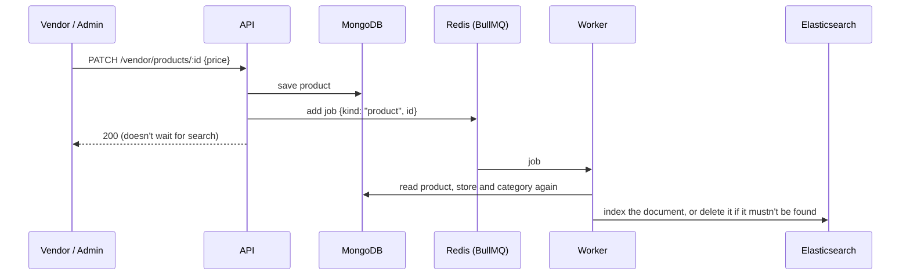

# 08 · Background jobs and search

[← API reference](06-api-reference.md) · [Index](README.md) · [Next: Payments, escrow and payouts →](09-payments.md)

Slow or retryable work runs in a separate **worker** process (`backend/src/worker.ts`), not inside API requests.
The API puts a job on a **BullMQ** queue in Redis and answers straight away; the worker picks the job up, and retries
it if it fails. This page covers the queues, and in detail the first one built: keeping **Elasticsearch search** in step
with MongoDB, and handing back stock from unpaid orders. Refunds and payouts are described in [Payments](09-payments.md); invoice PDFs follow on Day 7.

## Queues

| Queue | Job | Added on | Status |
|---|---|---|---|
| `search-index` | Add, update or remove products in the search index | Day 4 | ✓ |
| `invoice-pdf` | Generate a sub-order's invoice PDF and store it in S3 | Day 7 | planned |
| `payout` | Refund a cancelled part through Razorpay, or pay a released vendor share through the payout provider; an hourly sweep retries any that still haven't gone through ([details](09-payments.md)) | Day 6 | ✓ |
| `reservation-expiry` | Return reserved stock when an order is never paid | Day 5 | ✓ |

Every queue lives in the same Redis as the cache and sessions. Jobs survive an API or worker restart, because they're
stored in Redis (with append-only persistence on), not in memory.

## Search: how a change reaches the index

| What changed | Job | The worker |
|---|---|---|
| Product created, edited, published, taken off sale or deleted | `product` | Re-reads it; indexes it if shoppers may see it, deletes it otherwise |
| Store approved, suspended, restored or renamed | `vendor` | Re-syncs every product of that store in one bulk request |
| Category renamed, hidden or shown | `category` | Re-syncs every product in it (and in its sub-categories) |

**A product is searchable only if** it's `active`, its store is `approved`, and its category and department are active.
These are the same rules the product page uses, so search never shows something its page would refuse.

### Why jobs carry only an id

The job says *which* product changed, not *what* it changed to. The worker always reads the current state from
MongoDB, so:

- **Retries are safe.** Running a job twice gives the same result.
- **Order doesn't matter.** If two edits' jobs run in the wrong order, both read the latest data anyway.
- **Late jobs are harmless.** A job for a product deleted in the meantime simply removes it from the index.

### Retries and failure

| Situation | What happens |
|---|---|
| Elasticsearch restarting or briefly down | The job fails and is retried with exponential backoff (1 s, 2 s, 4 s … 8 attempts, about 4 minutes) |
| Redis down when the API adds the job | The change is still saved in MongoDB; the error is logged; `npm run reindex` puts search right |
| Worker stopped | Jobs wait in Redis and run when it starts again |
| Search down while shopping | `GET /search` answers `503 search_unavailable`; browsing by category, store pages and product pages use MongoDB and keep working |

Finished jobs are kept for an hour and failed ones for a week, for debugging. The worker runs 4 search jobs at a time.
In the smoke test, a product published through the API is searchable **about 1 second later**.

## Unpaid orders: giving the stock back

Checkout takes the stock straight away (so two shoppers can't both buy the last unit) and gives the customer 15 minutes
to pay. If they don't, the stock must go back on sale.

| Mechanism | When it runs | Why |
|---|---|---|
| A **delayed job** per order (`expire-<orderId>`) | Exactly when that order's reservation ends | Stock comes back on time, not up to a minute late |
| A **sweep** every minute (BullMQ job scheduler) | Always | Catches any order whose job was lost; harmless when there's nothing to do |
| Paying or cancelling first | | Removes the job; if it runs anyway it finds the order paid and does nothing |

Releasing an order is one transaction: the order becomes `expired` only if it is **still** waiting for payment, its parts
are cancelled with the reason "Not paid in time", and every line's stock is added back. Payment and expiry both start
with that same "still waiting for payment?" check, so whichever comes first wins and the other does nothing. Afterwards
the product cache is cleared and search is updated, so the product shows as in stock again.

Checked against the running stack: an unpaid order whose deadline was moved into the past was expired by the worker's
sweep within 30 seconds, and the product's stock went from 1 back to 2.

## Rebuilding the index with no downtime

Searches always go through an **alias**, `products`. The real index behind it is named `products-<timestamp>`.

`npm run reindex` (or `docker compose exec api node dist/scripts/reindex.js`):

1. creates a new, empty index with the current mapping and synonyms (refreshing switched off for speed);
2. streams every active product from MongoDB and bulk-loads the ones shoppers may see, 500 at a time;
3. switches the alias from the old index to the new one in **one atomic step**;
4. deletes the old index.

Searches keep using the old index until the moment of the switch, so there's no gap. All 214 demo products take
**under a second**. Use it after changing the mapping or synonyms, or if search ever drifts from the database. The
catalogue seed runs it at the end, and the API and worker create an empty index on a fresh install.

## The index

One document per searchable product, with everything a result card or a filter needs, so a search never queries
MongoDB. Definition: `backend/src/modules/search/search-mapping.ts`.

| Field | Type | Used for |
|---|---|---|
| `title` | text (lower-cased, accents removed) + `title.stem` | Matching and ranking |
| `suggest` | search-as-you-type | Autocomplete |
| `searchText` | text, filled from title, brand, category and store name | "Every word must match somewhere" |
| `description` | text (English stemming) | Matching |
| `brand`, `categorySlug`, `departmentSlug`, `vendorSlug` | keyword | Filters |
| `categoryFacet`, `vendorFacet` | keyword `slug\|Name` | Filter counts with names, without a lookup |
| `price`, `mrp`, `ratingAvg`, `ratingCount`, `stock`, `inStock`, `createdAt` | numbers, boolean, date | Filters and sorting |
| `imageKey`, `imageAlt` | stored only | The result card's photo |

**Synonyms** (applied when indexing): phone = smartphone = mobile, laptop = notebook, perfume = fragrance,
bike = motorcycle, dress = gown = frock, and a few more. Searching "samsung phone" finds the Samsung phones even though
none of them says "phone". They're applied at index time so that typo tolerance still works at search time.

## How a search is scored

| Rule | Why |
|---|---|
| Every word must be found in the title, brand, category or store name (or all of them in the description) | "samsung phone" shouldn't show every phone |
| One typo allowed in words of 4–7 letters, two from 8 letters | "iphne" finds iPhones; "perfume" must not match "performance" |
| Exact words score above typo matches; title matches ×4, brand ×3, an exact phrase in the title ×6 | The product that *is* an iPhone ranks above a case that mentions one |
| Ties broken by number of ratings | Popular products first among equals |
| Nothing matches every word → retry needing all but one word, flagged `matchedAllWords: false` | "red dress" shows dresses (there's no red one), and the page says it matched some of the words |

**Filter counts that don't vanish.** Filters are applied *after* the main query (`post_filter`), and each filter group
counts with every filter except its own. So after ticking "Apple", the brand list still shows how many Samsung products
there are, ready to add. All counts come from the same single request.

| Real searches on the 214-product demo catalogue | Results | Time |
|---|---|---|
| `iphne` | 8: iPhones and iPhone accessories | 21 ms |
| `samsng phone` | Samsung Galaxy S7, S8, S10 … | 12 ms |
| `lether bag` | Women's Leather Bag, Faux Leather Backpack | 15 ms |
| `perfume` | 5 fragrances (Dior, Gucci, Calvin Klein …) | 11 ms |
| `bike` | 12, motorcycles first | 7 ms |
| `red dress` | 17 dresses, "matching some of your words" | 14 ms |

Measured locally through nginx (Elasticsearch `took`). Load-test numbers with a 20 000-product catalogue follow on
Day 9 in [Testing and performance](README.md).

## Tests

| Test | Proves |
|---|---|
| `tests/search-units.test.ts` | Query rules: parameters, typo settings, exact-match boost, relaxed mode, filters vs facet counts, sorting, paging, autocomplete, response mapping |
| `tests/integration/search.test.ts` (real Elasticsearch) | Typos, ranking, words spread over fields, synonyms, relaxed fallback, every filter and its counts, sorting, autocomplete with typos, products leaving and rejoining search on unpublish, delete, store suspension and category changes, and a full rebuild behind the alias |
| `scripts/smoke-test.sh` (CI, whole stack) | The real worker indexes a newly published product and search finds it with a typo |
