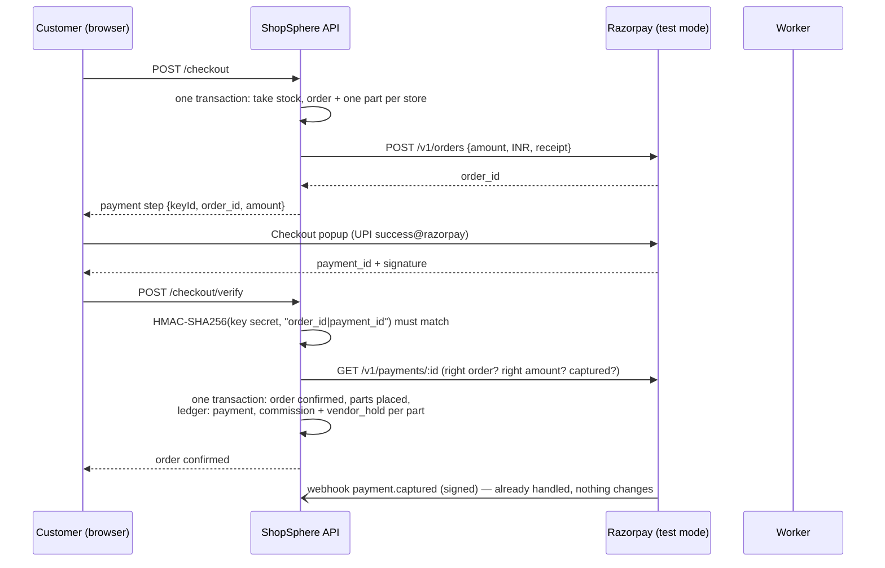
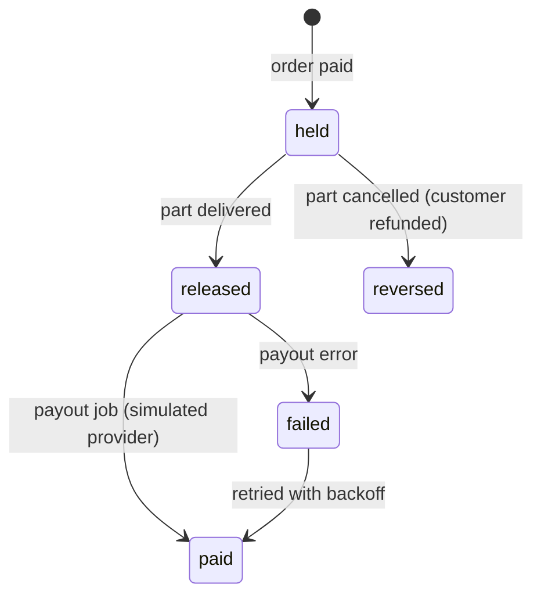

# 09 · Payments, escrow and payouts

[← Background jobs and search](08-background-jobs.md) · [Index](README.md) · [Next: Security →](10-security.md)

ShopSphere takes **one payment** for an order that may contain products from several stores, then splits it: each store's
share is **held** until its part is delivered, **released** on delivery and **paid out**; the platform keeps a commission.
A cancelled part is **refunded** to the customer and its share is **reversed**.

| Piece | How | Real or simulated |
|---|---|---|
| Taking the payment | Razorpay Orders + Checkout popup, test mode | **Real** Razorpay test-mode API; payments and refunds show in the Razorpay test dashboard |
| Proving the payment | HMAC signature check, then a capture check against Razorpay | Real |
| Payment events | Signed Razorpay webhooks, each handled once | Real (connected once the site is live) |
| Splitting, commission, escrow | ShopSphere's own ledger in MongoDB | Real (our code) |
| Refunds | Razorpay refund API, per cancelled part | **Real** test-mode refunds |
| Vendor payouts | `PayoutProvider` interface with a `mock` driver | **Simulated** and labelled as such |

Why not Razorpay Route (automatic splits) or RazorpayX (payouts): both need a registered business, which a student
project doesn't have ([design decision 1](04-design-decisions.md#1-real-razorpay-payments-our-own-split-and-escrow-engine)).
Test mode never moves real money, and the server refuses live keys (`rzp_live_…`) outright.

## The payment, step by step

If the customer closes the tab after paying but before the popup reports back, the **`payment.captured` webhook**
confirms the order instead. Both paths run the same `markPaid`, which only acts on an order still waiting for payment,
so whichever arrives second changes nothing.

## Escrow: what happens to each store's share

| Event | Part's `payout.status` | Ledger entries | Background job |
|---|---|---|---|
| Order paid | `held` (amount = `vendorNet`) | `payment` (order), `commission` + `vendor_hold` (each part) | — |
| Part delivered | `released` | `vendor_release` | `payout` |
| Payout sent | `paid` (+ provider reference) | `payout` | — |
| Part cancelled | `reversed`; `refund` = `pending` | `vendor_reversal`, `commission_reversal` | `refund` |
| Refund made | `refund.status` = `processed` or `pending` | `refund` | — |

A vendor without payout details keeps released shares waiting; saving the details (`PUT /vendors/me/payout`) sends
every waiting share at once.

## The ledger

`ledgerEntries` is **append-only**: entries are never edited or deleted. Each has a positive amount in paise and a type
saying what happened. A unique `key` (`<type>:<part or order id>`) allows only one entry of each type per part, so a
retried job or a repeated webhook can never record the same movement twice.

**The books always balance.** For every order:

> money kept = `payment` − `refund` = (`vendor_hold` − `vendor_reversal`) + (`commission` − `commission_reversal`)

The integration tests check this after payment, after delivery and after a cancellation.

**Worked example** (from the tests): a ₹20,000 phone from Vikram Electronics and two ₹299 cables from Meera Gadgets, 15% commission.

| | Vikram's part | Meera's part | Order |
|---|---|---|---|
| Customer pays | 2 000 000 | 59 800 | **2 059 800** (`payment`) |
| Commission (15%) | 300 000 | 8 970 | 308 970 |
| Held for the vendor | **1 700 000** | **50 830** | 1 750 830 |
| Customer cancels Meera's part | | refund 59 800; reversal 50 830 + 8 970 | kept 2 000 000 = 1 700 000 + 300 000 ✓ |

## Refunds

- Cancelling a paid part (before it ships) refunds **what was paid for that part** (`payable`) through Razorpay.
- The refund call runs as a background job and is retried with backoff if Razorpay is unreachable. If Razorpay refuses,
  the part's refund shows as **failed** ("couldn't be sent yet; it will be retried"), and the worker's **hourly sweep**
  tries every unfinished refund and payout again until it goes through.
- **No double refunds:** every refund is created with `notes.key = "refund-<part id>"`. Before creating one, the driver
  lists the payment's refunds and reuses a refund with that key, so a retry after a crash finds the earlier refund.
- The order's payment becomes `partially_refunded`, or `refunded` once everything paid has been returned.
- `refund.processed` / `refund.failed` webhooks update the part's refund status. They find the part through the note
  key, even if the event arrives before our own record of the refund id was saved.
- **A payment that arrives too late** (the order expired or was cancelled before the money came in) is refunded in full
  automatically, from whichever reports it first: the popup's callback or the webhook. A database claim makes sure only
  one of them refunds.

### Known limit: Razorpay test accounts may refuse refunds

Tested on 6 Nov 2026 with a real test-mode Netbanking payment (₹3,399, captured): Razorpay answered every refund request
with `400 BAD_REQUEST_ERROR "invalid request sent"`, and **the dashboard's own "Issue refund" button gave the same
error**, so it's a limit on the test account, not something in our request. Each field of the request was checked: the
same request with an impossible amount gets the specific error "greater than amount captured", so the request itself
is accepted. The likely reason is that the payment hadn't settled yet (settlement was shown for 9 Nov), but Razorpay
doesn't say.

ShopSphere handles this the same way it would a Razorpay outage: the cancellation goes through (stock returned, share
reversed, ledger balanced), the refund shows as failed, and the hourly sweep keeps retrying, so it completes by itself
once Razorpay allows it. An integration test runs exactly this case.

## Webhooks

`POST /api/v1/webhooks/razorpay` (on the live site, Razorpay Dashboard → Webhooks, with a secret you choose; locally the
endpoint answers `503 webhook_not_configured` until `RAZORPAY_WEBHOOK_SECRET` is set).

| Check | How |
|---|---|
| Authentic | `X-Razorpay-Signature` must equal HMAC-SHA256 of the **raw body** with the webhook secret (constant-time compare). The API keeps the exact bytes it received for this |
| Once only | `webhookEvents` stores each `X-Razorpay-Event-Id`. A repeat is answered `200 duplicate` and skipped; a failed one is processed again on the next delivery |
| Order doesn't matter | Every handler reads the current state first: `payment.captured` for an already-confirmed order does nothing, a refund event finds its part either way |
| Retries | An error answers `500`, so Razorpay delivers the event again later |
| Safe lookups | An event without an order or payment id is ignored (a query with a missing id would match everything) |

| Event | Effect |
|---|---|
| `payment.captured` | Confirms a waiting order (tab-closed case), or refunds a late payment |
| `payment.failed` | Marks the attempt failed; the order stays payable until its reservation ends |
| `refund.processed`, `refund.failed` | Updates the part's refund status |
| anything else | Recorded as `ignored` |

## Payouts (simulated)

`PayoutProvider` has two calls, and the `mock` driver implements both without contacting any bank:

| Call | Real provider would | `mock` does |
|---|---|---|
| `registerBeneficiary` | Store the account, return a beneficiary id | Returns `bene_mock_<hash>` |
| `pay(amount, key)` | Send money; the same key never pays twice | Returns `pout_mock_<hash of key>`, status `processed` |

Vendors type their account number once; only the **last 4 digits**, IFSC and holder name are stored. Everything a vendor
sees about payouts says "simulated".

## Configuration

| Variable | Meaning |
|---|---|
| `PAYMENT_PROVIDER` | `mock` (default; offline test payment screen, used by CI) or `razorpay` |
| `RAZORPAY_KEY_ID`, `RAZORPAY_KEY_SECRET` | Test keys from Razorpay Dashboard → Test Mode → API Keys. Only `rzp_test_…` is accepted |
| `RAZORPAY_WEBHOOK_SECRET` | The secret typed when creating the webhook; empty turns the endpoint off |

Keys live only in `.env` (git-ignored) on a PC and in the server's environment; they're never committed.

**Trying it:** with `PAYMENT_PROVIDER=razorpay`, check out, press **Pay with Razorpay**, choose **Netbanking**, pick any
bank and press **Success** on Razorpay's test bank page (**Failure** shows a failed payment). Which methods the popup
offers is decided by Razorpay for the account; UPI often isn't shown in test mode, and when it is, `success@razorpay` works. The payment, and any refund after cancelling a part, appear in
the Razorpay dashboard under Test Mode → Transactions.

## Tests

| Test | Proves |
|---|---|
| `backend/tests/payment-units.test.ts` | Razorpay driver against a fake API: order body and auth, signature check, capture of an authorised payment, mismatch and failure refused, refund reuse by key, error mapping; webhook signatures; live keys refused; payout idempotency |
| `backend/tests/integration/payments.test.ts` | Shares held on payment and the books balancing; release on delivery; payout waiting for details, then paid; only 4 digits stored; cancel → reversal + refund + `partially_refunded`; webhooks: bad signature, tab-closed confirmation, duplicates, late payment refunded once, refund status, failed attempt |
| `frontend/src/pages/payments.test.tsx` | The popup gets the right key, order and amount; its result is verified; a failure is explained and payment can be retried; refunds shown; payout account form |
| `scripts/smoke-test.sh` (CI) | Through nginx with the real worker: share held → payout details → delivered → paid out; cancelled part refunded |
| By hand, Razorpay test mode | A real test UPI payment confirms the order, and a cancellation shows a real refund in the Razorpay dashboard |
