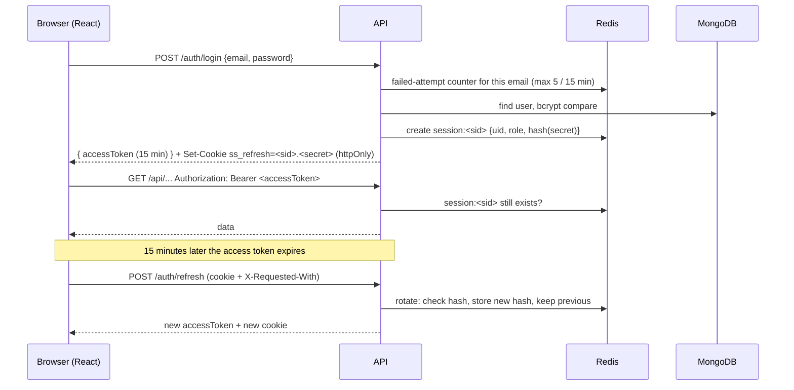

# 10 · Security

[← API reference](06-api-reference.md) · [Index](README.md) · Next: DevOps (written on Day 9)

This page covers how ShopSphere signs people in, keeps them signed in, decides what each account may do, and the
protections around that, and how vendors upload photos safely. Later days add payments and webhooks.

## Sign-in at a glance

## Passwords

| Rule | Why |
|---|---|
| Hashed with **bcrypt, cost 12** (`BCRYPT_COST`) | Slow on purpose: about 250 ms per guess, so stolen hashes are expensive to crack |
| **10–72 bytes**, at least one letter and one number | bcrypt ignores everything after 72 bytes; longer passwords are refused rather than silently cut |
| Never returned by the API (`select: false` on the field, one `toPublicUser` shape) | A bug elsewhere can't leak hashes |
| Unknown email still runs a bcrypt check | A wrong email takes as long as a wrong password, so response times don't reveal which accounts exist |
| Same message for wrong email and wrong password | `Email or password is incorrect` can't be used to discover accounts |

Sign-up does say when an email is taken (`409 email_taken`). That's a deliberate usability trade-off, and it's rate-limited (see below).

## Tokens and sessions

| | Access token | Refresh token |
|---|---|---|
| What | Signed JWT (HS256): user id, role, session id; issuer and audience checked | Random 32 bytes, `<sessionId>.<secret>` |
| Lifetime | 15 minutes (`ACCESS_TOKEN_TTL_SECONDS`) | 7 days, renewed on use (`REFRESH_TOKEN_TTL_DAYS`) |
| Where the browser keeps it | **Memory only** (never localStorage) | **httpOnly cookie** `ss_refresh`, `Path=/api/v1/auth`, `SameSite=Lax` (`None; Secure` on the live site) |
| Where the server keeps it | Nowhere (stateless) | Redis `session:<sid>`: only the **SHA-256 hash** of the secret |
| JavaScript can read it | Yes, but only from memory, so it's gone when the tab closes | No |

**Every request checks the session still exists in Redis**, not just the JWT signature. Logging out, changing the
password or being suspended therefore takes effect immediately, not when the 15-minute token runs out.

### Rotation and theft detection
- Each refresh replaces the secret, so a refresh token works **once**.
- The previous secret's hash is kept. If it's presented again later, two copies of the token exist (one stolen),
  so **every session of that user is revoked** (`401 session_reused`).
- Two tabs refreshing at the same moment both send the same token. Within 15 seconds of a rotation, the second
  gets `409 refresh_in_progress` and retries with the new cookie the first one set, so it isn't mistaken for theft.
- The rotation check runs as one Lua script inside Redis, so two refreshes can never both succeed with the same secret.

### Signing out everywhere
`user-sessions:<uid>` lists a user's sessions. Changing the password revokes all of them except the current one,
and the account page says how many devices were signed out.

## Roles and access

| Role | Created by | Can use |
|---|---|---|
| `customer` | Sign-up | Shopping, own orders, own account |
| `vendor` | Sign-up ("I want to sell") | Seller dashboard and store application; products and photo uploads only once an admin approves the store |
| `admin` | **Only the seed script** (`seed-users.js`); sign-up refuses `role: "admin"` | Admin pages |

On the server, `requireAuth` (signed in, session active) and `requireRole(...)` guard routes. A wrong role gets
`403 forbidden` with `requiredRoles`, which the frontend uses to explain which account type a page is for.
**Ownership.** Every vendor product query includes the vendor's own store id, so another store's product answers
`404` (not `403`, which would confirm it exists). Store status is checked on every seller request: a pending, rejected or
suspended store gets `403 vendor_not_approved`, and suspending a store hides all its products from shoppers at once.
Customers' own orders get the same treatment on Day 5.

The frontend's `RequireAuth` mirrors this for a good experience, but **the API is the real gate**: hiding a page
in React is never treated as security.

## Brute-force and abuse limits (Redis, shared by every API container)

| Limit | Value | Response |
|---|---|---|
| Sign-ups per IP | 10 per hour | `429 rate_limited` + `Retry-After` |
| Sign-in attempts per IP | 30 per 15 min | same |
| **Failed** sign-ins per email | 5 per 15 min; reset after a successful sign-in | same, even with the right password, until the window ends |
| Password changes per user | 5 per 15 min | same |

Client IPs come from `X-Forwarded-For` with exactly one trusted proxy hop (nginx locally, Caddy on the server), so a
client can't fake its IP by sending the header itself.

## CSRF

The refresh cookie is sent automatically by the browser, so the two endpoints that act on it (`/auth/refresh`,
`/auth/logout`) also require the header `X-Requested-With: ShopSphere`. Another website can only send a custom
header after a CORS preflight, and CORS allows only ShopSphere's own origins (`CORS_ORIGINS`), so a malicious page
can't trigger them. Every other endpoint needs the `Authorization` header, which browsers never add on their own.

## File uploads (product photos, store logos)

Files go straight from the browser to S3 with a **presigned PUT link**; the API never handles the bytes. See the
sequence in the [API reference](06-api-reference.md#uploads).

| Rule | How |
|---|---|
| Only vendors, only for their own store | Keys are generated by the API: `products/<vendorId>/<random uuid>.<ext>`; the browser can't choose them |
| Only JPEG, PNG or WebP, at most 5 MB | Checked when the link is requested; **content type and exact size are part of the signature**, so S3 refuses a different file |
| Short-lived | Links expire after 5 minutes; 120 links per vendor per 15 minutes |
| Checked again before use | Saving a product `HEAD`s every new key in S3: right prefix, really uploaded, allowed type, ≤ 5 MB. The local S3 mock doesn't verify signatures, so this check is what protects development too |
| No SVG | SVG can contain scripts; it's not an allowed type |
| No precomputed checksum in links | The AWS SDK adds a checksum of an empty body to presigned links by default, which makes real S3 refuse the upload. The client adds checksums only where S3 requires them, and a unit test fails if a link contains one |
| Cleaned up | Photos removed from a product, or of a deleted product, are deleted from S3 |
| Bucket | Private. On the live site only `products/` and `stores/` will be publicly readable (bucket policy, Day 8); invoices stay private |

## Other protections

| Area | Measure |
|---|---|
| Headers | Helmet (nosniff, frame denial, HSTS behind HTTPS, …); `X-Powered-By` removed; nginx adds the same on the static site |
| Input | Every body parsed with Zod; one error per field; JSON bodies capped at 100 kB; unknown routes return JSON 404 |
| Errors | Unexpected errors return a generic 500; details only in server logs |
| Logs | Authorization and cookie headers and password fields are redacted |
| Redirects | `?next=` after sign-in only accepts same-site paths (`/…`, not `//…` or `https://…`) |
| Secrets | `JWT_ACCESS_SECRET` must be set (32+ characters) when `NODE_ENV=production`; `SameSite=None` is refused without `Secure`; `.env` is git-ignored |
| Network | MongoDB, Redis and Elasticsearch ports are bound to `127.0.0.1` locally and never opened on the server |

## Tests that prove it

- Unit (`backend/tests/auth-units.test.ts`): password rules incl. the 72-byte limit, JWT expiry vs tampering vs `alg: none`, refresh-token parsing, `requireAuth` / `requireRole`, production secret rules.
- Integration against real MongoDB and Redis (`backend/tests/integration/auth.test.ts`): sign-up, case-insensitive sign-in, identical errors for unknown email and wrong password, the 5-failure lock, suspended accounts, rotation, the two-tab race, reuse detection signing out every device, CSRF header, logout killing the access token at once, password change signing out other devices.
- Integration (`vendors.test.ts`, `catalog.test.ts`): admin-only routes, vendor ownership (404 for another store's product), unapproved stores blocked, photos from another store or never uploaded refused, a file stored as HTML refused, suspension hiding products straight away.
- Smoke test through nginx: sign-up, `/me`, refresh, logout, the token failing afterwards, seeded admin sign-in, store approval, a real presigned upload and the product it belongs to.

## Known limits (v1)

- No email verification or "forgot password" (no email provider in scope).
- No two-factor authentication.
- Sign-up reveals whether an email is registered (rate-limited).
