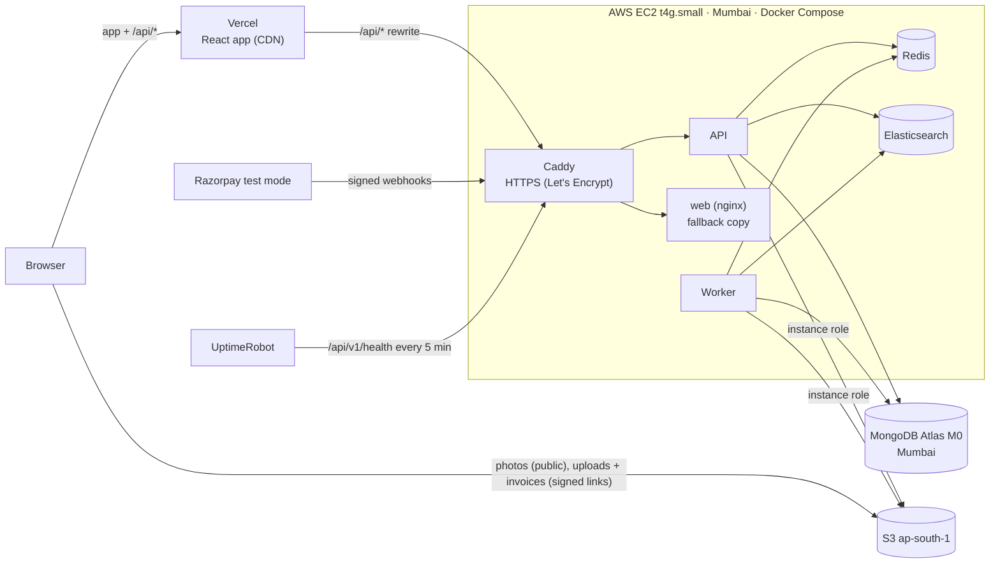
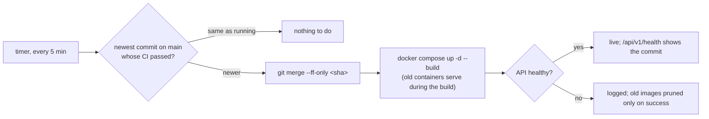

# 11 · DevOps: containers, CI/CD and live hosting

[← Security](10-security.md) · [Index](README.md) · Next: Testing and performance (written on Day 10)

ShopSphere runs as the same Docker images on a laptop, in CI and on the live server; only environment variables
change. The frontend and the backend are **deployed separately**: the React app on Vercel, the API and its services on
an AWS server in Mumbai.

| | Address |
|---|---|
| Web app (Vercel) | the project's `*.vercel.app` address (in the submission) |
| API server (AWS) | `https://shopsphere-adarsh.duckdns.org/api/v1/health` |

## Live architecture

| Piece | Where | Why |
|---|---|---|
| React app | **Vercel** (`frontend/vercel.json`) | Separate deployment, global CDN, builds from GitHub |
| API, worker, Redis, Elasticsearch | **AWS EC2 t4g.small** (2 vCPU, 2 GB + 2 GB swap), Ubuntu 24.04 arm64, `docker-compose.prod.yml` | Always on (no cold starts); Elasticsearch needs a real machine |
| HTTPS | **Caddy** on the server, certificate from Let's Encrypt for a free **DuckDNS** name | Automatic certificates and renewal, no domain to buy |
| Database | **MongoDB Atlas M0** (Mumbai) | Managed replica set, so checkout's transactions work; free |
| Files | **S3** `shopsphere-media-2026` (ap-south-1) | Product photos public (`products/*`, `stores/*` only); invoices private |
| Monitoring | **UptimeRobot**, health check every 5 minutes | Email if the site goes down |

### One origin for the browser

Vercel **rewrites** `/api/*` to the AWS server, so the browser only ever talks to the Vercel address:

- The sign-in refresh cookie and the guest-cart cookie are **first-party** (`SameSite=Lax`, `Secure`). Calling the API's
  own domain from the Vercel page would make them third-party cookies, which Safari and private windows block, so
  people would be signed out on every reload.
- No CORS preflight for API calls.
- The API still sees the visitor's address: Vercel passes it in `X-Forwarded-For`, Caddy keeps it, and the API trusts
  two proxy hops (`TRUST_PROXY_HOPS=2`) for the per-IP sign-in limits. Vercel has no fixed address range to
  allow-list, so a client calling the API host directly could fake that header; the per-email failure limit still applies.

The API host also serves a copy of the web app, so `https://shopsphere-adarsh.duckdns.org` works on its own. Razorpay's
webhooks and UptimeRobot call it directly.

### No AWS keys anywhere

The server has an IAM **instance role** (`shopsphere-ec2-role`) allowed only `PutObject`, `GetObject`, `DeleteObject`
on the bucket and `ListBucket` for the health check. With `S3_ACCESS_KEY_ID` left empty, the AWS SDK picks up
short-lived credentials from the role and renews them itself (`s3Credentials()` in `lib/s3.ts`). There's no access key
to leak, rotate or commit. The bucket policy makes only `products/*` and `stores/*` public; CORS allows uploads from
the two site origins only.

### Firewall

The EC2 security group allows **80 and 443** from anywhere and **22 (SSH) only from the owner's IP**. Inside the server
only Caddy publishes ports; Redis, Elasticsearch and the API are reachable only on the private Docker network. Secrets
(Atlas URL, sign-in secret, Razorpay test keys, webhook secret, demo password) are in `FS-01/.env` on the server only,
never in Git or CI.

### Memory on a 2 GB machine

| Container | Limit / typical |
|---|---|
| Elasticsearch | heap fixed at 512 MB (`ES_JAVA_OPTS`), ~800 MB in total |
| Redis | `maxmemory 128mb`, `noeviction` (queues must not lose jobs) |
| API, worker | ~100–150 MB each |
| Caddy, nginx | ~20 MB each |

Plus 2 GB of swap (`vm.swappiness=10`) for builds. Container logs are capped at 3 × 10 MB each.

## Continuous integration

`.github/workflows/fs01-ci.yml` runs on every push or pull request that touches `FS-01/`:

| Job | What it proves |
|---|---|
| Backend | Lint, typecheck, unit tests with coverage, integration tests against real MongoDB (replica set), Redis, Elasticsearch and S3Mock |
| Frontend | Lint, 62 component tests, production build |
| Docker Compose smoke test | Builds the real images, starts the whole stack, seeds it, and runs `scripts/smoke-test.sh` through nginx: sign-in, store approval, uploads, search, cart, checkout, payment, coupon, invoice, review, payout, refund, dashboards |

## Continuous deployment

**Frontend:** Vercel builds `FS-01/frontend` on every push to `main` (Vercel's GitHub integration).

**Backend:** the server deploys itself. `shopsphere-deploy.timer` runs `deploy/auto-deploy.sh` every 5 minutes:

- **Only commits that passed CI** are deployed: the script asks GitHub's public API for the newest successful run of
  the FS-01 workflow on `main` and deploys exactly that commit.
- **Nothing reaches into the server.** No SSH from GitHub, no deploy key or AWS credentials in CI; port 22 stays
  closed to everyone but the owner.
- A failed build leaves the previous containers running and isn't retried until a newer commit passes.
- `/api/v1/health` reports `"version": "<commit>"`, so anyone can see what's live.
- A file lock stops a deploy and the nightly reset from running at the same time.

Logs: `journalctl -u shopsphere-deploy -n 50`. Force a rebuild: `bash deploy/auto-deploy.sh --force`.

## Nightly demo reset

Reviewers use shared demo accounts, so the demo goes back to a known state every night at **03:00 IST**
(`shopsphere-reset.timer` → `deploy/demo-reset.sh`):

1. Once, after seeding, `bash deploy/demo-reset.sh --save` takes a snapshot of the database (`mongodump`, ~1 MB
   gzipped) into `~/.shopsphere/`.
2. Each night: stop the API and worker → drop every collection → restore the snapshot (`mongorestore`, indexes
   included) → empty Redis (sessions, carts, caches, queues) → start the API and worker → rebuild the search index.

Restoring keeps every id, so the product photos already in S3 stay valid and nothing is downloaded again. The site is
down for about a minute at 03:00. Logs: `journalctl -u shopsphere-reset -n 50`.

Tested locally against a scratch database: a deleted product came back, a changed one was reverted, and collections
created after the snapshot were removed.

## Server setup, from nothing

| Step | Command / place |
|---|---|
| 1. S3 bucket + policy, IAM policy + role | AWS console (bucket policy and role policy in this doc's history and `deploy/`) |
| 2. EC2 t4g.small, Ubuntu 24.04 arm64, 20 GB gp3, role attached, security group 22 (own IP) / 80 / 443 | AWS console |
| 3. DuckDNS name → server IP; Atlas network access → server IP | DuckDNS, Atlas |
| 4. Docker, swap, Elasticsearch kernel setting, automatic security updates | `sudo bash deploy/server-setup.sh` |
| 5. Secrets | `cp deploy/production.env.example .env && nano .env` |
| 6. Start | `docker compose -f docker-compose.prod.yml up -d --build` |
| 7. Demo data | `exec api node dist/scripts/seed-users.js`, `seed-catalog.js`, `seed-orders.js`, `reindex.js` |
| 8. Snapshot + timers | `bash deploy/demo-reset.sh --save`, `sudo bash deploy/install-timers.sh` |
| 9. Vercel | Import the repo, root directory `FS-01/frontend` (settings come from `vercel.json`) |
| 10. Razorpay webhook, UptimeRobot | Dashboard → Webhooks → `https://<api host>/api/v1/webhooks/razorpay`; monitor `/api/v1/health` |

## Cost

Covered by the AWS free-plan credits ($100, valid to July 2027), with a zero-spend budget alert:

| Item | ~ per month |
|---|---|
| EC2 t4g.small (on demand, Mumbai) | $12 |
| 20 GB gp3 disk | $2 |
| Public IPv4 address | $3.6 |
| S3 (a few hundred MB) and requests | < $0.10 |
| Vercel Hobby, Atlas M0, DuckDNS, UptimeRobot | free |

## Why not …

| Option | Why not |
|---|---|
| Render / Railway free tiers | Sleep after inactivity (30–60 s first load) and can't run Elasticsearch |
| Oracle Cloud Always Free | First choice; Hyderabad had no ARM capacity for a week ([design decision 10](04-design-decisions.md#10-separate-frontend-and-backend-hosting-always-on)) |
| Hosted Elasticsearch | Free trials end after 14 days, before reviewers are likely to look |
| GitHub Actions deploying over SSH | Would need port 22 open to GitHub's address ranges and a server key stored in CI |
