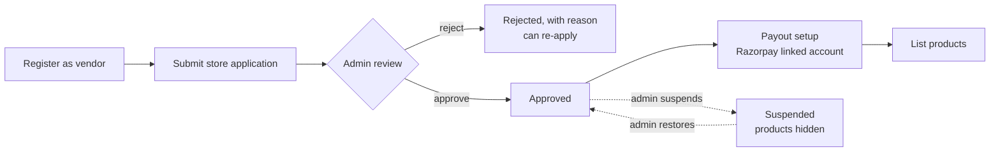
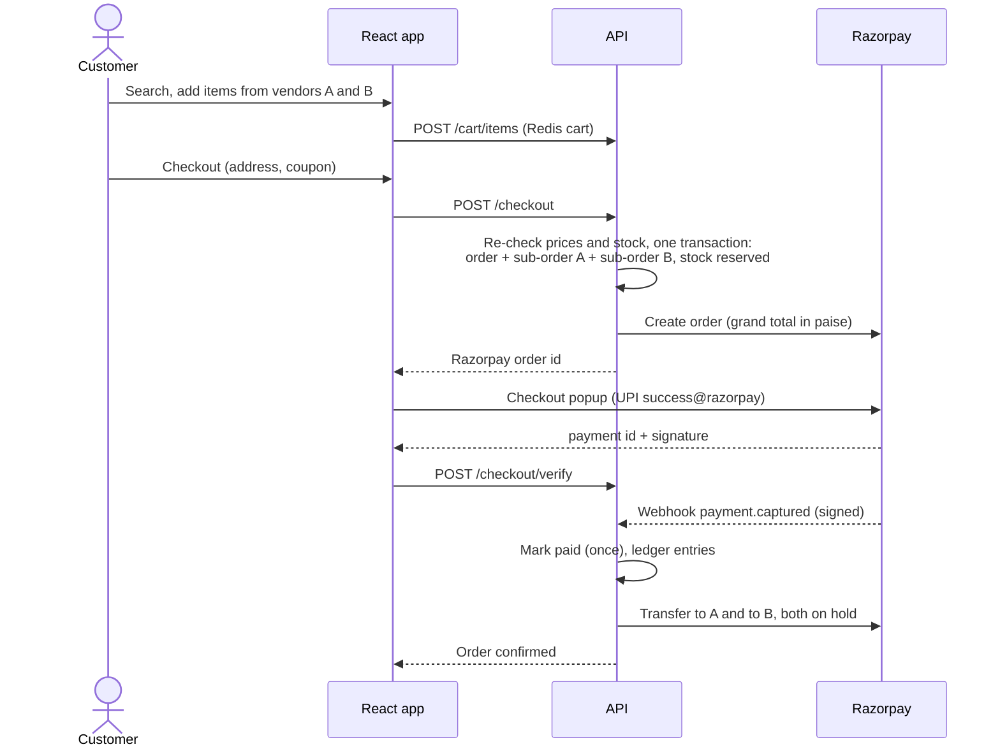
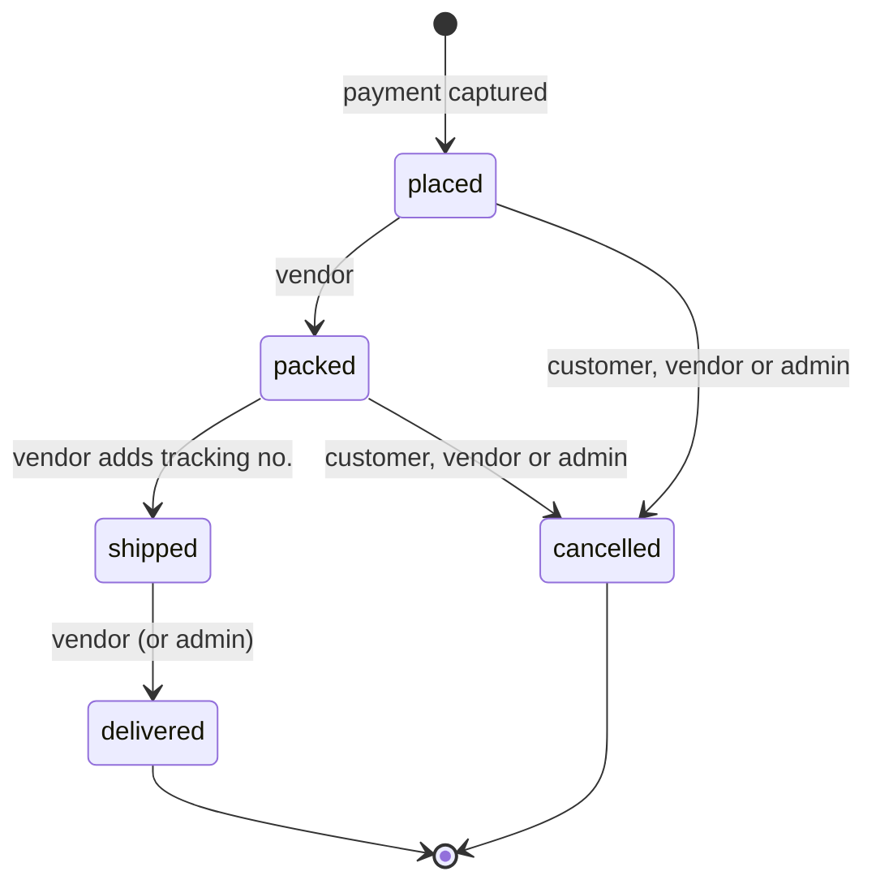

# App flow · ShopSphere

[← PRD](01-prd.md) · [Index](../README.md) · [Next: Database schema →](03-database-schema.md)

## 1. Screen map

| Area | Screens | Who |
|---|---|---|
| Public | Home, search results, product page, store page, cart, sign in, register | Everyone |
| Customer | Checkout, my orders, order detail (timeline per vendor), invoices, write review, account | Customer |
| Vendor | Application form / status, dashboard, products (list, create, edit, photos), orders, earnings, payout setup, coupons | Vendor |
| Admin | Dashboard (analytics), vendors (approve / suspend / commission), categories, coupons, reviews, refunds | Admin |

## 2. Vendor onboarding

A vendor can list products as soon as they are approved, but **orders for them can't be paid out until payout setup is done**, so the dashboard keeps reminding them.

## 3. Buying journey

If the customer never pays, the reservation expires after 15 minutes, the stock goes back and the order becomes `expired`.

## 4. Sub-order lifecycle (one per vendor)

| Event | Money |
|---|---|
| `placed` | Vendor's transfer created **on hold** |
| `delivered` | Hold **released**; vendor sees it as released, then settled |
| `cancelled` | Transfer **reversed**, that part of the payment **refunded** to the customer, stock returned |

Only allowed moves are accepted; for example a shipped sub-order can't be cancelled, and nothing moves backwards.

## 5. Coupon at checkout

1. Customer enters a code in the cart.
2. API checks: active, within dates, minimum order met, total and per-user limits, and for a vendor coupon that the cart has that vendor's items.
3. Discount shown; applied for real only inside the checkout transaction (so two tabs can't both use the last redemption).

## 6. Review

Only shown for products in a **delivered** sub-order of that customer, once per product. The product's average rating updates straight away and the search index shortly after.

## 7. Access by role

| Action | Guest | Customer | Vendor | Admin |
|---|:-:|:-:|:-:|:-:|
| Browse, search, cart | ✓ | ✓ | ✓ | ✓ |
| Checkout, orders, reviews | | ✓ | | |
| Manage own products, orders, earnings | | | ✓ (approved) | |
| Approve vendors, commission, categories, refunds, analytics | | | | ✓ |
