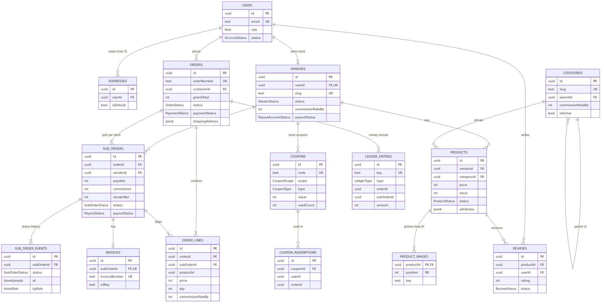

# Database schema · ShopSphere

[← App flow](02-app-flow.md) · [Index](../README.md) · [Next: API list →](04-api-list.md)

PostgreSQL 17 through Prisma 7. The source of truth is [`backend/prisma/schema.prisma`](../../backend/prisma/schema.prisma);
the SQL it creates is in [`backend/prisma/migrations/`](../../backend/prisma/migrations/).

- Every table has `id uuid` (UUIDv7, time-ordered), and most have `createdAt` / `updatedAt` (`timestamptz`).
- **All money is stored as integer paise** (₹499.00 = `49900`), so there are no rounding errors from floating-point maths.
- **Rates are basis points** (`1000` = 10%).
- Statuses, roles and types are PostgreSQL **enums**. Tables are snake_case plurals; columns keep the API's camelCase.
- `uuid → table` marks a foreign key.

Source: [`assets/erd.mmd`](../assets/erd.mmd).

## users

| Column | Type | Notes |
|---|---|---|
| name | text | 2–80 chars |
| email | text | **unique**, stored lower-case |
| passwordHash | text | bcrypt, cost 12; never returned by the API (routes select only public columns) |
| role | `customer` \| `vendor` \| `admin` | Admins are created by the seed script, never by sign-up |
| status | `active` \| `suspended` | Suspended users can't sign in |
| passwordChangedAt, lastLoginAt | timestamptz | |

## addresses

| Column | Type | Notes |
|---|---|---|
| userId | uuid → users | Deleted with the user |
| label, name, phone, line1, line2, city, state, pincode | text | Phone stored as 10 digits, PIN code as 6 |
| isDefault | bool | Exactly one default whenever the user has any; at most 5 per user (checked with the user's row locked) |

Index: `userId`.

## vendors

| Column | Type | Notes |
|---|---|---|
| userId | uuid → users | **unique** (one store per vendor account) |
| storeName, slug | text | `slug` **unique**, used in store URLs |
| description, logoKey | text | Logo is an S3 key |
| contactEmail, phone, gstin | text | GSTIN optional, shown on invoices |
| status | `pending` \| `approved` \| `rejected` \| `suspended` | |
| rejectionReason | text | Shown to the vendor |
| commissionRateBp | int, nullable | Overrides the category rate when set |
| payoutAccountHolder, payoutBankLast4, payoutIfsc, payoutProvider, payoutBeneficiaryRef | text | The full account number goes only to the payout provider, never into the database |
| payoutStatus, payoutUpdatedAt | `not_started` \| `active`, timestamptz | |
| ratingAvg, ratingCount | float, int | Average over the store's visible product reviews |
| submittedAt | timestamptz | Last time the application was sent; pending applications are reviewed oldest first |
| approvedAt, approvedBy, statusChangedAt, statusChangedBy | timestamptz, uuid | Audit |

Indexes: `userId` unique, `slug` unique, `status`.

## categories

| Column | Type | Notes |
|---|---|---|
| name, slug | text | `slug` **unique** |
| parentId | uuid → categories, nullable | Two levels (e.g. Electronics → Phones) |
| commissionRateBp | int, nullable | Falls back to the department's, then the platform default (1000) |
| isActive | bool | Hidden categories disappear from the shop; a category in use can be hidden but not deleted |
| sortOrder | int | Display order within its level |

## products and product_images

| Column | Type | Notes |
|---|---|---|
| vendorId | uuid → vendors | Owner; only this vendor may edit |
| categoryId | uuid → categories | |
| title, slug | text | `(vendorId, slug)` **unique** |
| description | text | Up to 5 000 chars |
| brand | text | Used for filters |
| price, mrp | int (paise) | `price ≤ mrp`; MRP shows the discount |
| stock | int | `≥ 0`, decremented inside the checkout transaction (`WHERE stock >= qty`) |
| sku | text, nullable | `(vendorId, sku)` **unique**; NULLs never clash |
| attributes | jsonb | Free-form specs (`{ "RAM": "8 GB" }`) |
| ratingAvg, ratingCount, soldCount | float, int, int | Denormalised for sorting |
| status | `draft` \| `active` \| `inactive` | Only `active` products of `approved` vendors are on sale and searchable |

`product_images`: `(productId, position)` primary key, `key` (S3 key under `products/<vendorId>/`, checked in S3 before
saving), `alt`. Up to 6; position 0 is the cover. Replaced as a whole when the vendor saves, deleted with the product.

Indexes: `(vendorId, status)`, `categoryId`, `(status, createdAt desc)` (browsing).
Search itself runs on Elasticsearch (alias `products`), which holds a flattened copy: title, description, brand,
category path, vendor name, price, rating, stock, cover image, createdAt.

## orders

| Column | Type | Notes |
|---|---|---|
| orderNumber | text | **unique**, `SS-2026-000123` |
| customerId | uuid → users | |
| shippingAddress | jsonb | Copy of the address at checkout |
| itemsTotal, discount, shipping, grandTotal | int (paise) | `grandTotal = itemsTotal − discount + shipping`; shipping is 0 in v1 |
| couponId, couponCode, couponScope, couponVendorId, couponDiscount | | The coupon used, copied at checkout |
| paymentProvider | `mock` \| `razorpay` | |
| paymentProviderOrderId | text, nullable | **unique** (Razorpay order id) |
| paymentProviderPaymentId, paidAt | text, timestamptz | |
| paymentStatus | `created` \| `paid` \| `failed` \| `refunded` \| `partially_refunded` | |
| refundedAmount | int (paise) | |
| status | `pending_payment` \| `confirmed` \| `completed` \| `cancelled` \| `expired` | `completed` when every part is delivered or cancelled |
| reservationExpiresAt | timestamptz | Stock is returned if unpaid by then |
| cancelledAt, completedAt | timestamptz | |

Indexes: `orderNumber` unique, `paymentProviderOrderId` unique, `(customerId, createdAt desc)`, `(status, reservationExpiresAt)`, `createdAt`.

Order and invoice numbers come from `counters` (`id = 'order-2026'`, `seq`), taken with one atomic
`INSERT … ON CONFLICT DO UPDATE … RETURNING`, outside the checkout transaction so checkouts don't queue on one row; a
failed checkout leaves a gap.

## order_lines

| Column | Type | Notes |
|---|---|---|
| orderId, subOrderId | uuid → orders, sub_orders | Each line belongs to the order and to its store's part |
| position | int | Order in which the shopper added them |
| productId, vendorId | uuid | Not foreign keys: a line is a snapshot and outlives product changes (an ordered product can't be deleted) |
| title, imageKey, price, qty | text, text, int, int | Copied at checkout |
| commissionRateBp | int | The rate frozen for this line |

Indexes: `orderId`, `subOrderId`, `productId`.

## sub_orders (one per store per order)

| Column | Type | Notes |
|---|---|---|
| orderId, orderNumber | uuid → orders, text | |
| customerId, vendorId | uuid | |
| vendorName, vendorSlug | text | Snapshot, so the order reads the same if the store is renamed |
| itemsTotal | int | Sum of this store's lines |
| discountShare, discountBy | int, `platform` \| `vendor` | This part's share of the order discount, and who pays for it |
| payable | int | `itemsTotal − discountShare`: what the customer paid for this part |
| commission | int | Sum of the lines' commissions |
| vendorNet | int | What the vendor receives (rules below) |
| status | `awaiting_payment` \| `placed` \| `packed` \| `shipped` \| `delivered` \| `cancelled` | |
| trackingCarrier, trackingNumber | text | Required for `shipped` |
| payoutAmount, payoutStatus | int, `held` \| `released` \| `paid` \| `reversed` \| `failed` | `payoutAmount` = `vendorNet` |
| payoutProvider, payoutProviderRef, payoutReleasedAt, payoutPaidAt, payoutLastError | | |
| refundAmount, refundStatus | int, `pending` \| `processed` \| `failed` | Set when a paid part is cancelled |
| refundProviderRef, refundRequestedAt, refundProcessedAt, refundLastError | | `refundProviderRef` is the Razorpay refund id |
| placedAt | timestamptz | When the order was paid; vendors only see parts that have it |
| invoiceNumber, deliveredAt, cancelledAt, cancelReason | | |

Indexes: `orderId`, `(vendorId, status, createdAt desc)`, `(vendorId, placedAt desc)`, `(payoutStatus, vendorId)`, `refundStatus`.

`sub_order_events`: `subOrderId`, `status`, `at`, `byUserId`, `byRole` (`customer` \| `vendor` \| `admin` \| `system`),
`note`. One row per status change; index `(subOrderId, at)`.

**Escrow states:** `held` (paid, not yet delivered) → `released` (delivered) → `paid` (payout done), or `held` →
`reversed` (cancelled and refunded). A failed payout stays `failed` and is retried by the job.

### Money rules

- **Commission** = `round(base × rateBp / 10 000)`, rate = vendor override ?? category rate ?? department rate ?? platform default.
- **Platform coupon** (the platform pays for it): split across parts in proportion to `itemsTotal` (remainder paise go to the largest). Commission is on `itemsTotal`, so `vendorNet = itemsTotal − commission`; the vendor isn't affected by the discount. The discount is capped so the platform never pays out more than it collected (`Σ vendorNet ≤ grandTotal`).
- **Vendor coupon** (the vendor pays for it): applies only to that vendor's part. Commission is on `payable`, so `vendorNet = payable − commission`.
- **Check on every paid order:** `grandTotal = Σ vendorNet + platform share`, where `platform share = Σ commission − platform discount`. A test enforces this for every scenario.
- **Cancelling one part** refunds its `payable` through Razorpay and reverses its `vendorNet` hold; the platform gives up that part's commission and, for a platform coupon, its discount share is reversed in the ledger (`platform_discount_reversal`).

## ledger_entries (append-only)

| Column | Type | Notes |
|---|---|---|
| orderId, subOrderId, vendorId | uuid | `subOrderId`, `vendorId` empty for order-level entries |
| key | text | **unique**, `<type>:<part or order id>`: one entry of each type per part, so nothing is recorded twice |
| type | `payment` \| `refund` \| `commission` \| `commission_reversal` \| `vendor_hold` \| `vendor_release` \| `vendor_reversal` \| `payout` \| `platform_discount` \| `platform_discount_reversal` | |
| amount | int (paise) | Always positive; the type says which way it went |
| providerRef | text | Razorpay payment or refund id, or the payout reference |
| note | text | |

Never updated or deleted; corrections are new entries. Powers vendor earnings and admin analytics. It balances:
`payment − refund + platform_discount − platform_discount_reversal = (vendor_hold − vendor_reversal) + (commission − commission_reversal)` ([Payments](../09-payments.md)).

Indexes: `key` unique, `orderId`, `(vendorId, type, createdAt desc)`, `(type, createdAt desc)`.

## reviews

| Column | Type | Notes |
|---|---|---|
| productId | uuid → products | |
| vendorId | uuid | |
| userId | uuid → users, nullable | Empty for the demo catalogue's imported reviews |
| subOrderId | uuid, nullable | The delivered part that proves the purchase |
| authorName | text | As written, so a later name change doesn't rewrite old reviews |
| rating | int 1–5 | |
| title, body | text | Up to 120 / 2 000 chars |
| status, hiddenReason | `visible` \| `hidden`, text | Admin can hide |
| source | `customer` \| `seed` | Only `customer` reviews are "verified purchase" |

Indexes: `(productId, userId)` **unique** (NULL user ids never clash), `(productId, status, createdAt desc)`, `(vendorId, status)`, `(status, createdAt desc)`.
`products.ratingAvg/ratingCount` and `vendors.ratingAvg/ratingCount` are recalculated from visible reviews on every change.

## coupons and coupon_redemptions

| coupons column | Type | Notes |
|---|---|---|
| code | text | **unique**, upper-case |
| scope, vendorId | `platform` \| `vendor`, uuid → vendors | `vendorId` only for store coupons |
| type, value | `percent` \| `flat`, int | percent in bp, flat in paise |
| maxDiscount, minOrder | int (paise) | |
| startsAt, endsAt | timestamptz | |
| usageLimit, perUserLimit, usedCount | int | `usedCount` incremented with a conditional update (`usedCount < usageLimit`) |
| isActive | bool | Off = can't be applied |
| description, createdBy | text, uuid | Shown in the cart |

`coupon_redemptions`: `couponId`, `userId`, `orderId`; unique `(couponId, orderId)`, index `(couponId, userId)` for the
per-customer limit. Removed (with `usedCount` given back) if the order expires or is cancelled before payment. A coupon
applied to a cart lives in Redis next to it (`cart:<id>:coupon`).

## invoices

| Column | Type | Notes |
|---|---|---|
| subOrderId | uuid → sub_orders | **unique** |
| orderId, vendorId, customerId | uuid | Who may download it |
| invoiceNumber | text | **unique**, `INV-2026-000123` (from `counters`, also copied onto the part) |
| s3Key | text | `invoices/<vendorId>/<invoiceNumber>.pdf`, private |
| generatedAt | timestamptz | |

## webhook_events

| Column | Type | Notes |
|---|---|---|
| provider | `razorpay` | |
| eventId | text | **unique** with provider (`X-Razorpay-Event-Id`), so a repeated delivery is ignored |
| type | text | e.g. `payment.captured`, `payment.failed`, `refund.processed`, `refund.failed` |
| status | `processing` \| `processed` \| `ignored` \| `failed` | A failed event is processed again when Razorpay redelivers it |
| result, error | text | |
| receivedAt, processedAt | timestamptz | |

## What lives in Redis (not PostgreSQL)

| Key | Content | Lifetime |
|---|---|---|
| `cart:<userId>` / `cart:guest:<id>` | hash `productId → qty`, plus `coupon` | 7 days, refreshed on use |
| `session:<sessionId>` | refresh-token family, user id, current token hash | 7 days; deleted on logout or reuse |
| `cache:product:<id>`, `cache:categories` | JSON | 5 min, deleted on write |
| `rl:<route>:<ip or user>` | counters | rate-limit window |
| `bull:*` | BullMQ queues: `search-index`, `invoice-pdf`, `payout`, `reservation-expiry` | until processed |
