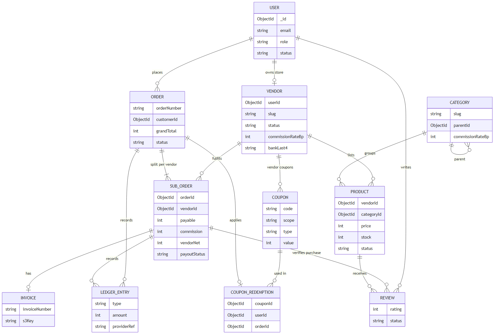

# Database schema · ShopSphere

[← App flow](02-app-flow.md) · [Index](../README.md) · [Next: API list →](04-api-list.md)

MongoDB (Mongoose). Every collection has `_id`, `createdAt` and `updatedAt`.
**All money is stored as integer paise** (₹499.00 = `49900`), so there are no rounding errors from floating-point maths.
**Rates are basis points** (`1000` = 10%).

Source: [`assets/erd.mmd`](../assets/erd.mmd).

## users

| Field | Type | Notes |
|---|---|---|
| name | string | 2–80 chars |
| email | string | **unique**, stored lower-case |
| passwordHash | string | bcrypt, cost 12; never returned by the API |
| role | `customer` \| `vendor` \| `admin` | Admins are created by the seed script, never by sign-up |
| status | `active` \| `suspended` | Suspended users can't sign in |
| addresses | array | `{ label, name, phone, line1, line2, city, state, pincode, isDefault }`, max 5 |
| passwordChangedAt | date | Tokens issued before this are rejected |

Indexes: `email` unique.

## vendors

| Field | Type | Notes |
|---|---|---|
| userId | ObjectId → users | **unique** (one store per vendor account) |
| storeName, slug | string | `slug` **unique**, used in store URLs |
| description, logoKey | string | Logo is an S3 key |
| contactEmail, phone, gstin | string | GSTIN optional, shown on invoices |
| status | `pending` \| `approved` \| `rejected` \| `suspended` | |
| rejectionReason | string | Shown to the vendor |
| commissionRateBp | int \| null | Overrides the category rate when set |
| payout | object | `{ accountHolder, bankLast4, ifsc, provider: "mock", beneficiaryRef, status: "not_started" \| "active", updatedAt }`. The full account number goes only to the payout provider, never into our database |
| ratingAvg, ratingCount | number | Average over the vendor's product reviews |
| submittedAt | date | Last time the application was sent; pending applications are reviewed oldest first |
| approvedAt, approvedBy | date, ObjectId | Audit |
| statusChangedAt, statusChangedBy | date, ObjectId | Who last approved, rejected, suspended or restored the store |

Indexes: `userId` unique, `slug` unique, `status`.

## categories

| Field | Type | Notes |
|---|---|---|
| name, slug | string | `slug` **unique** |
| parentId | ObjectId \| null | Two levels (e.g. Electronics → Phones) |
| commissionRateBp | int \| null | Falls back to the platform default (1000) |
| isActive | bool | Hidden categories disappear from the shop; a category in use can be hidden but not deleted |
| sortOrder | int | Display order within its level |

## products

| Field | Type | Notes |
|---|---|---|
| vendorId | ObjectId → vendors | Owner; only this vendor may edit |
| categoryId | ObjectId → categories | |
| title, slug | string | `slug` **unique** per vendor |
| description | string | Up to 5 000 chars |
| brand | string | Used for filters |
| images | array | `{ key, alt }`, max 6, S3 keys under `products/<vendorId>/`; each new key is checked in S3 (type, size) before saving; the first is the cover |
| price, mrp | int (paise) | `price ≤ mrp`; MRP shows the discount |
| stock | int | `≥ 0`, decremented inside the checkout transaction |
| sku | string | Optional, unique per vendor |
| attributes | map | Free-form specs (`{ "RAM": "8 GB" }`) |
| ratingAvg, ratingCount, soldCount | number | Denormalised for sorting |
| status | `draft` \| `active` \| `inactive` | Only `active` products of `approved` vendors are searchable |

Indexes: `{ vendorId, status }`, `{ vendorId, slug }` unique, `{ vendorId, sku }` unique (when set), `categoryId`, `{ status, createdAt: -1 }` (browsing).
Search itself runs on Elasticsearch (index `products`), which holds a flattened copy: title, description, brand, category path, vendor name, price, rating, stock, status, createdAt.

## orders

| Field | Type | Notes |
|---|---|---|
| orderNumber | string | **unique**, `SS-2026-000123` |
| customerId | ObjectId → users | |
| items | array | Snapshot at purchase: `{ productId, vendorId, title, imageKey, price, qty, commissionRateBp }` (later price or rate changes don't affect it) |
| shippingAddress | object | Copied from the user's address |
| itemsTotal, discount, shipping, grandTotal | int (paise) | `grandTotal = itemsTotal − discount + shipping`; shipping is 0 in v1 |
| coupon | object \| null | `{ couponId, code, scope, vendorId, discount }` |
| payment | object | `{ provider, providerOrderId, providerPaymentId, status: "created" \| "paid" \| "failed" \| "refunded" \| "partially_refunded", paidAt, refundedAmount }` |
| status | `pending_payment` \| `confirmed` \| `completed` \| `cancelled` \| `expired` | `completed` when every sub-order is delivered or cancelled |
| reservationExpiresAt | date | Stock is returned if unpaid by then |

Indexes: `orderNumber` unique, `{ customerId, createdAt: -1 }`, `payment.providerOrderId` unique (when set), `{ status, reservationExpiresAt }`, `items.productId` (an ordered product can't be deleted).

Order numbers come from `counters` (`{ _id: "order-2026", seq }`), incremented outside the checkout transaction so checkouts don't queue on one document; a failed checkout leaves a gap.

## subOrders (one per vendor per order)

| Field | Type | Notes |
|---|---|---|
| orderId, orderNumber | ObjectId, string | |
| customerId, vendorId | ObjectId | |
| vendorName, vendorSlug | string | Snapshot, so the order reads the same if the store is renamed |
| items | array | This vendor's lines from the order |
| itemsTotal | int | Sum of this vendor's lines |
| discountShare | int | This sub-order's part of the order discount |
| payable | int | `itemsTotal − discountShare`: what the customer paid for this part |
| commission | int | Sum of the lines' commissions (each line keeps its own frozen rate) |
| vendorNet | int | What the vendor receives (rules below) |
| status | `awaiting_payment` \| `placed` \| `packed` \| `shipped` \| `delivered` \| `cancelled` | `awaiting_payment` until the order is paid |
| statusHistory | array | `{ status, at, byUserId, byRole, note }` |
| tracking | object | `{ carrier, number }`, required for `shipped` |
| payout | object | `{ amount, status: "held" \| "released" \| "paid" \| "reversed" \| "failed", provider, providerRef, releasedAt, paidAt, lastError }`. `amount` = `vendorNet` |
| refund | object \| null | `{ amount, status: "pending" \| "processed" \| "failed", providerRef, requestedAt, processedAt }`; `providerRef` is the Razorpay refund id |
| placedAt | date | When the order was paid; vendors only see parts that have it |
| deliveredAt, cancelledAt, cancelReason | date, date, string | |

Indexes: `{ vendorId, status, createdAt: -1 }`, `{ vendorId, placedAt: -1 }`, `orderId`, `{ "payout.status", vendorId }`.

**Escrow states:** `held` (paid, not yet delivered) → `released` (delivered) → `paid` (payout done), or `held` → `reversed` (cancelled and refunded). A failed payout stays `failed` and is retried by the job.

### Money rules

- **Commission** = `round(base × rateBp / 10 000)`, rate = vendor override ?? category rate ?? platform default.
- **Platform coupon** (the platform pays for it): split across sub-orders in proportion to `itemsTotal` (remainder paise go to the largest). Commission is on `itemsTotal`, so `vendorNet = itemsTotal − commission`; the vendor isn't affected by the discount. The discount is capped so the platform never pays out more than it collected (`Σ vendorNet ≤ grandTotal`).
- **Vendor coupon** (the vendor pays for it): applies only to that vendor's sub-order. Commission is on `payable`, so `vendorNet = payable − commission`.
- **Check on every paid order:** `grandTotal = Σ vendorNet + platform share`, where `platform share = Σ commission − platform discount`. A test enforces this for every scenario.
- **Cancelling one sub-order** refunds its `payable` through Razorpay and reverses its `vendorNet` hold; the platform gives up that sub-order's commission and, for a platform coupon, absorbs its discount share.

## ledgerEntries (append-only)

| Field | Type | Notes |
|---|---|---|
| orderId, subOrderId, vendorId | ObjectId | `subOrderId`, `vendorId` empty for order-level entries |
| key | string | **unique**, `<type>:<part or order id>`: one entry of each type per part, so nothing is recorded twice |
| type | `payment` \| `refund` \| `commission` \| `commission_reversal` \| `vendor_hold` \| `vendor_release` \| `vendor_reversal` \| `payout` (+ `platform_discount` with coupons on Day 7) | |
| amount | int (paise) | Always positive; the type says which way it went |
| providerRef | string | Razorpay payment or refund id, or the payout reference |
| note | string | |

Never updated or deleted; corrections are new entries. Powers vendor earnings and admin analytics. It balances:
`payment − refund = (vendor_hold − vendor_reversal) + (commission − commission_reversal)` ([Payments](../09-payments.md)).

## reviews

| Field | Type | Notes |
|---|---|---|
| productId, vendorId, userId, subOrderId | ObjectId | `subOrderId` proves a delivered purchase |
| rating | int 1–5 | |
| title, body | string | Up to 120 / 2 000 chars |
| status | `visible` \| `hidden` | Admin can hide |

Indexes: `{ productId, userId }` **unique**, `{ productId, status, createdAt: -1 }`.

## coupons and couponRedemptions

| coupons field | Type | Notes |
|---|---|---|
| code | string | **unique**, upper-case |
| scope, vendorId | `platform` \| `vendor`, ObjectId | `vendorId` only for vendor coupons |
| type, value | `percent` \| `flat`, int | percent in bp, flat in paise |
| maxDiscount, minOrder | int (paise) | |
| startsAt, endsAt | date | |
| usageLimit, perUserLimit, usedCount | int | `usedCount` incremented atomically with a limit check |
| isActive | bool | Hidden categories disappear from the shop; a category in use can be hidden but not deleted |
| sortOrder | int | Display order within its level |

`couponRedemptions`: `{ couponId, userId, orderId }`, unique `{ couponId, orderId }`, used for the per-user limit and released if the order expires or is cancelled in full.

## invoices

| Field | Type | Notes |
|---|---|---|
| subOrderId | ObjectId | **unique** |
| invoiceNumber | string | **unique**, `INV-2026-000123` |
| s3Key | string | `invoices/<vendorId>/<invoiceNumber>.pdf`, private |
| generatedAt | date | |

## webhookEvents

| Field | Type | Notes |
|---|---|---|
| provider | `razorpay` | |
| eventId | string | **unique** with provider (`X-Razorpay-Event-Id`), so a repeated delivery is ignored |
| type | string | e.g. `payment.captured`, `payment.failed`, `refund.processed`, `refund.failed` |
| status | `processing` \| `processed` \| `ignored` \| `failed` | A failed event is processed again when Razorpay redelivers it |
| receivedAt, processedAt | date | |

## What lives in Redis (not MongoDB)

| Key | Content | Lifetime |
|---|---|---|
| `cart:<userId>` / `cart:guest:<id>` | hash `productId → qty`, plus `coupon` | 7 days, refreshed on use |
| `session:<sessionId>` | refresh-token family, user id, current token hash | 7 days; deleted on logout or reuse |
| `cache:product:<id>`, `cache:categories` | JSON | 5 min, deleted on write |
| `rl:<route>:<ip or user>` | counters | rate-limit window |
| `bull:*` | BullMQ queues: `search-index`, `invoice-pdf`, `payout`, `reservation-expiry` | until processed |
