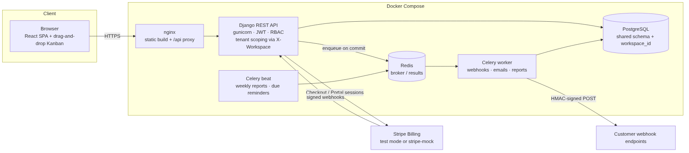

# TaskFlow — Multi-Tenant SaaS Project Management

[](https://github.com/Adarsh619/Rout_Adarsh_Pradhan_Capstone_Projects/actions/workflows/fs04-ci.yml)

A Jira-style product where every company gets its own **isolated workspace** with projects, drag-and-drop
Kanban boards, sprints, custom workflows, comments, attachments, an audit log, outgoing webhooks, background
jobs and **Stripe subscription billing** (test mode).

| Layer | Tech |
|---|---|
| API | Django 5.2 · Django REST Framework · SimpleJWT · drf-spectacular (OpenAPI) |
| Database | PostgreSQL 16 (shared schema, `workspace_id` on every tenant row) |
| Background jobs | Celery 5 + Redis (worker + beat) |
| Billing | Stripe Billing: Checkout, Customer Portal, signed webhooks. Runs on Stripe's official `stripe-mock` by default |
| Frontend | React 18 · Vite · React Router · @hello-pangea/dnd |
| Infra | Docker Compose · nginx · GitHub Actions (test → smoke-test → publish images → verify the published release → GitHub Release) |

**Status:** all seven steps of the brief are built, reviewed day by day and tested: **176 backend tests (96% coverage)**, **61 frontend tests**, and a CI smoke test that starts the whole Docker stack on every push.



---

## Features

- **Multi-tenancy**: shared-schema isolation. The tenant comes from the `X-Workspace` header; every queryset is filtered by it, and
  every foreign key in a request is validated against the same workspace, so you can't reference another company's data by guessing IDs.
- **Roles per workspace**: `viewer` (read-only) → `member` (work on issues, delete the ones they created) → `admin` (projects, workflows, sprints, members, webhooks, audit log) → `owner` (billing, admins, ownership transfer). Pages a role can't use explain why instead of failing.
- **Accounts**: email login (any letter case), strong-password rules, rate-limited sign-in, rotating refresh tokens, logout that revokes the session, and an account page to change your name and password (other devices get signed out).
- **Kanban board** with drag-and-drop, optimistic updates and server-side ordering. Columns the workflow doesn't allow are greyed out while you drag. Filters (search, assignee, sprint) live in the URL, overdue cards are flagged, and a drop on a filtered board lands exactly where you dropped it.
- **Custom workflows**: your own statuses (todo / in-progress / done categories) and allowed transitions, enforced by the API.
- **Sprints**: plan, start (one active per project), complete (unfinished issues go back to the backlog).
- **Issues**: per-project keys (`WEB-42`), type, priority, story points, due date, assignee, comments, file attachments (downloads are checked against the tenant), and per-issue history.
- **Audit log**: append-only (enforced in code) record of who changed what, with field-level diffs, trustworthy client IPs, filters and CSV export.
- **Webhooks**: subscribe to any of 32 events; payloads are HMAC-SHA256 signed and sent by Celery with retries for temporary failures; internal addresses are blocked (SSRF); secret rotation, redelivery and a delivery log in the UI.
- **Background jobs**: notification emails, due-date reminders (daily), weekly workspace reports (Celery Beat) and on-demand reports.
- **Billing**: Free / Pro / Business plans with enforced limits (HTTP 402 when you hit one), Stripe Checkout + Customer Portal, signature-verified webhooks that are safe against duplicate, late and failed deliveries; no double subscriptions. **Mock mode** (default) needs no Stripe account.
- **Notifications**: in-app bell (assignments, comments, moves, due soon, deletion requests) plus email; only current members are notified.

## Quick start (Docker)

Prerequisite: Docker Desktop.

```bash
cp .env.example .env            # Windows PowerShell: copy .env.example .env
docker compose up --build
docker compose exec backend python manage.py seed_demo     # optional demo data
docker compose exec backend python manage.py createsuperuser  # optional, for /admin
```

| URL | What |
|---|---|
| http://localhost:3000 | React app |
| http://localhost:8000/api/docs/ | Swagger / OpenAPI docs |
| http://localhost:8000/admin/ | Django admin |
| http://localhost:3000/w/acme/billing | Billing (mock Stripe checkout) |

Port 3000 taken? Set `FRONTEND_PORT=3001` in `.env`. The API, database and stripe-mock ports are published on `127.0.0.1` only.

Demo logins (password `demo12345`): `owner@acme.test`, `admin1@acme.test`, `member2@acme.test`, `member3@acme.test`, `viewer4@acme.test`.
A second tenant, `owner@globex.test`, lets you check isolation. `seed_demo` refuses to run unless `DJANGO_DEBUG=true` (or `--force`).

## Run the released version (no build)

Every push to `main` publishes tested images to GitHub Container Registry, and GitHub Actions then **runs those exact images and smoke-tests them** before calling the release good. You can run the same release without cloning or building anything:

1. Download [`docker-compose.release.yml`](docker-compose.release.yml) and [`.env.example`](.env.example) (also attached to every [GitHub Release](https://github.com/Adarsh619/Rout_Adarsh_Pradhan_Capstone_Projects/releases)), and save `.env.example` as `.env`.
2. Start it (Docker Desktop is the only requirement):

```bash
docker compose -f docker-compose.release.yml up -d
docker compose -f docker-compose.release.yml exec backend python manage.py seed_demo   # optional demo data
```

3. Open http://localhost:3000 and sign in as `owner@acme.test` / `demo12345`.

`TASKFLOW_TAG` picks the version: `latest` (default), a release such as `1.0.0`, or a commit such as `sha-74ac210`. Images are built for both `linux/amd64` and `linux/arm64` (Apple Silicon, ARM servers).

## Local development (without Docker)

You need Python 3.12+, Node 20+, PostgreSQL and Redis running locally. (Or start only the databases: `docker compose up db redis`.)

```bash
# backend
cd backend
python -m venv .venv
.venv\Scripts\activate          # macOS/Linux: source .venv/bin/activate
pip install -r requirements-dev.txt
copy ..\.env.example ..\.env    # then edit it if needed
python manage.py migrate
python manage.py seed_demo
python manage.py runserver

# Celery (separate terminals; on Windows add --pool=solo)
celery -A config worker -l info --pool=solo
celery -A config beat -l info

# frontend
cd frontend
npm install
npm run dev                      # http://localhost:5173 (proxies /api to :8000)
```

Django reads `.env` through VS Code's launch config. In a plain terminal, set the variables yourself, or set
`CELERY_TASK_ALWAYS_EAGER=true` to run background jobs inline without a worker.

## Tests

```bash
cd backend && pytest            # 176 tests, 96% coverage (fails below 90%), PostgreSQL + stripe-mock, ~45 s
cd frontend && npm test         # 61 tests: Vitest + Testing Library
```

Results and performance numbers: [docs/12-testing.md](docs/12-testing.md).

## Stripe billing

Billing works in two modes, set in `.env`:

| Mode | When to use | What happens |
|---|---|---|
| **Mock** (`STRIPE_MOCK=true`, default) | No Stripe account (Stripe is [invite-only in India](https://support.stripe.com/questions/stripe-accounts-are-invite-only-in-india)) | Stripe SDK calls go to Stripe's official [`stripe-mock`](https://github.com/stripe/stripe-mock) server (a Docker service). **Upgrade** opens a clearly labelled simulated checkout page. Confirming sends **Stripe-signed webhook events** through the same handler real Stripe uses, so the plan changes and its limits apply. |
| **Real test mode** (`STRIPE_MOCK=false`) | You have Stripe test keys | Real hosted Stripe Checkout and Customer Portal. Pay with `4242 4242 4242 4242`. Setup: [docs/guides/ACCOUNTS_SETUP.md](docs/guides/ACCOUNTS_SETUP.md). |

Both modes are free. Mock mode needs no account, card or keys. Switching modes only changes `.env`; the code stays the same.

## CI/CD

`.github/workflows/fs04-ci.yml` sits at the repository root, because this project lives in the `FS-04/` subfolder. It runs on every push and pull request that touches `FS-04/`:

1. **backend**: ruff lint, migration check, pytest on PostgreSQL + Redis + stripe-mock service containers; fails below 90% coverage (uploads JUnit + coverage)
2. **frontend**: ESLint, Vitest, production build
3. **smoke**: builds and starts the real Docker Compose stack and checks the app, API, admin, security headers and a sign-up through nginx (`scripts/smoke-test.sh`)
4. **publish** (pushes to `main` and `v*` tags): builds both images for amd64 and arm64 and **deploys them to GitHub Container Registry** (`latest`, `sha-<commit>`, and `1.2.3` / `1.2` for version tags)
5. **verify-release**: pulls the images it just published, starts them with `docker-compose.release.yml` and runs the same smoke test; recorded as a deployment to the `release` environment
6. **release** (version tags only): creates a GitHub Release with the run instructions and the two files needed
7. **deploy-server** (optional): deploys to a live server; skipped unless the repository variable `DEPLOY_ENABLED` is `true`

## Project layout

```
backend/
  config/            settings, urls, celery app
  apps/accounts      custom email-login User, register/login/logout/password, throttling
  apps/tenancy       Workspace, Membership, roles, TenantScopedMixin, permissions
  apps/tracker       workflows, projects, boards, sprints, issues, comments, attachments, seed_demo
  apps/audit         AuditLog + record() helper
  apps/integrations  webhooks (+ SSRF guard), notifications, reports, Celery tasks
  apps/billing       plans/limits, Subscription, Stripe service + webhook, mock mode (mock.py)
  tests/             pytest suite
frontend/src/
  api.js auth.jsx workspace.jsx boardLogic.js
  components/        Layout, IssueModal, IssueCard, Notifications, Modal, DeleteIssueControls
  pages/             Board, Sprints, Projects, Members, Workflows, Webhooks, AuditLog, Reports, Billing, Account, NotFound…
  test/              Vitest + Testing Library suites
docs/                design docs (01–14), guides, diagrams, screenshots, OpenAPI schema
```

## Documentation

Full documentation lives in [`docs/`](docs/README.md), one file per topic:

| | | |
|---|---|---|
| [01 Overview](docs/01-overview.md) | [06 API reference](docs/06-api.md) | [11 DevOps](docs/11-devops.md) |
| [02 Features and roles](docs/02-features-and-roles.md) | [07 Frontend](docs/07-frontend.md) | [12 Testing and performance](docs/12-testing.md) |
| [03 System architecture](docs/03-architecture.md) | [08 Background jobs](docs/08-background-jobs.md) | [13 Challenges and next steps](docs/13-challenges-and-next-steps.md) |
| [04 Multi-tenancy](docs/04-multi-tenancy.md) | [09 Billing](docs/09-billing.md) | [14 Setup and layout](docs/14-setup.md) |
| [05 Data model](docs/05-data-model.md) | [10 Security](docs/10-security.md) | |

Specs: [PRD](docs/specs/01-prd.md) · [TRD](docs/specs/02-trd.md) · [App flow](docs/specs/03-app-flow.md) · [Implementation plan](docs/specs/04-implementation-plan.md) · [UI/UX brief](docs/specs/05-ui-ux-design-brief.md) · [Backend schema](docs/specs/06-backend-schema.md)

Day-by-day review log (what was found and fixed on each day): [13 Challenges and next steps](docs/13-challenges-and-next-steps.md#day-by-day-review-days-214).

Guides: [accounts setup](docs/guides/ACCOUNTS_SETUP.md) · [14-day commit plan](docs/guides/COMMIT_PLAN.md) · [presentation outline](docs/guides/PRESENTATION_OUTLINE.md) · [reflection template](docs/guides/REFLECTION_TEMPLATE.md)
