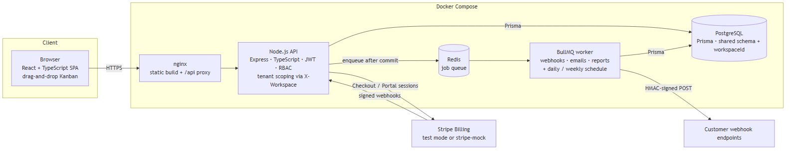

# TaskFlow — Multi-Tenant SaaS Project Management

[](https://github.com/Adarsh619/Rout_Adarsh_Pradhan_Capstone_Projects/actions/workflows/fs04-ci.yml)

## 🔗 Live demo: [taskflow-fs04.onrender.com](https://taskflow-fs04.onrender.com)

Sign in with any of these (password `demo12345`) to see each role:

| Role | Login |
|---|---|
| Owner (billing, everything) | `owner@acme.test` |
| Admin | `admin1@acme.test` |
| Member | `member2@acme.test` |
| Viewer (read-only) | `viewer4@acme.test` |
| Owner of a second, isolated company | `owner@globex.test` |

It's a **shared demo**: the demo logins can't change their password, the demo data resets every night (02:30 IST), and accounts you create yourself are removed after 7 days. Billing runs in Stripe mock mode, so no real payment is ever taken. Every tested push to `main` is deployed here automatically ([how it's hosted](docs/11-devops.md#live-deployment-free-always-on)).

A Jira-style product where every company gets its own **isolated workspace** with projects, drag-and-drop
Kanban boards, sprints, custom workflows, comments, attachments, an audit log, outgoing webhooks, background
jobs and **Stripe subscription billing** (test mode).

| Layer | Tech |
|---|---|
| API | **Node.js 24 · Express 5 · TypeScript** (strict) · Zod validation · JWT (`jose`) · OpenAPI 3 |
| Database | **PostgreSQL 16 · Prisma 7** (shared schema, `workspaceId` on every tenant row) |
| Background jobs | BullMQ + Redis 7 (one worker process runs the jobs and the schedule) |
| Billing | Stripe Billing: Checkout, Customer Portal, signed webhooks. Runs on Stripe's official `stripe-mock` by default |
| Frontend | **React 18 · TypeScript** (strict) · Vite 7 · React Router · @hello-pangea/dnd |
| Tests | **Vitest** + Supertest (API, against real PostgreSQL), Vitest + Testing Library (frontend) |
| Infra | **Docker** Compose · nginx · GitHub Actions (test → smoke-test → publish images → verify the published release → GitHub Release → live deploy) |

**Status:** all seven steps of the brief are built and tested: **197 backend tests (96% line coverage)**, **63 frontend tests**, and a CI smoke test that starts the whole Docker stack and walks through a full user flow on every push. Version 2.0.0 moved the stack from Django/Python to the required Node.js/TypeScript/Prisma tools with the same API and features ([why and how](docs/13-challenges-and-next-steps.md#stack-migration-to-nodejs-and-typescript-v200)).



---

## Features

- **Multi-tenancy**: shared-schema isolation. The tenant comes from the `X-Workspace` header; every query is filtered by it, and
  every id in a request is checked against the same workspace, so you can't reference another company's data by guessing IDs.
- **Roles per workspace**: `viewer` (read-only) → `member` (work on issues, delete the ones they created) → `admin` (projects, workflows, sprints, members, webhooks, audit log) → `owner` (billing, admins, ownership transfer). Pages a role can't use explain why instead of failing.
- **Accounts**: email login (any letter case), strong-password rules, rate-limited sign-in, rotating refresh tokens, logout that revokes the session, and an account page to change your name and password (other devices get signed out).
- **Kanban board** with drag-and-drop, optimistic updates and server-side ordering. Columns the workflow doesn't allow are greyed out while you drag. Filters (search, assignee, sprint) live in the URL, overdue cards are flagged, and a drop on a filtered board lands exactly where you dropped it.
- **Custom workflows**: your own statuses (todo / in-progress / done categories) and allowed transitions, enforced by the API.
- **Sprints**: plan, start (one active per project, enforced by the database), complete (unfinished issues go back to the backlog).
- **Issues**: per-project keys (`WEB-42`), type, priority, story points, due date, assignee, comments, file attachments (downloads are checked against the tenant), and per-issue history.
- **Audit log**: append-only (a database trigger refuses any change or deletion) record of who changed what, with field-level diffs, trustworthy client IPs, filters and CSV export.
- **Webhooks**: subscribe to any of 32 events; payloads are HMAC-SHA256 signed and sent by the worker with retries for temporary failures; internal addresses are blocked (SSRF); secret rotation, redelivery and a delivery log in the UI.
- **Background jobs**: notification emails, due-date reminders (daily), weekly workspace reports (scheduled) and on-demand reports.
- **Billing**: Free / Pro / Business plans with enforced limits (HTTP 402 when you hit one), Stripe Checkout + Customer Portal, signature-verified webhooks that are safe against duplicate, late and failed deliveries; no double subscriptions. **Mock mode** (default) needs no Stripe account.
- **Notifications**: in-app bell (assignments, comments, moves, due soon, deletion requests) plus email; only current members are notified.

## Quick start (Docker)

Prerequisite: Docker Desktop.

```bash
cp .env.example .env            # Windows PowerShell: copy .env.example .env
docker compose up --build
docker compose exec backend node dist/scripts/seed-demo.js     # optional demo data
```

| URL | What |
|---|---|
| http://localhost:3000 | React app |
| http://localhost:8000/api/docs/ | Swagger / OpenAPI docs |
| http://localhost:3000/w/acme/billing | Billing (mock Stripe checkout) |

Port 3000 taken? Set `FRONTEND_PORT=3001` in `.env`. The API, database and stripe-mock ports are published on `127.0.0.1` only.

Demo logins (password `demo12345`): `owner@acme.test`, `admin1@acme.test`, `member2@acme.test`, `member3@acme.test`, `viewer4@acme.test`.
A second tenant, `owner@globex.test`, lets you check isolation. The demo seed refuses to run unless `DEBUG=true` (or `--force`).

## Run the released version (no build)

Every push to `main` publishes tested images to GitHub Container Registry, and GitHub Actions then **runs those exact images and smoke-tests them** before calling the release good. You can run the same release without cloning or building anything.

> A [GitHub Release](https://github.com/Adarsh619/Rout_Adarsh_Pradhan_Capstone_Projects/releases) is a **download**, not a hosted website: `http://localhost:…` only opens after you start the release on your own computer as below. The only requirement is Docker Desktop (running).

**Windows (PowerShell)**

```powershell
mkdir C:\taskflow-release; cd C:\taskflow-release
Invoke-WebRequest https://github.com/Adarsh619/Rout_Adarsh_Pradhan_Capstone_Projects/releases/download/v2.0.0/docker-compose.release.yml -OutFile docker-compose.release.yml
Invoke-WebRequest https://github.com/Adarsh619/Rout_Adarsh_Pradhan_Capstone_Projects/releases/download/v2.0.0/taskflow.env.example -OutFile .env
docker compose -f docker-compose.release.yml up -d --wait
docker compose -f docker-compose.release.yml exec backend node dist/scripts/seed-demo.js
```

**macOS / Linux**

```bash
mkdir taskflow-release && cd taskflow-release
curl -fLO https://github.com/Adarsh619/Rout_Adarsh_Pradhan_Capstone_Projects/releases/download/v2.0.0/docker-compose.release.yml
curl -fL https://github.com/Adarsh619/Rout_Adarsh_Pradhan_Capstone_Projects/releases/download/v2.0.0/taskflow.env.example -o .env
docker compose -f docker-compose.release.yml up -d --wait
docker compose -f docker-compose.release.yml exec backend node dist/scripts/seed-demo.js
```

Then open http://localhost:3000 and sign in as `owner@acme.test` / `demo12345`. Stop it with `docker compose -f docker-compose.release.yml down`.

These commands fetch FS-04 release **v2.0.0**. For a newer FS-04 version, replace `v2.0.0` in the two URLs with its tag from the [Releases page](https://github.com/Adarsh619/Rout_Adarsh_Pradhan_Capstone_Projects/releases) (FS-04 releases are titled "TaskFlow …"). v1.0.1 is the earlier Django version.

Settings are lines in `.env`, so they work the same on every system:

| Setting | Use |
|---|---|
| `TASKFLOW_TAG` | Version to run: `latest` (default), a release such as `2.0.0`, or a commit such as `sha-f723be1` |
| `FRONTEND_PORT` | The app's port. **If port 3000 is already used** (for example by a dev server), set `3002` and open http://localhost:3002 |

If it doesn't start: make sure Docker Desktop is running, and stop a source-built TaskFlow stack first (`docker compose stop` in `FS-04`), because both use the API port 8000. Images are built for both `linux/amd64` and `linux/arm64` (Apple Silicon, ARM servers).

## Local development (without Docker)

You need Node.js 24+, and PostgreSQL, Redis and stripe-mock running (easiest: `docker compose up -d db redis stripe-mock`).

```bash
# backend
cd backend
npm install                      # also generates the typed Prisma client
copy ..\.env.example ..\.env     # macOS/Linux: cp ../.env.example ../.env
npx prisma migrate deploy        # create the tables
npm run seed                     # demo data
npm run dev                      # API on http://localhost:8000 (reloads on save)
npm run dev:worker               # background jobs, in a second terminal

# frontend
cd frontend
npm install
npm run dev                      # http://localhost:5173 (proxies /api to :8000)
```

The backend reads its settings from the environment. To skip the worker while developing, set `JOBS_INLINE=true`: background jobs then run inside the API process.

## Tests

```bash
cd backend && npm test          # 197 tests: Vitest + Supertest on real PostgreSQL + stripe-mock (own database taskflow_test)
cd backend && npm run test:coverage   # the same, failing below 90% line coverage
cd frontend && npm test         # 63 tests: Vitest + Testing Library
bash scripts/smoke-test.sh http://localhost:3000   # the whole running stack, through nginx
```

Results and performance numbers: [docs/12-testing.md](docs/12-testing.md).

## Stripe billing

Billing works in two modes, set in `.env`:

| Mode | When to use | What happens |
|---|---|---|
| **Mock** (`STRIPE_MOCK=true`, default) | No Stripe account (Stripe is [invite-only in India](https://support.stripe.com/questions/stripe-accounts-are-invite-only-in-india)) | Stripe SDK calls go to Stripe's official [`stripe-mock`](https://github.com/stripe/stripe-mock) server (a Docker service). **Upgrade** opens a clearly labelled simulated checkout page. Confirming sends **Stripe-signed webhook events** through the same handler real Stripe uses, so the plan changes and its limits apply. |
| **Real test mode** (`STRIPE_MOCK=false`) | You have Stripe test keys | Real hosted Stripe Checkout and Customer Portal. Pay with `4242 4242 4242 4242`. Setup: [docs/guides/ACCOUNTS_SETUP.md](docs/guides/ACCOUNTS_SETUP.md). |

Both modes are free. Mock mode needs no account, card or keys. Switching modes only changes `.env`; the code stays the same.

## CI/CD

`.github/workflows/fs04-ci.yml` sits at the repository root, because this project lives in the `FS-04/` subfolder. It runs on every push and pull request that touches `FS-04/`:

1. **backend**: ESLint, TypeScript type-check, Vitest on PostgreSQL + Redis + stripe-mock service containers; fails below 90% coverage (uploads JUnit + coverage)
2. **frontend**: ESLint, TypeScript type-check, Vitest, production build
3. **smoke**: builds and starts the real Docker Compose stack and, through nginx, checks the app, API docs, security headers and a full user flow (sign-up, project, issue, drag, comment, audit log, mock Stripe checkout, a background job) with `scripts/smoke-test.sh`
4. **publish** (pushes to `main` and `v*` tags): builds both images for amd64 and arm64 and **deploys them to GitHub Container Registry** (`latest`, `sha-<commit>`, and `2.0.0` / `2.0` for version tags)
5. **verify-release**: pulls the images it just published, starts them with `docker-compose.release.yml` and runs the same smoke test; recorded as a deployment to the `release` environment
6. **release** (version tags only): creates a GitHub Release with the run instructions and the two files needed
7. **deploy-server** (`main` only): deploys the commit to the live site, waits until it runs, and smoke-tests it read-only

## Project layout

```
backend/
  prisma/              schema.prisma + migrations (raw SQL for partial unique indexes and the audit trigger)
  src/app.ts           the Express app: middleware, routers, error shapes
  src/index.ts         API process · src/worker.ts background worker process
  src/modules/auth     register/login/refresh/logout/password, JWT, demo-account lock
  src/modules/tenancy  workspaces, members, roles, X-Workspace middleware
  src/modules/tracker  workflows, projects, boards, sprints, issues, comments, attachments
  src/modules/audit    append-only audit log + record() helper
  src/modules/integrations  webhooks (+ SSRF guard), notifications, reports, jobs
  src/modules/billing  plans/limits, Stripe service + webhook, mock mode
  src/modules/demo     Faker demo seed, nightly reset, visitor clean-up
  src/jobs             BullMQ queue, job registry and schedule
  openapi.yaml         the API description (served at /api/schema/)
  tests/               Vitest + Supertest suites
frontend/src/
  api.ts auth.tsx workspace.tsx boardLogic.ts types.ts
  components/          Layout, IssueModal, IssueCard, Notifications, Modal, DeleteIssueControls
  pages/               Board, Sprints, Projects, Members, Workflows, Webhooks, AuditLog, Reports, Billing, Account, NotFound…
  test/                Vitest + Testing Library suites
deploy/render/         the all-in-one image for the free live site
docs/                  design docs (01–14), guides, diagrams, screenshots, OpenAPI schema
```

## Documentation

Full documentation lives in [`docs/`](docs/README.md), one file per topic:

| | | |
|---|---|---|
| [01 Overview](docs/01-overview.md) | [06 API reference](docs/06-api.md) | [11 DevOps](docs/11-devops.md) |
| [02 Features and roles](docs/02-features-and-roles.md) | [07 Frontend](docs/07-frontend.md) | [12 Testing and performance](docs/12-testing.md) |
| [03 System architecture](docs/03-architecture.md) | [08 Background jobs](docs/08-background-jobs.md) | [13 Challenges and next steps](docs/13-challenges-and-next-steps.md) |
| [04 Multi-tenancy](docs/04-multi-tenancy.md) | [09 Billing](docs/09-billing.md) | [14 Setup and layout](docs/14-setup.md) |
| [05 Data model](docs/05-data-model.md) | [10 Security](docs/10-security.md) | |

Specs: [PRD](docs/specs/01-prd.md) · [TRD](docs/specs/02-trd.md) · [App flow](docs/specs/03-app-flow.md) · [Implementation plan](docs/specs/04-implementation-plan.md) · [UI/UX brief](docs/specs/05-ui-ux-design-brief.md) · [Backend schema](docs/specs/06-backend-schema.md)

Day-by-day review log (what was found and fixed on each day): [13 Challenges and next steps](docs/13-challenges-and-next-steps.md#day-by-day-review-days-214).

Guides: [accounts setup](docs/guides/ACCOUNTS_SETUP.md) · [14-day commit plan](docs/guides/COMMIT_PLAN.md) · [presentation outline](docs/guides/PRESENTATION_OUTLINE.md) · [reflection template](docs/guides/REFLECTION_TEMPLATE.md)
