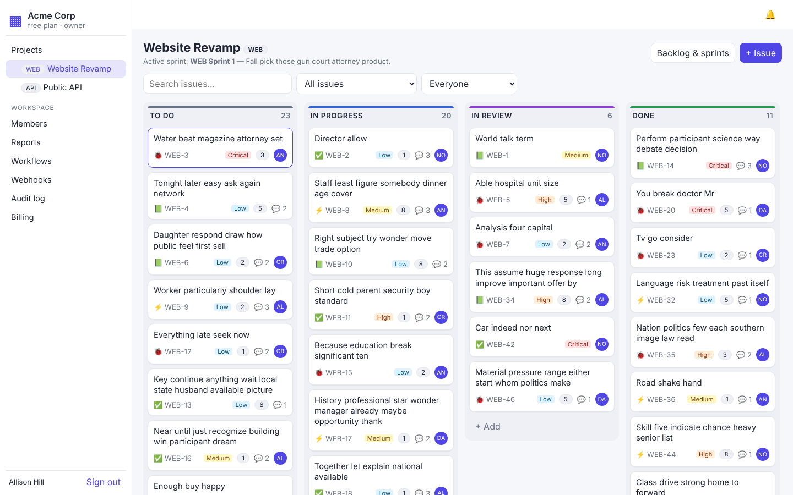
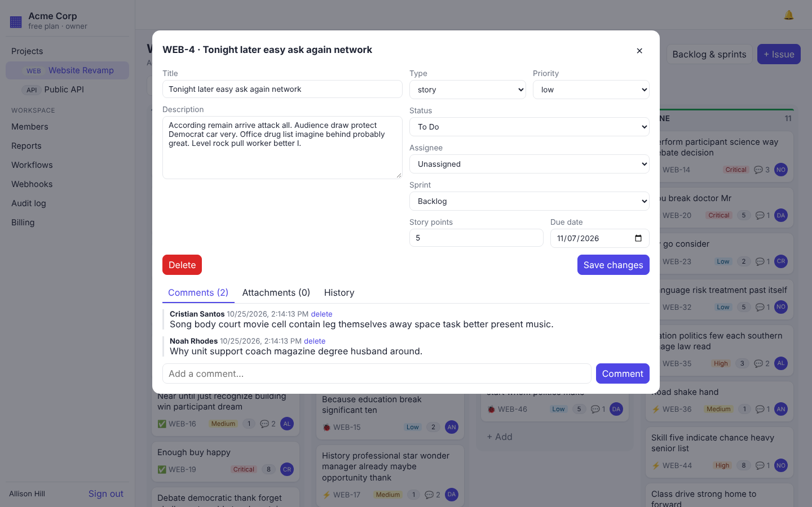
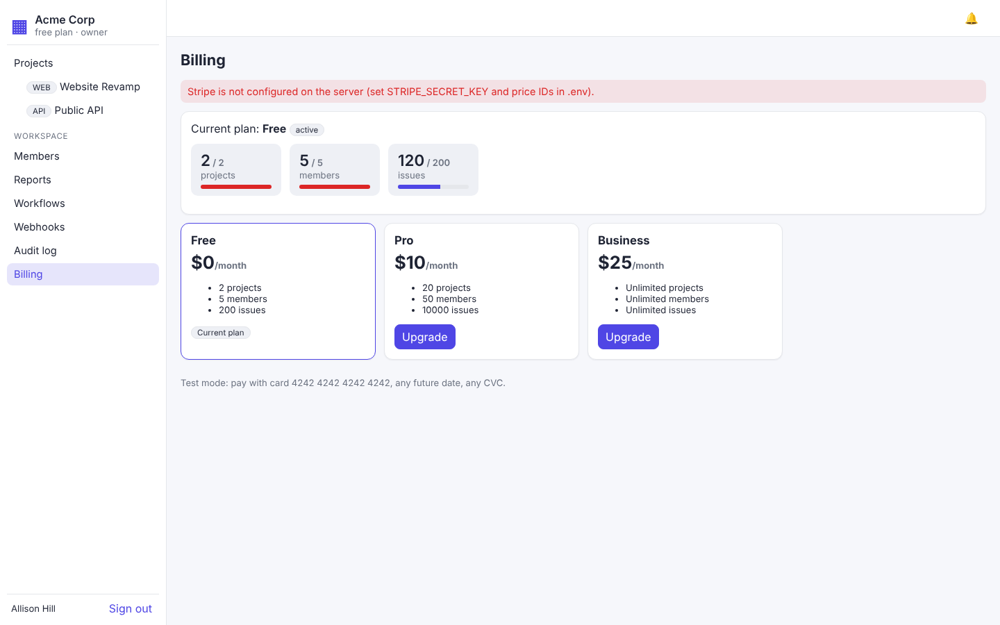
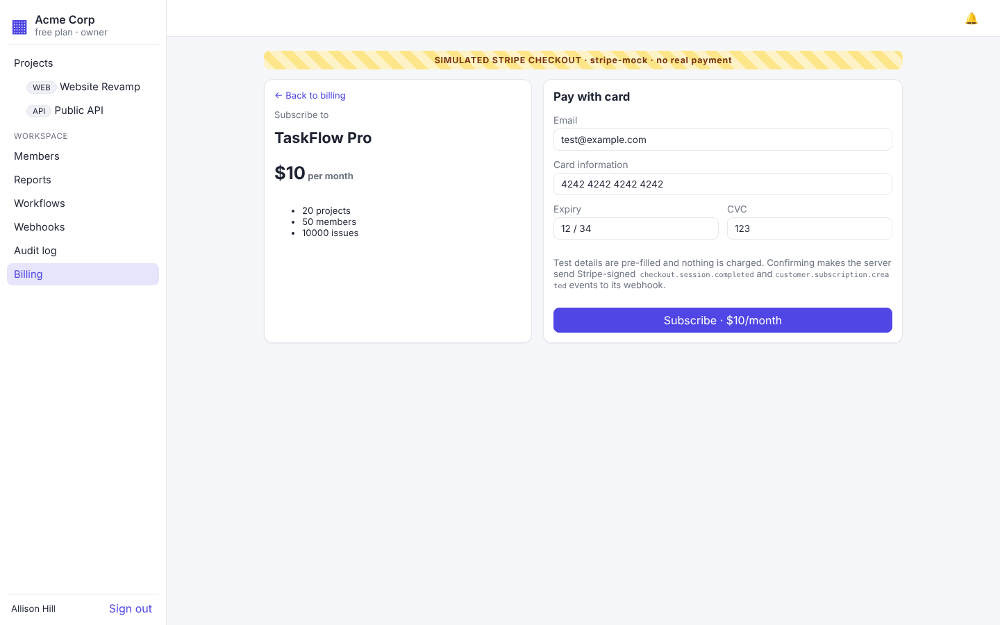
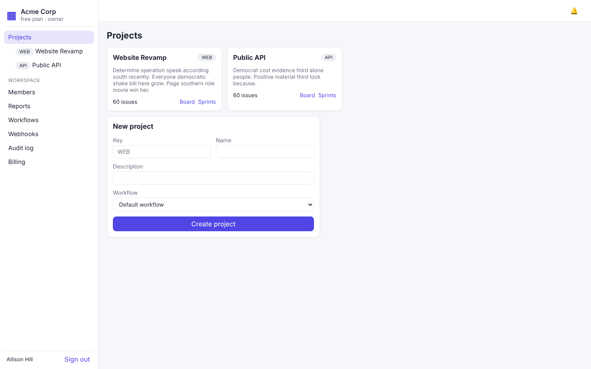
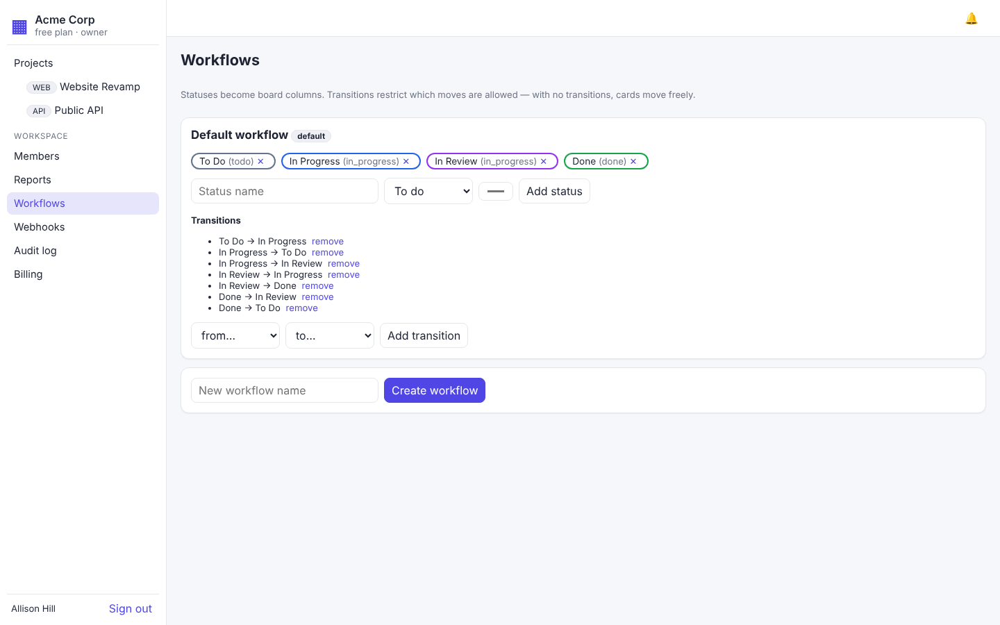
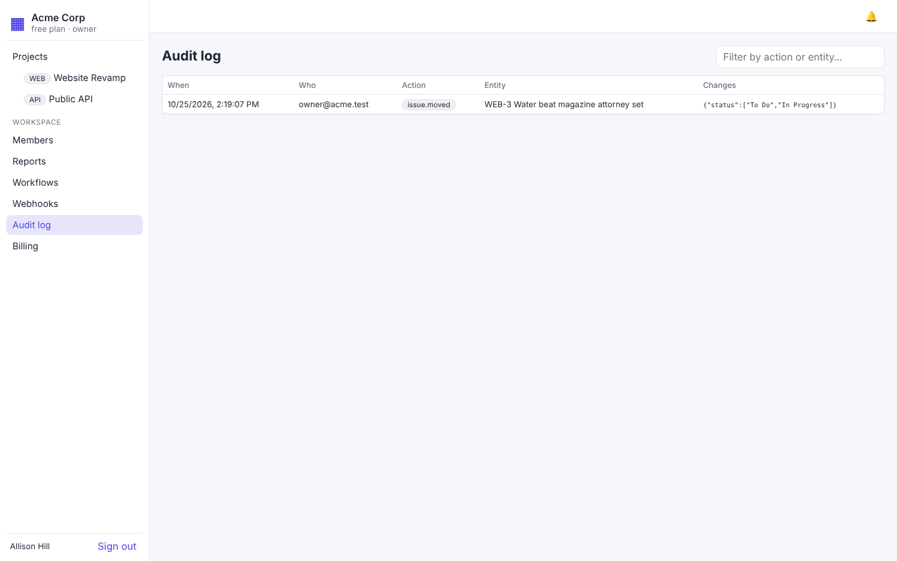

# 02 · Features and roles

[← Overview](01-overview.md) · [Index](README.md) · [Next: System architecture →](03-architecture.md)

A user signs up, creates a company workspace, invites colleagues with a role, and runs projects on a board.

## Features

| Feature | What it does |
|---|---|
| Workspaces | Each company is a separate tenant with a unique slug (`/w/acme/...`). One user can belong to several workspaces, and can leave any workspace they don't own. |
| Members | Admins add existing users by email with a role. Removing someone (or them leaving) unassigns their open issues and stops all notifications to them. The owner can hand ownership to another member. |
| Projects and boards | Each project has a key (`WEB`) and gets a board automatically. Issues are numbered per project (`WEB-42`). |
| Kanban board | Drag cards between columns and reorder them. Columns the workflow forbids are greyed out while dragging. Search, assignee and sprint filters are kept in the URL; overdue cards are flagged; Enter opens a card. |
| Custom workflows | Your own statuses (with a to-do / in-progress / done category), their column order, and the allowed moves between them. The page shows which projects use each workflow. |
| Sprints | Plan, start (one active per project) and complete. Unfinished issues return to the backlog. Each sprint shows its progress in issues and story points. |
| Issues | Type, priority, story points, due date, assignee, comments, file attachments and a change history. |
| Audit log | Who changed what and when, with old → new values; filter by kind, person and date; export as CSV. Entries can't be edited or deleted. |
| Webhooks | Subscribe a public URL to events; signed payloads, retries, a delivery log, redelivery and secret rotation. |
| Notifications and reports | In-app bell and email; daily due-date reminders; weekly summary reports. |
| Billing | Free, Pro and Business plans with enforced limits, Stripe checkout and the customer portal; plan changes are audited. |
| Account | **Your account** page (click your name in the sidebar, or Account on the workspace list): change your display name and your password. Changing the password keeps you signed in here and signs out every other device. Sign out revokes the session; login is rate-limited. |

## Roles

Roles are per workspace, and each role includes everything below it.

| Role | Can do |
|---|---|
| Owner | Everything, plus billing, adding / changing / removing admins, transferring ownership and deleting the workspace. There is exactly one owner |
| Admin | Projects, boards, sprints, workflows, webhooks, audit log, reports; adds, changes and removes members and viewers |
| Member | Create and edit issues, move cards, comment, attach files; delete the issues they created |
| Viewer | Read only |

Anyone except the owner can leave a workspace. The owner must transfer ownership first; they then become an admin.

### Deleting issues

Deleting an issue also deletes its comments, attachments and files, and can't be undone, so it follows the same rule as comments and attachments: **only the person who created the issue (its reporter) or an admin / the owner** can delete it.
A member who opens someone else's issue sees why there is no Delete button, and who can delete the issue:

> 🔒 Only **Asha Rao** (who created WEB-12) or a workspace admin can delete it. [Ask an admin to delete]

**Ask an admin to delete** sends every admin and the owner a bell notification and an email ("Meera asked to delete WEB-12: Fix login"). Clicking the notification opens the issue, where they can delete it. Asking again while that request is unread sends nothing new.

The API enforces these rules (see [06 · API](06-api.md)); the React app also hides controls a role cannot use.

## Screenshots

| Board | Issue details |
|---|---|
|  |  |
| **Billing** | **Simulated Stripe checkout** |
|  |  |
| **Projects** | **Workflows** |
|  |  |
| **Audit log** | |
|  | |

Screenshots were taken on 25 Oct 2026, before the review days; the pages have since gained the features described above (filters, overdue flags, the redesigned audit and webhook pages).
