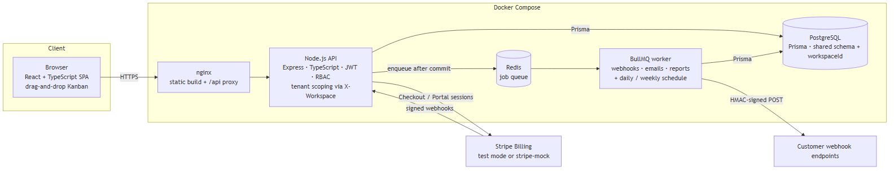
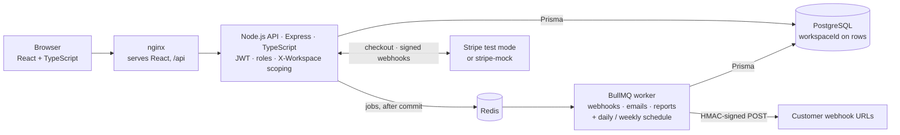

# 03 · System architecture

[← Features and roles](02-features-and-roles.md) · [Index](README.md) · [Next: Multi-tenancy →](04-multi-tenancy.md)

The browser talks only to nginx, which serves the React app and forwards `/api` to one Node.js API shared by every tenant. Slow work goes through a Redis queue to the BullMQ worker.

The diagram's source is [`assets/architecture.mmd`](assets/architecture.mmd). GitHub also renders this version directly:

## Components

| Component | Runs as | Responsibility |
|---|---|---|
| React SPA (TypeScript) | Static files served by nginx | UI; sends the JWT and `X-Workspace` header on every call |
| nginx | `frontend` container | Serves the build; proxies `/api` to the API |
| Node.js API (Express 5, TypeScript) | `backend` container (`node dist/index.js`) | Auth, tenant scoping, permissions, business rules, audit log; applies the Prisma migrations on start |
| PostgreSQL 16 | `db` container | All data, through Prisma; tenant rows carry `workspaceId` |
| Redis 7 | `redis` container | The BullMQ job queue |
| BullMQ worker | `worker` container (`node dist/worker.js`, same image as the API) | Webhook delivery, emails, reports, and the daily and weekly schedule |
| stripe-mock | `stripe-mock` container | Stripe's official API mock, used in billing mock mode |

v1 ran a separate Celery beat container for the schedule. BullMQ's job schedulers live in Redis, so the one worker both registers the schedule and runs the jobs.

## A request, step by step

1. The React app sends `Authorization: Bearer <JWT>` and `X-Workspace: <slug>`.
2. `readUser` and `requireUser` (`src/modules/auth/middleware.ts`) check the token and load the user. `useWorkspace` (`src/modules/tenancy/context.ts`) finds the caller's membership in that workspace and attaches `req.workspace` and `req.membership`. Not a member → **404**.
3. Each route calls `need(req, role)` for the role ladder (`viewer < member < admin < owner`): reads usually need viewer, writes member or admin.
4. The body is validated with Zod (`parse()` in `src/lib/validate.ts`), giving `{field: [messages]}` errors. Every id in the body is looked up within the same workspace (`ref()` / `memberRef()` in `src/modules/tracker/common.ts`).
5. Every write runs in `inTransaction()` (`src/lib/db.ts`) and calls `record()` (`src/modules/audit/service.ts`). That writes the audit entry in the same transaction and queues webhook deliveries with `unit.after()`, so nothing is sent for a change that rolls back.
6. The worker delivers signed webhooks and emails, and runs the scheduled jobs.

## Backend modules

| Module (`src/modules/…`) | Owns |
|---|---|
| `auth` | Register, login, token refresh and logout (rotating refresh tokens), password change, profile, demo-account lock |
| `tenancy` | Workspaces, members, roles, the `X-Workspace` middleware, workspace create/delete and ownership services |
| `tracker` | Workflows, statuses, transitions, projects, boards (and the board view), sprints, issues, comments, attachments |
| `audit` | The append-only audit log, `record()`, the admin log page and CSV export |
| `integrations` | Webhooks (+ SSRF guard), deliveries, notifications, reports, and their background jobs |
| `billing` | Plans and limits, Stripe service, webhook handler, mock mode |
| `demo` | The Faker demo seed, nightly reset and visitor clean-up |

Supporting code: `src/app.ts` (the Express app), `src/config.ts` (settings from the environment, validated with Zod), `src/lib` (database, errors, validation, pagination, email), `src/jobs` (queue, job registry, schedule, worker), `prisma/` (schema and migrations) and `openapi.yaml` (the API description).
