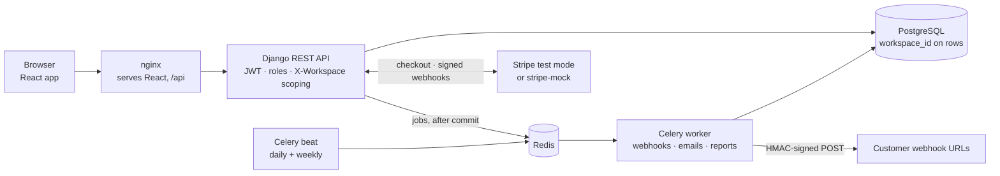

# 03 · System architecture

[← Features and roles](02-features-and-roles.md) · [Index](README.md) · [Next: Multi-tenancy →](04-multi-tenancy.md)

The browser talks only to nginx, which serves the React app and forwards `/api` to one Django API shared by every tenant. Slow work goes through Redis to Celery.

The diagram's source is [`assets/architecture.mmd`](assets/architecture.mmd). GitHub also renders this version directly:

## Components

| Component | Runs as | Responsibility |
|---|---|---|
| React SPA | Static files served by nginx | UI; sends the JWT and `X-Workspace` header on every call |
| nginx | `frontend` container | Serves the build; proxies `/api`, `/admin`, `/static` to Django |
| Django REST API | `backend` container (gunicorn, 3 workers) | Auth, tenant scoping, permissions, business rules, audit log |
| PostgreSQL 16 | `db` container | All data; tenant rows carry `workspace_id` |
| Redis 7 | `redis` container | Celery broker and result store |
| Celery worker | `worker` container | Webhook delivery, emails, reports |
| Celery beat | `beat` container | Schedules daily reminders and weekly reports |
| stripe-mock | `stripe-mock` container | Stripe's official API mock, used in billing mock mode |

## A request, step by step

1. The React app sends `Authorization: Bearer <JWT>` and `X-Workspace: <slug>`.
2. `TenantScopedMixin` (`apps/tenancy/mixins.py`) authenticates the user, finds their membership in that workspace and attaches `request.workspace` and `request.membership`. Not a member → **404**.
3. `WorkspaceRolePermission` checks the role ladder (`viewer < member < admin < owner`). Each view declares `read_role`, `write_role` and optional per-action overrides.
4. The view reads and writes only that workspace's rows. Foreign keys in the request body are validated against the same workspace.
5. Every write calls `audit.services.record()`. It stores an audit entry and queues webhook deliveries with `transaction.on_commit`, so nothing is sent for a change that rolls back.
6. The Celery worker delivers signed webhooks and emails; Celery Beat runs the scheduled jobs.

## Backend apps

| App | Owns |
|---|---|
| `accounts` | Custom email-login `User`, register and profile endpoints |
| `tenancy` | `Workspace`, `Membership`, roles, `TenantScopedMixin`, permissions, workspace create/delete services |
| `tracker` | Workflows, projects, boards, sprints, issues, comments, attachments, the `seed_demo` command |
| `audit` | `AuditLog` and the `record()` helper |
| `integrations` | Webhooks, deliveries, notifications, reports, all Celery tasks |
| `billing` | Plans and limits, `Subscription`, Stripe service, webhook handler, mock mode |
