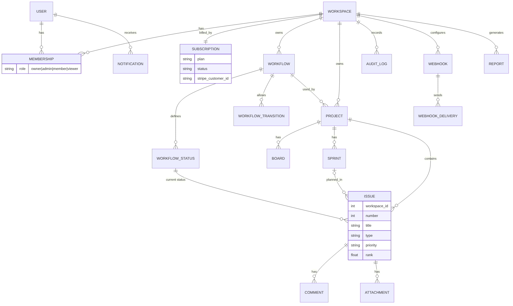

# 05 · Data model

[← Multi-tenancy](04-multi-tenancy.md) · [Index](README.md) · [Next: API reference →](06-api.md)

Nineteen models in six Django apps; everything except `User` and `StripeEvent` belongs to exactly one workspace.

Diagram source: [`assets/erd.mmd`](assets/erd.mmd).

## Models

| Model | App | Belongs to | Key fields and rules |
|---|---|---|---|
| User | accounts | (global) | Email login; joins workspaces through Membership |
| Workspace | tenancy | (the tenant) | Unique `slug`, owner |
| Membership | tenancy | Workspace + User | `role` = owner / admin / member / viewer; unique per pair |
| Workflow | tracker | Workspace | Name; one default per workspace |
| WorkflowStatus | tracker | Workflow | Name, category (todo / in_progress / done), colour, order |
| WorkflowTransition | tracker | Workflow | From status → to status; none defined = free movement |
| Project | tracker | Workspace | `key` unique per workspace; `issue_counter` generates `KEY-N` |
| Board | tracker | Project | Kanban or Scrum; columns = the workflow's statuses |
| Sprint | tracker | Project | planned → active → closed; one active per project |
| Issue | tracker | Project | Number, type, priority, status, sprint, assignee, points, due date, `rank` |
| Comment | tracker | Issue | Author, body |
| Attachment | tracker | Issue | File stored under `workspaces/<id>/`, size, uploader |
| AuditLog | audit | Workspace | Actor, action, entity, JSON diff, IP; append-only |
| Webhook | integrations | Workspace | URL, subscribed events, signing secret |
| WebhookDelivery | integrations | Webhook | Event, payload, status code, attempts |
| Notification | integrations | User in a workspace | Verb, message, read flag |
| Report | integrations | Workspace | Weekly summary data |
| Subscription | billing | Workspace (one-to-one) | Plan, status, Stripe customer and subscription IDs, period end |
| StripeEvent | billing | (global) | Processed Stripe event IDs, for idempotency |

## Design details

- **Issue numbers** come from `Project.issue_counter`, incremented under a row lock (`SELECT … FOR UPDATE`), so two simultaneous creates never get the same key.
- **Card order**: `rank` is a float that orders cards inside a column. A move re-numbers the destination column in one transaction.
- **Protected links**: projects and issues PROTECT their workflow and status, so an admin cannot delete a status that is still in use. Deleting a whole workspace (`delete_workspace()`) removes issues and projects first.
- **Indexes** on `(workspace, project, status)` and `(workspace, assignee)` serve the board and "my issues" queries.
