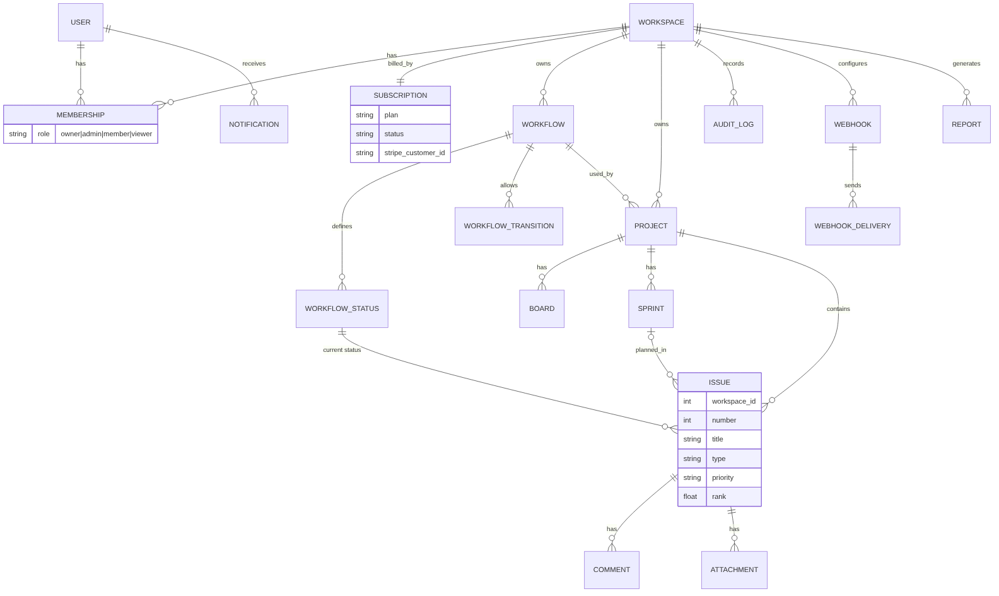

# 05 · Data model

[← Multi-tenancy](04-multi-tenancy.md) · [Index](README.md) · [Next: API reference →](06-api.md)

Twenty tables, defined in [`backend/prisma/schema.prisma`](../backend/prisma/schema.prisma) and created by Prisma migrations; everything except `User`, `RefreshToken` and `StripeEvent` belongs to exactly one workspace. Ids are integers, as the API has always exposed them.

Diagram source: [`assets/erd.mmd`](assets/erd.mmd).

## Models

| Model | Module | Belongs to | Key fields and rules |
|---|---|---|---|
| User | auth | (global) | Email login (stored lower-case), bcrypt password hash; joins workspaces through Membership |
| RefreshToken | auth | User | One row per refresh token issued (`jti`, expiry, `revokedAt`): rotation and logout revoke rows |
| Workspace | tenancy | (the tenant) | Unique `slug`, owner |
| Membership | tenancy | Workspace + User | `role` = owner / admin / member / viewer; unique per pair |
| Workflow | tracker | Workspace | Name; one default per workspace |
| WorkflowStatus | tracker | Workflow | Name, category (todo / in_progress / done), colour, order |
| WorkflowTransition | tracker | Workflow | From status → to status; none defined = free movement |
| Project | tracker | Workspace | `key` unique per workspace; `issue_counter` generates `KEY-N` |
| Board | tracker | Project | Kanban or Scrum; columns = the workflow's statuses |
| Sprint | tracker | Project | planned → active → closed; one active per project |
| Issue | tracker | Project | Number, type, priority, status, sprint, assignee, points, due date, `rank` |
| Comment | tracker | Issue | Author, body |
| Attachment | tracker | Issue | File stored under `workspaces/<id>/`, size, uploader |
| AuditLog | audit | Workspace | Actor and a copy of their email (kept if the account is deleted), action, entity, JSON diff, client IP. Append-only: a database trigger refuses updates and deletes. Deleting the workspace still removes its entries, and deleting a user only clears `actorId` |
| Webhook | integrations | Workspace | URL, subscribed events, signing secret |
| WebhookDelivery | integrations | Webhook | Event, payload, status code, attempts |
| Notification | integrations | User in a workspace | Verb, message, read flag |
| Report | integrations | Workspace | Weekly summary data |
| Subscription | billing | Workspace (one-to-one) | Plan, status, Stripe customer and subscription IDs, period end |
| StripeEvent | billing | (global) | Processed Stripe event IDs, for idempotency |

## Design details

- **Issue numbers** come from `Project.issueCounter`, incremented under a row lock (`SELECT … FOR UPDATE`), so two simultaneous creates never get the same key (a test creates six at once).
- **Card order**: `rank` is a float that orders cards inside a column. A move re-numbers the destination column in one transaction.
- **Protected links**: projects and issues restrict deleting their workflow and status (`onDelete: Restrict`), so an admin cannot delete a status that is still in use. Deleting a whole workspace (`deleteWorkspace()`) removes issues and projects first.
- **Indexes** on `(workspaceId, projectId, statusId)` and `(workspaceId, assigneeId)` serve the board and "my issues" queries.
- **Rules held by the database**, so they survive two requests arriving at the same moment:
  - only one `active` sprint per project (a partial unique index; a second Start gets 400, not a server error);
  - only one default workflow per workspace (a partial unique index);
  - audit entries can't be changed or deleted (a trigger);
  - a sprint's `end_date` is never before its `start_date` (a check constraint; the API also compares a PATCHed date with the saved one).
- **Validated values**: status colours must be `#rrggbb`, because the frontend puts them in CSS; project keys are ASCII `A–Z` and `0–9` only.
- **Cross-tenant checks**: every id in a request (an issue's project, status, sprint and assignee, a project's workflow and lead, a comment's issue…) is looked up within the same workspace, and users must be members. v1 also had a Django admin site with its own checks; v2 has no admin site (Prisma Studio, `npx prisma studio`, is for local inspection only).
- **Attachment files** are deleted from storage after the row is deleted and the transaction commits, also when an issue, project or workspace is deleted. A failed delete keeps the file.
- Prisma's schema language can't express partial unique indexes, check constraints or triggers, so those are raw SQL at the end of the first migration (`prisma/migrations/20261117000000_init/migration.sql`).
