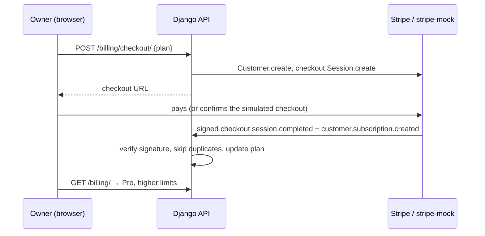

# 09 · Billing

[← Background jobs](08-background-jobs.md) · [Index](README.md) · [Next: Security →](10-security.md)

Each workspace has a plan whose limits the API enforces; going over a limit returns **HTTP 402** with an upgrade message. Stripe's webhook is the single source of truth for plan changes.

## Plans (`apps/billing/plans.py`)

| Plan | Price | Projects | Members | Issues |
|---|---|---|---|---|
| Free | $0 | 2 | 5 | 200 |
| Pro | $10 / month | 20 | 50 | 10,000 |
| Business | $25 / month | Unlimited | Unlimited | Unlimited |

`enforce_limit()` runs before a project, member or issue is created. A past-due or cancelled subscription falls back to Free limits.

## Upgrade flow

1. The owner clicks **Upgrade**. The API creates a Stripe customer and a Checkout Session for the plan's price.
2. The owner pays on the checkout page.
3. Stripe sends signed events to `/api/billing/stripe-webhook/`.
4. The handler verifies the signature, skips events it has already processed (stored event IDs) and updates the plan and renewal date.
5. **Manage subscription** (Customer Portal) handles plan changes and cancellation the same way.

## Two modes, chosen in `.env`

| Mode | Used when | Checkout page | Webhooks |
|---|---|---|---|
| Mock (`STRIPE_MOCK=true`, default) | No Stripe account. New Stripe accounts in India are invite-only. | Simulated page in the app, clearly labelled | Built in Stripe's format, signed with Stripe's scheme, sent through the real handler |
| Real test mode (`STRIPE_MOCK=false`) | Stripe test keys available | Stripe's hosted Checkout | Sent by Stripe |

In mock mode every Stripe SDK call goes to `stripe-mock`, Stripe's official mock server, which checks each request against Stripe's API specification.
Confirming the simulated checkout calls `POST /api/billing/mock/complete/`. That endpoint builds the events Stripe would send, signs them with `STRIPE_WEBHOOK_SECRET` (`t=…,v1=HMAC-SHA256`) and runs them through the same `process_webhook()` function real Stripe events use.

Switching modes changes only `.env`, not code, and neither mode ever charges money. Real test-mode setup is in the [accounts guide](guides/ACCOUNTS_SETUP.md).

## Handled Stripe events

| Event | Effect |
|---|---|
| `checkout.session.completed` | Stores the customer and subscription IDs |
| `customer.subscription.created` / `updated` | Sets plan (from the price ID), status and renewal date |
| `customer.subscription.deleted` | Back to Free; clears the renewal date |
| `invoice.payment_failed` | Marks the subscription past due (Free limits apply) |
