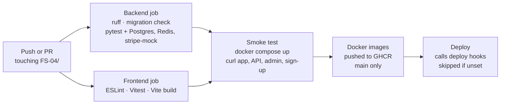

# 11 · DevOps

[← Security](10-security.md) · [Index](README.md) · [Next: Testing and performance →](12-testing.md)

One command, `docker compose up --build`, starts the whole product locally; GitHub Actions tests every change and builds images from `main`.

## Docker Compose services (`docker-compose.yml`)

| Service | Image | Purpose |
|---|---|---|
| `db` | postgres:16-alpine | Database, with a persistent volume (port 5432 on `127.0.0.1` only) |
| `redis` | redis:7-alpine | Celery queue and results (not published) |
| `backend` | built from `backend/Dockerfile` | Django API on gunicorn (port 8000 on `127.0.0.1`); runs migrations on start; `WEB_CONCURRENCY` worker processes (3) |
| `worker` | same image | Celery worker |
| `beat` | same image | Celery scheduler |
| `stripe-mock` | stripe/stripe-mock **v0.206.0** | Stripe's mock API (port 12111 on `127.0.0.1`) |
| `frontend` | built from `frontend/Dockerfile` | nginx serving the React build and proxying `/api`, `/admin` and `/static` (port `FRONTEND_PORT`, default 3000) |

Start-up order is driven by health checks: the backend waits for PostgreSQL and Redis; the Celery worker, beat and the frontend wait until the backend is **healthy**, which means its migrations have run (before, a worker could start a task against tables that didn't exist yet). Every service has `restart: unless-stopped`, so the stack comes back by itself after Docker Desktop restarts. Uploaded files live in a `media` volume.

Only the app port is reachable from other machines on your network. The database, API and stripe-mock ports are published on `127.0.0.1` for local tools and the test suite, so the demo database with its default password isn't open to the Wi-Fi.

If port 3000 is taken (for example by a dev server), set `FRONTEND_PORT=3001` in `.env`.

### Images

- `backend/.dockerignore` keeps the local virtualenv, caches, coverage files and `.env` out of the build context. Before, the whole `.venv` (hundreds of MB of Windows binaries) was sent to Docker on every build.
- The backend runs as a non-root `app` user; static files are collected at build time and served by WhiteNoise.
- stripe-mock is pinned to the same version in Compose and CI, so a new release can't change test results without a commit.

### nginx (`frontend/nginx.conf`)

| Setting | Why |
|---|---|
| `/assets/*` cached for a year (`immutable`) | Vite puts a content hash in each file name, so a changed file has a new name |
| `index.html` sent with `no-cache` | After a deploy, browsers fetch the new page and its new assets instead of the old release |
| gzip for JS, CSS, JSON and SVG | The 334 kB bundle goes over the wire as about 104 kB |
| `X-Content-Type-Options`, `X-Frame-Options: DENY`, `Referrer-Policy` | Basic hardening: no MIME sniffing, no framing (clickjacking), no full URLs leaked to other sites |
| `X-Forwarded-For` on `/api`, `/admin` and `/static` | The audit log records the real client IP for Django admin actions too |
| `server_tokens off` | Doesn't advertise the nginx version |

## CI/CD pipeline (`.github/workflows/fs04-ci.yml`)

| Job | Runs on | Steps |
|---|---|---|
| Backend | Every push / PR | ruff lint, `makemigrations --check`, pytest with PostgreSQL, Redis and stripe-mock service containers; **fails if line coverage drops below 90%** (`--cov-fail-under=90`; it's 96% today); uploads JUnit and coverage reports |
| Frontend | Every push / PR | `npm ci`, ESLint, Vitest, production build |
| Smoke test | Every push / PR, after both pass | Starts the real Docker Compose stack from `.env.example` and checks it answers through nginx: the React page, `/api/health/`, the API schema, Django admin, the security headers, and a **sign-up** (which exercises Django, PostgreSQL and the migrations). Prints the container logs if anything fails |
| Docker | `main` only, after the smoke test | Builds backend and frontend images and pushes them to GitHub Container Registry |
| Deploy | `main` only, after Docker | POSTs to `BACKEND_DEPLOY_HOOK` / `FRONTEND_DEPLOY_HOOK` secrets (e.g. Render); skipped when they are not set. A configured hook that fails now fails the job (it used to be ignored for the frontend) |

The workflow's token is read-only by default; only the image job gets permission to write packages. Every job has a time limit, so a hung step can't burn CI minutes for hours.

The project lives in the repo's `FS-04/` subfolder, so the workflow sits at the repository root and every path is prefixed with `FS-04/`. It only runs when files under `FS-04/` change.

## Cost

Everything uses free tiers: Docker Desktop, GitHub Actions minutes, GitHub Container Registry and Stripe test mode / stripe-mock. The deploy step stays skipped unless you add hooks.
