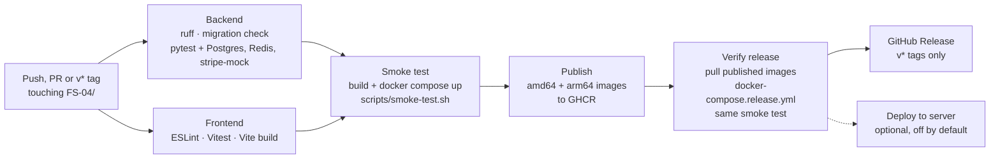
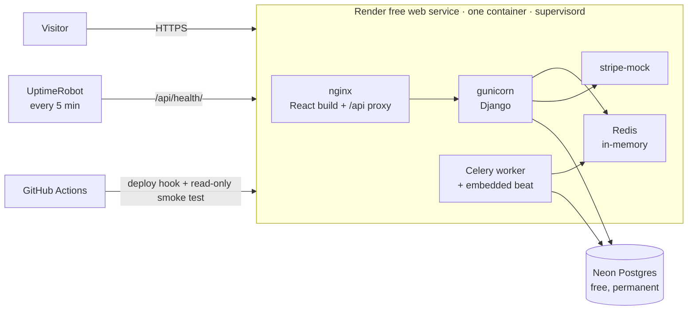

# 11 · DevOps

[← Security](10-security.md) · [Index](README.md) · [Next: Testing and performance →](12-testing.md)

One command, `docker compose up --build`, starts the whole product locally. GitHub Actions tests every change, then deploys it as versioned, verified Docker images that anyone can run with one command.

## Docker Compose services (`docker-compose.yml`)

| Service | Image | Purpose |
|---|---|---|
| `db` | postgres:16-alpine | Database, with a persistent volume (port 5432 on `127.0.0.1` only) |
| `redis` | redis:7-alpine | Celery queue and results (not published) |
| `backend` | built from `backend/Dockerfile` | Django API on gunicorn (port 8000 on `127.0.0.1`); runs migrations on start; `WEB_CONCURRENCY` worker processes (3) |
| `worker` | same image | Celery worker |
| `beat` | same image | Celery scheduler |
| `stripe-mock` | stripe/stripe-mock **v0.206.0** | Stripe's mock API (port 12111 on `127.0.0.1`) |
| `frontend` | built from `frontend/Dockerfile` | nginx serving the React build and proxying `/api`, `/admin` and `/static` (port `FRONTEND_PORT`, default 3000) |

Start-up order is driven by health checks: the backend waits for PostgreSQL and Redis; the Celery worker, beat and the frontend wait until the backend is **healthy**, which means its migrations have run (before, a worker could start a task against tables that didn't exist yet). Every service has `restart: unless-stopped`, so the stack comes back by itself after Docker Desktop restarts. Uploaded files live in a `media` volume.

Only the app port is reachable from other machines on your network. The database, API and stripe-mock ports are published on `127.0.0.1` for local tools and the test suite, so the demo database with its default password isn't open to the Wi-Fi.

If port 3000 is taken (for example by a dev server), set `FRONTEND_PORT=3001` in `.env`.

### Images

- `backend/.dockerignore` keeps the local virtualenv, caches, coverage files and `.env` out of the build context. Before, the whole `.venv` (hundreds of MB of Windows binaries) was sent to Docker on every build.
- The backend runs as a non-root `app` user; static files are collected at build time and served by WhiteNoise.
- stripe-mock is pinned to the same version in Compose and CI, so a new release can't change test results without a commit.

### nginx (`frontend/nginx.conf`)

| Setting | Why |
|---|---|
| `/assets/*` cached for a year (`immutable`) | Vite puts a content hash in each file name, so a changed file has a new name |
| `index.html` sent with `no-cache` | After a deploy, browsers fetch the new page and its new assets instead of the old release |
| gzip for JS, CSS, JSON and SVG | The 334 kB bundle goes over the wire as about 104 kB |
| `X-Content-Type-Options`, `X-Frame-Options: DENY`, `Referrer-Policy` | Basic hardening: no MIME sniffing, no framing (clickjacking), no full URLs leaked to other sites |
| `X-Forwarded-For` on `/api`, `/admin` and `/static` | The audit log records the real client IP for Django admin actions too |
| `server_tokens off` | Doesn't advertise the nginx version |

## CI/CD pipeline (`.github/workflows/fs04-ci.yml`)



| Job | Runs on | Steps |
|---|---|---|
| Backend | Every push / PR | ruff lint, `makemigrations --check`, pytest with PostgreSQL, Redis and stripe-mock service containers; **fails if line coverage drops below 90%** (`--cov-fail-under=90`; it's 96% today); uploads JUnit and coverage reports |
| Frontend | Every push / PR | `npm ci`, ESLint, Vitest, production build |
| Smoke test | Every push / PR, after both pass | Builds and starts the real Docker Compose stack from `.env.example` and runs `scripts/smoke-test.sh` through nginx: the React page, `/api/health/`, the API schema, Django admin, the security headers, and a **sign-up** (which exercises Django, PostgreSQL and the migrations). Prints the container logs if anything fails |
| Publish | Pushes to `main` and `v*` tags, after the smoke test | Builds both images for `linux/amd64` and `linux/arm64` and pushes them to GitHub Container Registry with `latest` + `sha-<commit>` tags (and `1.2.3` + `1.2` for a version tag), plus OCI labels linking them to this repository |
| Verify release | After publish | Pulls exactly the images just published (nothing is built), starts them with `docker-compose.release.yml` and runs the same smoke test. Recorded as a deployment to the **`release`** environment on the repository's Deployments page |
| GitHub Release | `v*` tags, after verification | Creates the release with notes, image names and the two files needed to run it |
| Deploy to server | Only when the repository variable `DEPLOY_ENABLED` is `true` | Calls the `BACKEND_DEPLOY_HOOK` / `FRONTEND_DEPLOY_HOOK` secrets; fails if enabled without them. Skipped otherwise, so it never records a deployment that didn't happen |

The workflow's token is read-only by default; only the image job gets permission to write packages. Every job has a time limit, so a hung step can't burn CI minutes for hours.

The project lives in the repo's `FS-04/` subfolder, so the workflow sits at the repository root and every path is prefixed with `FS-04/`. It only runs when files under `FS-04/` change.

## Releases and deployment

"Deploy" here means: the tested code is turned into versioned Docker images, published where anyone can pull them, and **proven to work by running the published images** before the release counts as good.

| What | Where to see it |
|---|---|
| Every successful `main` build | Images `fs04-backend` and `fs04-frontend` in GitHub Container Registry (public), tagged `latest` and `sha-<commit>` |
| Proof the published images work | The **Verify published release** job; the repository's **Deployments** page lists each one under `release` |
| Versioned releases | Push a tag such as `v1.0.0` → images tagged `1.0.0` and `1.0`, and a **GitHub Release** with run instructions, `docker-compose.release.yml` and `taskflow.env.example` |

Running a release needs only Docker and two files in one folder: `docker-compose.release.yml` and `.env` (a copy of `.env.example`). The version and port are **lines in `.env`** (`TASKFLOW_TAG=1.0.0`, `FRONTEND_PORT=3002`), so the same command works in PowerShell, macOS Terminal and Linux shells:

```bash
docker compose -f docker-compose.release.yml up -d --wait
```

Step-by-step Windows and macOS/Linux commands are in the [README](../README.md#run-the-released-version-no-build). A GitHub Release is a download; nothing is hosted, so `localhost` works only once it's running.

This repository also holds another capstone project, so GitHub's "latest release" can belong to either. **Plain `v*` tags (v1.0.0, v1.0.1…) belong to FS-04** and start this pipeline's release job; other projects must use their own prefix (for example `fs01-v1.0.0`). The README's download commands name the FS-04 tag (`releases/download/v1.0.1/…`) rather than "latest" for the same reason.

`docker-compose.release.yml` mirrors `docker-compose.yml` but pulls the two app images instead of building them, and uses its own project name (`taskflow-release`) so it can't collide with a source-built stack on the same machine. It doesn't publish the database or stripe-mock ports at all.

**A live server (optional):** the `deploy-server` job is ready for a server or platform with a deploy hook. Set the repository variable `DEPLOY_ENABLED=true` and the hook secrets to switch it on; images already run on ARM servers such as Oracle Cloud's free tier.

## Live deployment (free, always on)

The public demo runs on free tiers only. Every option was compared first; the others failed on cost, capacity or "always on":

| Option (checked Nov 2026) | Why not |
|---|---|
| Oracle Cloud Always Free ARM | No ARM capacity in the Indian region for weeks |
| AWS Free plan EC2 | Credits only, account closes after 6 months; already used by another project |
| Google Cloud e2-micro | 1 GB RAM, US only, a billed account after the trial |
| Hugging Face Spaces (Docker) | Docker Spaces now need a paid plan |
| Fly.io, Railway, Koyeb | Trial credit or a card hold, not a free tier |
| Vercel, Netlify, Cloudflare Pages | Static sites only: no Django, Celery, Postgres or Redis |
| Your own PC + Cloudflare Tunnel | Only online while the PC is on |



| Piece | Free tier | Why it fits |
|---|---|---|
| **Render web service** | 512 MB RAM, 0.1 CPU, 750 instance hours a month; sleeps after 15 min without traffic | Free plans have no background workers, so `deploy/render/Dockerfile` runs **every process in one container** under supervisord: nginx, gunicorn (1 worker, 4 threads), Celery `--pool=solo -B` (worker and beat in one process), Redis and the stripe-mock binary. Measured: **about 200–240 MB** in use under a 512 MB / 0.1 CPU limit |
| **Neon Postgres** | 1 GB, permanent, no card; scales to zero after 5 min idle | Render's free Postgres expires after 30 days; Neon doesn't. Connections are health-checked (`conn_health_checks`), since a sleeping database drops them |
| **UptimeRobot** | 5-minute checks, email alerts | Its checks keep the Render service awake 24/7 (~744 of the 750 free hours). `/api/health/` doesn't touch the database, so Neon still sleeps when nobody uses the app |

**Deploys:** after the published release is verified, the `deploy-server` job calls the Render deploy hook with `ref=<commit>`, waits until `/api/health/` reports that commit (`APP_VERSION`, taken from Render's `RENDER_GIT_COMMIT`), then runs `scripts/smoke-test.sh --read-only` against the live site (it signs in with the demo login and creates nothing). Render's own auto-deploy is turned off, so only tested commits go live.

**Inside the container:** every program runs as the non-root user `app` with `HOME=/home/app` (supervisord would otherwise keep root's `HOME`, which breaks SSL database connections), the system resolver prefers IPv4 (Render has no IPv6 route; Neon publishes both), and Redis and stripe-mock listen only inside the container.

**Container start-up** (`deploy/render/start.sh`): derives allowed hosts and CSRF origins from Render's `RENDER_EXTERNAL_HOSTNAME`, applies migrations, then starts supervisord. A one-off `seed` program creates the demo companies if they're missing. A cold start takes about 2 minutes on 0.1 CPU; that only happens on a deploy or a platform restart. Render's health check uses `/healthz`, which nginx answers itself.

**Settings on the live site** (image defaults, plus two secrets set on Render): `DJANGO_DEBUG=false`, `DEMO_MODE=true`, `SECURE_PROXY_SSL=true`, `STRIPE_MOCK=true`, `TRUSTED_PROXY_COUNT=2` (Render's proxy + our nginx), and the secrets `DATABASE_URL` (Neon) and `DJANGO_SECRET_KEY`.

**Demo mode:** the published demo logins can't change their password or profile. The demo companies are rebuilt every night at 02:30 IST, and accounts or workspaces visitors create are removed after 7 days (see [Security](10-security.md)).

**Limits:** pages are slower than locally (0.1 CPU); attachments uploaded on the live site are lost on redeploy (the container disk isn't permanent); free tiers can change, and UptimeRobot emails you if the site goes down.

## Cost

Everything uses free tiers: Docker Desktop, GitHub Actions minutes, GitHub Container Registry (public images), Stripe's stripe-mock, and for the live site Render (free web service), Neon (free Postgres) and UptimeRobot (free monitoring). Nothing is billed unless a plan is upgraded by hand.
