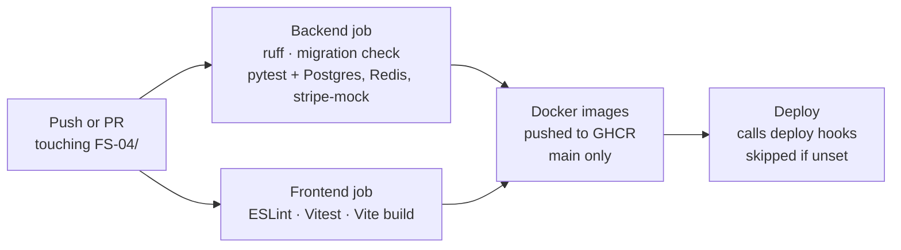

# 11 · DevOps

[← Security](10-security.md) · [Index](README.md) · [Next: Testing and performance →](12-testing.md)

One command, `docker compose up --build`, starts the whole product locally; GitHub Actions tests every change and builds images from `main`.

## Docker Compose services (`docker-compose.yml`)

| Service | Image | Purpose |
|---|---|---|
| `db` | postgres:16-alpine | Database, with a persistent volume |
| `redis` | redis:7-alpine | Celery queue and results |
| `backend` | built from `backend/Dockerfile` | Django API on gunicorn (port 8000); runs migrations on start |
| `worker` | same image | Celery worker |
| `beat` | same image | Celery scheduler |
| `stripe-mock` | stripe/stripe-mock | Stripe's mock API (port 12111) |
| `frontend` | built from `frontend/Dockerfile` | nginx serving the React build and proxying `/api` (port 3000) |

Health checks make the backend wait for PostgreSQL and Redis. Uploaded files live in a `media` volume.

## CI/CD pipeline (`.github/workflows/fs04-ci.yml`)

| Job | Runs on | Steps |
|---|---|---|
| Backend | Every push / PR | ruff lint, `makemigrations --check`, pytest with PostgreSQL, Redis and stripe-mock service containers; **fails if line coverage drops below 90%** (`--cov-fail-under=90`; it's 96% today); uploads JUnit and coverage reports |
| Frontend | Every push / PR | `npm ci`, ESLint, Vitest, production build |
| Docker | `main` only, after both pass | Builds backend and frontend images and pushes them to GitHub Container Registry |
| Deploy | `main` only, after Docker | POSTs to `BACKEND_DEPLOY_HOOK` / `FRONTEND_DEPLOY_HOOK` secrets (e.g. Render); skipped when they are not set |

The project lives in the repo's `FS-04/` subfolder, so the workflow sits at the repository root and every path is prefixed with `FS-04/`. It only runs when files under `FS-04/` change.

## Cost

Everything uses free tiers: Docker Desktop, GitHub Actions minutes, GitHub Container Registry and Stripe test mode / stripe-mock. The deploy step stays skipped unless you add hooks.
