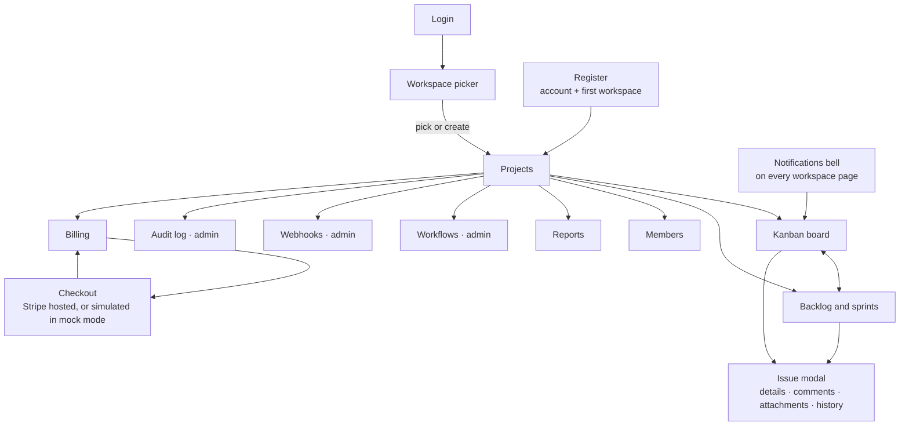
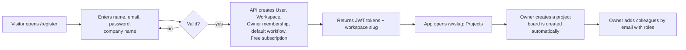
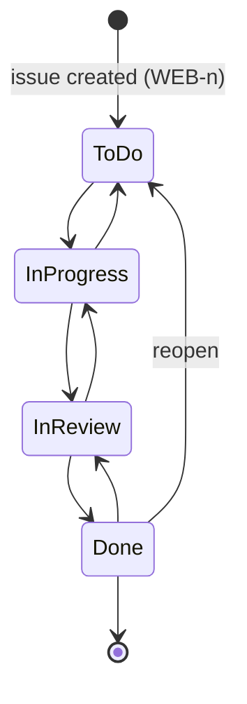
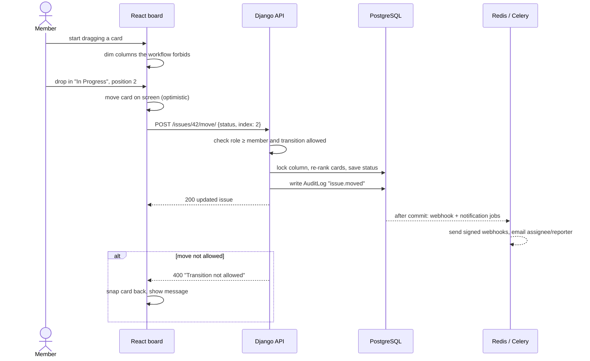
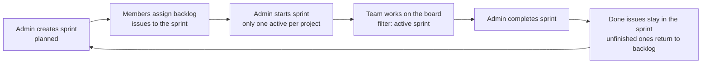
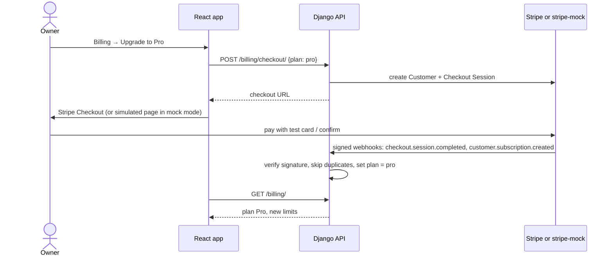
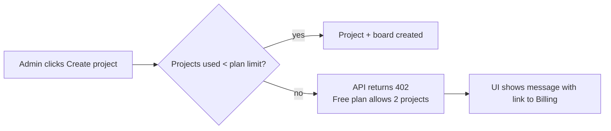

# App flow · TaskFlow

[← Technical Requirements](02-trd.md) · [Index](../README.md) · [Next: Implementation plan →](04-implementation-plan.md)

How users move through the app, and what happens behind each key action. The diagrams render on GitHub.

## 1. Screen map

## 2. Onboarding

## 3. Daily work: issue lifecycle

These are the default workflow's transitions. Admins can define their own on the Workflows page; with no transitions defined, any move is allowed.

## 4. Drag-and-drop a card

## 5. Sprint cycle

## 6. Upgrade a plan

## 7. Hitting a plan limit

## 8. Role-based access at a glance

| Screen / action | Viewer | Member | Admin | Owner |
|---|---|---|---|---|
| View projects, board, issues, members, billing | ✅ | ✅ | ✅ | ✅ |
| Create / edit issues, drag cards, comment, attach | | ✅ | ✅ | ✅ |
| Reports | | ✅ (view) | ✅ (+ generate) | ✅ |
| Projects, sprints, workflows, members, webhooks, audit log | | | ✅ | ✅ |
| Upgrade / manage plan, delete workspace | | | | ✅ |
