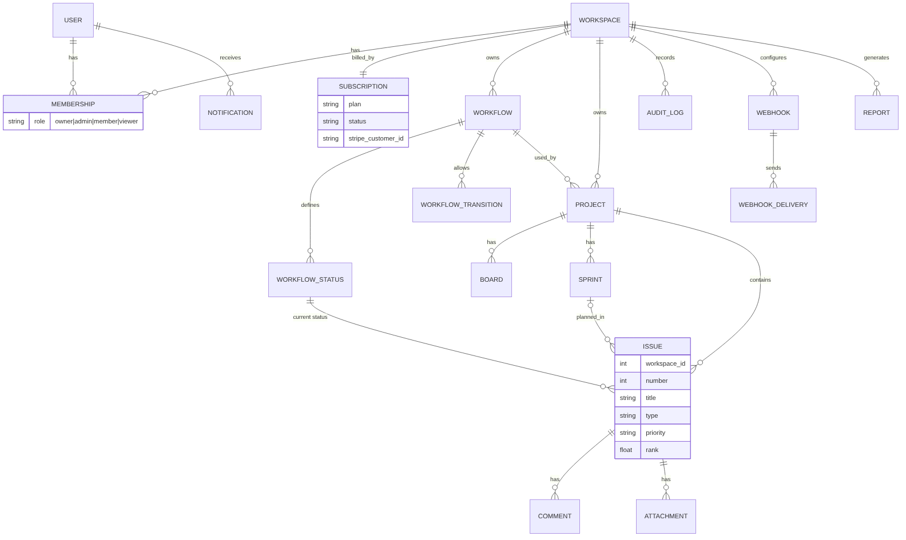

# Backend schema · TaskFlow

[← UI/UX design brief](05-ui-ux-design-brief.md) · [Index](../README.md)

The PostgreSQL schema of v2.0.0, defined in [`backend/prisma/schema.prisma`](../../backend/prisma/schema.prisma) and created by the Prisma migrations in `backend/prisma/migrations/`. This page is generated from that file. 20 tables; every table except `users`, `refresh_tokens` and `stripe_events` belongs to one workspace through its `workspaceId` column.
`id` is an `integer` identity primary key on every table (the API has always exposed integer ids). Timestamps are `timestamp(3)` in UTC, set automatically (`createdAt` on insert, `updatedAt` on every update). Column names are the Prisma field names (camelCase); the API sends them in snake_case.

(v1 used Django's tables, `accounts_user`, `tracker_issue` and so on, with the same columns in snake_case.)

## Entity-relationship diagram

Diagram source: [`../assets/erd.mmd`](../assets/erd.mmd).

## Rules beyond the column definitions

Prisma's schema language can't express these, so they are raw SQL at the end of the first migration:

| Rule | How |
|---|---|
| One default workflow per workspace | Partial unique index `one_default_workflow_per_workspace` on `workflows (workspaceId) WHERE "isDefault"` |
| One active sprint per project | Partial unique index `one_active_sprint_per_project` on `sprints (projectId) WHERE state = 'active'` |
| A sprint ends on or after it starts | Check constraint `sprint_ends_after_it_starts` |
| The audit log is append-only | Trigger `audit_logs_append_only`: every `UPDATE` or `DELETE` on `audit_logs` is refused, except the ones foreign-key cascades make (deleting a workspace removes its entries; deleting a user clears `actorId`) |

Cross-tenant references are checked by the API: every id in a request is looked up within the caller's workspace before it is stored.

## People and workspaces

### `users`

| Column | Type | Constraints / default | Notes |
|---|---|---|---|
| id | integer | PK, default identity |  |
| email | text | unique | stored lower-case |
| password | text |  | bcrypt hash |
| fullName | text | default "" |  |
| isStaff | boolean | default false |  |
| dateJoined | timestamp(3) | default now |  |

### `refresh_tokens`: One row per refresh token issued; rotation and logout set revokedAt (the blacklist).

| Column | Type | Constraints / default | Notes |
|---|---|---|---|
| id | integer | PK, default identity |  |
| jti | text | unique |  |
| userId | integer | FK → users, CASCADE |  |
| createdAt | timestamp(3) | default now |  |
| expiresAt | timestamp(3) |  |  |
| revokedAt | timestamp(3) | null |  |

Indexes: `index (userId)`.

### `workspaces`

| Column | Type | Constraints / default | Notes |
|---|---|---|---|
| id | integer | PK, default identity |  |
| name | text |  |  |
| slug | text | unique |  |
| ownerId | integer | FK → users, RESTRICT |  |
| createdAt | timestamp(3) | default now |  |

### `memberships`

| Column | Type | Constraints / default | Notes |
|---|---|---|---|
| id | integer | PK, default identity |  |
| workspaceId | integer | FK → workspaces, CASCADE |  |
| userId | integer | FK → users, CASCADE |  |
| role | enum `Role` | default member | `owner` / `admin` / `member` / `viewer` |
| joinedAt | timestamp(3) | default now |  |

Indexes: `unique (workspaceId, userId)`; `index (userId)`.

## Workflows

### `workflows`

| Column | Type | Constraints / default | Notes |
|---|---|---|---|
| id | integer | PK, default identity |  |
| workspaceId | integer | FK → workspaces, CASCADE |  |
| name | text |  |  |
| isDefault | boolean | default false |  |
| createdAt | timestamp(3) | default now |  |

Indexes: `index (workspaceId)`.

### `workflow_statuses`

| Column | Type | Constraints / default | Notes |
|---|---|---|---|
| id | integer | PK, default identity |  |
| workspaceId | integer | FK → workspaces, CASCADE |  |
| workflowId | integer | FK → workflows, CASCADE |  |
| name | text |  |  |
| category | enum `StatusCategory` | default todo | `todo` / `in_progress` / `done` |
| color | text | default "#64748b" |  |
| order | integer | default 0 |  |

Indexes: `unique (workflowId, name)`; `index (workspaceId)`.

### `workflow_transitions`

| Column | Type | Constraints / default | Notes |
|---|---|---|---|
| id | integer | PK, default identity |  |
| workspaceId | integer | FK → workspaces, CASCADE |  |
| workflowId | integer | FK → workflows, CASCADE |  |
| fromStatusId | integer | FK → workflow_statuses, CASCADE |  |
| toStatusId | integer | FK → workflow_statuses, CASCADE |  |

Indexes: `unique (workflowId, fromStatusId, toStatusId)`; `index (workspaceId)`.

## Projects, boards, sprints

### `projects`

| Column | Type | Constraints / default | Notes |
|---|---|---|---|
| id | integer | PK, default identity |  |
| workspaceId | integer | FK → workspaces, CASCADE |  |
| key | text |  |  |
| name | text |  |  |
| description | text | default "" |  |
| workflowId | integer | FK → workflows, RESTRICT |  |
| leadId | integer | null, FK → users, SETNULL |  |
| issueCounter | integer | default 0 |  |
| createdAt | timestamp(3) | default now |  |

Indexes: `unique (workspaceId, key)`.

### `boards`

| Column | Type | Constraints / default | Notes |
|---|---|---|---|
| id | integer | PK, default identity |  |
| workspaceId | integer | FK → workspaces, CASCADE |  |
| projectId | integer | FK → projects, CASCADE |  |
| name | text |  |  |
| kind | enum `BoardKind` | default kanban | `kanban` / `scrum` |
| createdAt | timestamp(3) | default now |  |

Indexes: `index (workspaceId)`; `index (projectId)`.

### `sprints`

| Column | Type | Constraints / default | Notes |
|---|---|---|---|
| id | integer | PK, default identity |  |
| workspaceId | integer | FK → workspaces, CASCADE |  |
| projectId | integer | FK → projects, CASCADE |  |
| name | text |  |  |
| goal | text | default "" |  |
| startDate | date | null |  |
| endDate | date | null |  |
| state | enum `SprintState` | default planned | `planned` / `active` / `closed` |
| createdAt | timestamp(3) | default now |  |

Indexes: `index (workspaceId)`; `index (projectId)`.

## Issues and their comments and files

### `issues`

| Column | Type | Constraints / default | Notes |
|---|---|---|---|
| id | integer | PK, default identity |  |
| workspaceId | integer | FK → workspaces, CASCADE |  |
| projectId | integer | FK → projects, CASCADE |  |
| number | integer |  |  |
| title | text |  |  |
| description | text | default "" |  |
| type | enum `IssueType` | default task | `task` / `bug` / `story` / `epic` |
| priority | enum `Priority` | default medium | `low` / `medium` / `high` / `critical` |
| statusId | integer | FK → workflow_statuses, RESTRICT |  |
| sprintId | integer | null, FK → sprints, SETNULL |  |
| assigneeId | integer | null, FK → users, SETNULL |  |
| reporterId | integer | null, FK → users, SETNULL |  |
| storyPoints | integer | null |  |
| dueDate | date | null |  |
| rank | double precision | default 0 | order inside a board column |
| createdAt | timestamp(3) | default now |  |
| updatedAt | timestamp(3) | set on update |  |

Indexes: `unique (projectId, number)`; `index (workspaceId, projectId, statusId)`; `index (workspaceId, assigneeId)`.

### `comments`

| Column | Type | Constraints / default | Notes |
|---|---|---|---|
| id | integer | PK, default identity |  |
| workspaceId | integer | FK → workspaces, CASCADE |  |
| issueId | integer | FK → issues, CASCADE |  |
| authorId | integer | null, FK → users, SETNULL |  |
| body | text |  |  |
| createdAt | timestamp(3) | default now |  |
| updatedAt | timestamp(3) | set on update |  |

Indexes: `index (workspaceId)`; `index (issueId)`.

### `attachments`

| Column | Type | Constraints / default | Notes |
|---|---|---|---|
| id | integer | PK, default identity |  |
| workspaceId | integer | FK → workspaces, CASCADE |  |
| issueId | integer | FK → issues, CASCADE |  |
| file | text |  | path under MEDIA_ROOT |
| filename | text | default "" |  |
| size | integer | default 0 |  |
| uploadedById | integer | null, FK → users, SETNULL |  |
| createdAt | timestamp(3) | default now |  |

Indexes: `index (workspaceId)`; `index (issueId)`.

## Audit log (append-only: no update or delete route; see src/modules/audit)

### `AuditLog`

| Column | Type | Constraints / default | Notes |
|---|---|---|---|
| id | integer | PK, default identity |  |
| workspaceId | integer | FK → workspaces, CASCADE |  |
| actorId | integer | null, FK → users, SETNULL |  |
| actorEmail | text | default "" | kept so the entry still names the person after their account is deleted |
| action | text |  | e.g. issue.updated |
| entityType | text |  |  |
| entityId | text |  |  |
| entityLabel | text | default "" |  |
| changes | jsonb |  |  |

## Webhooks, notifications, reports

### `webhooks`

| Column | Type | Constraints / default | Notes |
|---|---|---|---|
| id | integer | PK, default identity |  |
| workspaceId | integer | FK → workspaces, CASCADE |  |
| url | text |  |  |
| events | jsonb | default "[]" | event names; empty = all events |
| secret | text |  |  |
| isActive | boolean | default true |  |
| createdAt | timestamp(3) | default now |  |

Indexes: `index (workspaceId)`.

### `webhook_deliveries`

| Column | Type | Constraints / default | Notes |
|---|---|---|---|
| id | integer | PK, default identity |  |
| workspaceId | integer | FK → workspaces, CASCADE |  |
| webhookId | integer | FK → webhooks, CASCADE |  |
| event | text |  |  |
| payload | jsonb |  |  |
| statusCode | integer | null |  |
| responseBody | text | default "" |  |
| success | boolean | default false |  |
| attempts | integer | default 0 |  |
| createdAt | timestamp(3) | default now |  |
| deliveredAt | timestamp(3) | null |  |

Indexes: `index (webhookId, createdAt(sort: Desc))`; `index (createdAt)`.

### `notifications`

| Column | Type | Constraints / default | Notes |
|---|---|---|---|
| id | integer | PK, default identity |  |
| workspaceId | integer | FK → workspaces, CASCADE |  |
| userId | integer | FK → users, CASCADE |  |
| actorId | integer | null, FK → users, SETNULL |  |
| verb | text |  | assigned / commented / moved / due_soon / delete_requested |
| issueId | integer | null, FK → issues, CASCADE |  |
| message | text |  |  |
| read | boolean | default false |  |
| createdAt | timestamp(3) | default now |  |

Indexes: `index (workspaceId, userId, read)`.

### `Report`

| Column | Type | Constraints / default | Notes |
|---|---|---|---|
| id | integer | PK, default identity |  |
| workspaceId | integer | FK → workspaces, CASCADE |  |
| kind | text | default "weekly_summary" |  |
| data | jsonb |  |  |

## Billing

### `subscriptions`

| Column | Type | Constraints / default | Notes |
|---|---|---|---|
| id | integer | PK, default identity |  |
| workspaceId | integer | unique, FK → workspaces, CASCADE |  |
| plan | text | default "free" |  |
| status | enum `SubscriptionStatus` | default active | `active` / `trialing` / `past_due` / `canceled` / `incomplete` |
| stripeCustomerId | text | default "" |  |
| stripeSubscriptionId | text | default "" |  |
| currentPeriodEnd | timestamp(3) | null |  |
| cancelAtPeriodEnd | boolean | default false |  |
| stripeEventCreated | bigint | null |  |
| updatedAt | timestamp(3) | set on update |  |

### `stripe_events`: Processed Stripe event ids: makes the Stripe webhook idempotent.

| Column | Type | Constraints / default | Notes |
|---|---|---|---|
| id | integer | PK, default identity |  |
| eventId | text | unique |  |
| type | text |  |  |
| receivedAt | timestamp(3) | default now |  |
