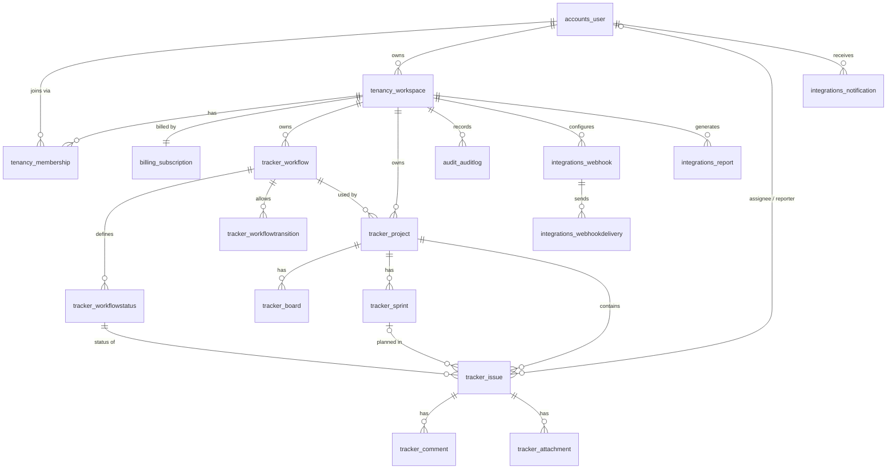

# Backend schema · TaskFlow

[← UI/UX design brief](05-ui-ux-design-brief.md) · [Index](../README.md)

The PostgreSQL schema generated by the Django models: 19 tables in 6 apps. Every table except `accounts_user` and `billing_stripeevent` belongs to one workspace (directly, or through its parent).
Types are the PostgreSQL types Django creates. `id` is a `bigint` identity primary key on every table.
Timestamps are `timestamptz`, set automatically (`created_at` on insert, `updated_at` on save).

## Entity-relationship diagram

A rendered version is in [`../assets/erd.png`](../assets/erd.png).

## accounts

### `accounts_user`
Global user; logs in with email. Extends Django's `AbstractUser`.

| Column | Type | Constraints / default | Notes |
|---|---|---|---|
| id | bigint | PK | |
| email | varchar(254) | unique | Login name, stored lower-case |
| full_name | varchar(150) | | |
| username | varchar(150) | unique | Set to the email automatically |
| password | varchar(128) | | Django password hash |
| is_active, is_staff, is_superuser | boolean | defaults true / false / false | |
| first_name, last_name | varchar(150) | | Unused (Django defaults) |
| last_login | timestamptz | null | |
| date_joined | timestamptz | default now | |

## tenancy

### `tenancy_workspace`: the tenant

| Column | Type | Constraints / default | Notes |
|---|---|---|---|
| id | bigint | PK | |
| name | varchar(100) | | Company name |
| slug | varchar(60) | unique | Used in URLs and the `X-Workspace` header |
| owner_id | bigint | FK → accounts_user, **PROTECT** | |
| created_at | timestamptz | | |

### `tenancy_membership`

| Column | Type | Constraints / default | Notes |
|---|---|---|---|
| id | bigint | PK | |
| workspace_id | bigint | FK → tenancy_workspace, CASCADE | |
| user_id | bigint | FK → accounts_user, CASCADE | |
| role | varchar(10) | `owner` / `admin` / `member` / `viewer`; default `member` | |
| joined_at | timestamptz | | |

Unique: `(workspace_id, user_id)`.

## tracker

All tracker tables also have `workspace_id bigint FK → tenancy_workspace, CASCADE, indexed` (from `TenantModel`); it's omitted below.

### `tracker_workflow`

| Column | Type | Constraints / default | Notes |
|---|---|---|---|
| name | varchar(80) | | |
| is_default | boolean | default false | One default per workspace, created with the workspace |
| created_at | timestamptz | | |

### `tracker_workflowstatus`

| Column | Type | Constraints / default | Notes |
|---|---|---|---|
| workflow_id | bigint | FK → tracker_workflow, CASCADE | |
| name | varchar(50) | | Board column name |
| category | varchar(20) | `todo` / `in_progress` / `done`; default `todo` | Drives reports and sprint completion |
| color | varchar(7) | default `#64748b` | Hex colour |
| order | integer ≥ 0 | default 0 | Column order |

Unique: `(workflow_id, name)`.

### `tracker_workflowtransition`

| Column | Type | Constraints / default | Notes |
|---|---|---|---|
| workflow_id | bigint | FK → tracker_workflow, CASCADE | |
| from_status_id | bigint | FK → tracker_workflowstatus, CASCADE | |
| to_status_id | bigint | FK → tracker_workflowstatus, CASCADE | |

Unique: `(workflow_id, from_status_id, to_status_id)`. No rows for a workflow = any move allowed.

### `tracker_project`

| Column | Type | Constraints / default | Notes |
|---|---|---|---|
| key | varchar(10) | | Upper-case letters/digits, e.g. `WEB` |
| name | varchar(120) | | |
| description | text | | |
| workflow_id | bigint | FK → tracker_workflow, **PROTECT** | |
| lead_id | bigint | FK → accounts_user, SET NULL, null | |
| issue_counter | integer ≥ 0 | default 0 | Next issue number; row-locked on use |
| created_at | timestamptz | | |

Unique: `(workspace_id, key)`.

### `tracker_board`

| Column | Type | Constraints / default | Notes |
|---|---|---|---|
| project_id | bigint | FK → tracker_project, CASCADE | |
| name | varchar(100) | | |
| kind | varchar(10) | `kanban` / `scrum`; default `kanban` | Scrum boards default to the active sprint |
| created_at | timestamptz | | |

### `tracker_sprint`

| Column | Type | Constraints / default | Notes |
|---|---|---|---|
| project_id | bigint | FK → tracker_project, CASCADE | |
| name | varchar(100) | | |
| goal | text | | |
| start_date, end_date | date | null | `end_date` ≥ `start_date` (validated) |
| state | varchar(10) | `planned` / `active` / `closed`; default `planned` | One `active` per project (validated) |
| created_at | timestamptz | | |

### `tracker_issue`

| Column | Type | Constraints / default | Notes |
|---|---|---|---|
| project_id | bigint | FK → tracker_project, CASCADE | |
| number | integer ≥ 0 | | Key = `project.key-number` |
| title | varchar(255) | | |
| description | text | | |
| type | varchar(10) | `task` / `bug` / `story` / `epic`; default `task` | |
| priority | varchar(10) | `low` / `medium` / `high` / `critical`; default `medium` | |
| status_id | bigint | FK → tracker_workflowstatus, **PROTECT** | Must belong to the project's workflow |
| sprint_id | bigint | FK → tracker_sprint, SET NULL, null | null = backlog |
| assignee_id | bigint | FK → accounts_user, SET NULL, null | Must be a workspace member |
| reporter_id | bigint | FK → accounts_user, SET NULL, null | |
| story_points | smallint ≥ 0 | null | |
| due_date | date | null | |
| rank | double precision | default 0 | Order inside a column |
| created_at, updated_at | timestamptz | | |

Unique: `(project_id, number)`. Indexes: `(workspace_id, project_id, status_id)`, `(workspace_id, assignee_id)`.

### `tracker_comment`

| Column | Type | Constraints / default | Notes |
|---|---|---|---|
| issue_id | bigint | FK → tracker_issue, CASCADE | |
| author_id | bigint | FK → accounts_user, SET NULL, null | |
| body | text | | |
| created_at, updated_at | timestamptz | | |

### `tracker_attachment`

| Column | Type | Constraints / default | Notes |
|---|---|---|---|
| issue_id | bigint | FK → tracker_issue, CASCADE | |
| file | varchar(100) | | Storage path `workspaces/<ws>/issues/<issue>/<name>` |
| filename | varchar(255) | | Original name |
| size | integer ≥ 0 | default 0 | Bytes; max 10 MB enforced by the API |
| uploaded_by_id | bigint | FK → accounts_user, SET NULL, null | |
| created_at | timestamptz | | |

## audit

### `audit_auditlog` (append-only)

| Column | Type | Constraints / default | Notes |
|---|---|---|---|
| workspace_id | bigint | FK → tenancy_workspace, CASCADE | |
| actor_id | bigint | FK → accounts_user, SET NULL, null | |
| action | varchar(60) | indexed | e.g. `issue.moved` |
| entity_type | varchar(40) | | e.g. `issue` |
| entity_id | varchar(40) | | |
| entity_label | varchar(255) | | Readable name at the time |
| changes | jsonb | default `{}` | `{"field": [old, new]}` |
| ip_address | inet | null | |
| created_at | timestamptz | indexed | |

Index: `(workspace_id, entity_type, entity_id)`.

## integrations

### `integrations_webhook`

| Column | Type | Constraints / default | Notes |
|---|---|---|---|
| workspace_id | bigint | FK, CASCADE | |
| url | varchar(500) | | |
| events | jsonb | default `[]` | Empty = all events |
| secret | varchar(80) | default `whsec_` + 48 hex chars | HMAC key |
| is_active | boolean | default true | |
| created_at | timestamptz | | |

### `integrations_webhookdelivery`

| Column | Type | Constraints / default | Notes |
|---|---|---|---|
| workspace_id | bigint | FK, CASCADE | |
| webhook_id | bigint | FK → integrations_webhook, CASCADE | |
| event | varchar(60) | | |
| payload | jsonb | | Exact body sent |
| status_code | integer | null | Last HTTP status |
| response_body | text | | First 2,000 characters |
| success | boolean | default false | |
| attempts | smallint | default 0 | Max 5 |
| created_at | timestamptz | | |
| delivered_at | timestamptz | null | |

### `integrations_notification`

| Column | Type | Constraints / default | Notes |
|---|---|---|---|
| workspace_id | bigint | FK, CASCADE | |
| user_id | bigint | FK → accounts_user, CASCADE | Recipient |
| actor_id | bigint | FK → accounts_user, SET NULL, null | |
| verb | varchar(40) | | `assigned` / `commented` / `moved` / `due_soon` |
| issue_id | bigint | FK → tracker_issue, CASCADE, null | |
| message | varchar(255) | | |
| read | boolean | default false | |
| created_at | timestamptz | | |

### `integrations_report`

| Column | Type | Constraints / default | Notes |
|---|---|---|---|
| workspace_id | bigint | FK, CASCADE | |
| kind | varchar(30) | default `weekly_summary` | |
| data | jsonb | default `{}` | created, completed, open_total, overdue, open_by_assignee, period |
| created_at | timestamptz | | |

## billing

### `billing_subscription` (one per workspace)

| Column | Type | Constraints / default | Notes |
|---|---|---|---|
| workspace_id | bigint | FK → tenancy_workspace, CASCADE, **unique** | |
| plan | varchar(20) | default `free` | `free` / `pro` / `business` |
| status | varchar(20) | `active` / `trialing` / `past_due` / `canceled` / `incomplete`; default `active` | Non-active → Free limits |
| stripe_customer_id | varchar(80) | | |
| stripe_subscription_id | varchar(80) | | |
| current_period_end | timestamptz | null | Renewal date |
| cancel_at_period_end | boolean | default false | |
| updated_at | timestamptz | | |

### `billing_stripeevent` (global)

| Column | Type | Constraints / default | Notes |
|---|---|---|---|
| event_id | varchar(80) | unique | Stripe event ID; guarantees each event is applied once |
| type | varchar(80) | | |
| received_at | timestamptz | | |

## Delete behaviour summary

| When this is deleted… | …this happens |
|---|---|
| Workspace | Everything in it is deleted (`delete_workspace()` removes issues and projects first because of PROTECT) |
| Workflow or status in use | Blocked (PROTECT) |
| Project | Its boards, sprints, issues, comments, attachments are deleted |
| Sprint | Its issues return to the backlog (SET NULL) |
| User | Blocked while they own a workspace (PROTECT). Otherwise their memberships and notifications are deleted, and issues, comments and audit entries keep the record with the person set to null |
